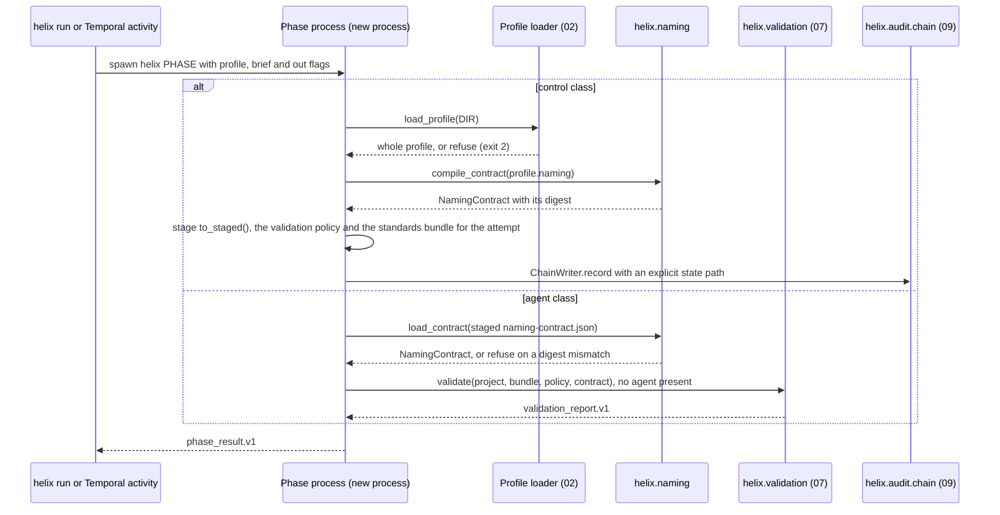
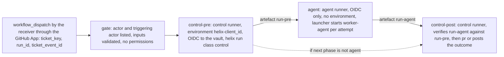
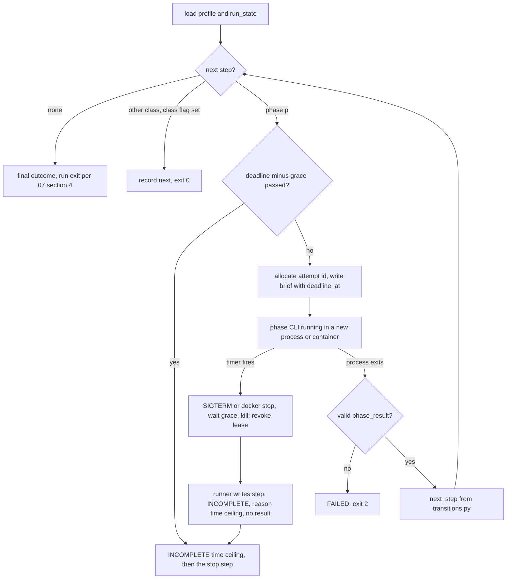

# 01 — Repository and runtime

> Standalone revision, 2026-10-12: the Meridian bridge package, the pinned wheel and every Meridian command, variable, profile file and state directory are withdrawn, and Helix-owned libraries (`helix.naming`, `helix.standards`, `helix.validation`, `helix.audit.chain`, `helix.clientdata`) with an optional adapter seam take their place (`docs/architecture/`).

## 1. Purpose and scope

This file is the foundation every other LLD file builds on. It covers Helix's repository layout, packaging, runtime configuration, container images, the B2 pilot as a GitHub Action, and `helix run`, which keeps terminal, Action, and Temporal execution in parity. The repository scaffold and offline profile validation land in **B1**. The images, pilot workflow, naming contract, and local validation entry points land in **B2**. The worker images are reused unchanged by **B5**. Nothing here is specific to **B6**, but nothing forecloses it.

Names, enums, the CLI surface, `PhaseOutcome`, storage paths, schema owners, process classes, credentials and the sandbox environment allowlist are defined in `00-conventions.md`. B1–B5 have no Meridian runtime dependency; a future optional adapter is governed by the standalone boundary in the architecture decisions and by the rules of §3.5.

## 2. Traceability

| Source | What this file implements |
| --- | --- |
| Plan §1 | CI on demand only, because minutes are billed |
| Plan §3.1 | Withdrawn (standalone decision): the plan's per-workflow Meridian exports and its auth-mode export are not set, because no core process starts Meridian (§3.5.2). Plan amendment needed (§6) |
| Plan §3.2 | Pilot as a GitHub Action, `allowed_bots`, six-hour ceiling; a hand-confirmed fact sheet read as a file, never the ticket; Maven recorded and run live on demand; never on push, never Windows. The plan's three imported names and five CLIs are withdrawn (standalone decision): Helix-owned naming, validation and audit libraries take their place (§3.5) |
| Plan §3.5 | Worker containers (JDK 17, Maven, Node, CLIs); Nexus credential never in the image; profile loaded per workflow in a fresh process (§3.4). The plan's sign-in-mode trap is withdrawn (standalone decision): core Helix has no sign-in path of its own, and the connected-app exchange is the broker's (03) |
| Plan §3.7 | QUICKSTART, ONBOARDING, RUNBOOK, done notes, `## Unreleased` sections; ONBOARDING and doctor held in step by a test. The paragraph for Meridian's docs is withdrawn (§3.11) |
| Plan §4 decisions 5 and 9 | New repository; rename-safe package name. Decision 5's version-pinned Meridian wheel and its contract test are withdrawn (standalone decision): any integration is an optional, version-pinned adapter that core Helix works without (§3.5, §3.6). Plan amendment needed (§6) |
| Plan §6 | Verify by running it; no client detail; parity; tripwire |
| HLD *Components*, *Runtime and non-functional design* | Pilot versus target table; worker paragraph. Withdrawn (standalone decision): the *Components* row for Meridian (§3.5) |
| HLD-P#1, #2 | Credentials only in control-plane processes; sandbox env per 00 §9; a child process never inherits its parent's environment (§3.5.2) |
| HLD-P#4 | Separate control and agent jobs; minimum isolation set before a real ticket |
| HLD-P#5 | No Nexus credential in any image or worker; Maven settings name only the proxy |
| HLD-P#6 | Where the control plane runs in the pilot |
| HLD-P#11 | Helix repository versus generated-app repositories; where the workflow lives and whose runner runs it |
| HLD-P#13 | Per-client pilot repository; ephemeral per-attempt Maven repository; one client per process |
| HLD-P#14 | Pilot runners are self-hosted in the client's region, so the runner hop stays inside the residency guarantee |
| HLD-P#15 | One `run_id` per ticket lifetime, so attempt numbers come from the control-plane store, not from one Action run |
| HLD-P#17 | `helix run` branches on `PhaseOutcome`, not exit codes |
| HLD lower bullets | Hosted-agents revisit test (image smoke test). The dependency-surface bullet is withdrawn with the dependency: the contract tests now pin Helix's own schemas (§3.6) |
| Review item 19 | Withdrawn (standalone decision): there is no Meridian version to record per state directory (§3.5.5) |
| Files 02, 03, 04, 05, 06, 07, 09, 10 | The Helix-owned libraries each of them calls, and the rules for an optional adapter (§3.5); the pilot's runners, trigger and jobs, which 01 owns and 03's services serve (§3.8; 03 §1 names 01 as their owner); 04's sandbox user model (§3.7) and the staged naming contract (§3.5.2); 09's chain segments and the state root they live under (§3.5.5); 10's tripwire secret (§3.10) |
| Standalone architecture decisions (`docs/architecture/`) | Helix is standalone (§3.2, §3.5, G1); Python 3.14 (§3.2); `helix.naming`, `helix.standards` and `helix.validation` in the layout (§3.1); the branch name from the standards bundle's `review.branch_pattern` (§3.1, §3.9) |

## 3. Design

### 3.1 Repository layout `[PLAN-DEFAULT 5]` `[LLD]`

This expands 00 §3. Owner is the LLD file that defines the module's behaviour.

| Path | Responsibility | Owner | Lands |
| --- | --- | --- | --- |
| `pyproject.toml`, `uv.lock` | Packaging and the exact environment (§3.2) | 01 | B1 |
| `src/helix/__init__.py` | `__version__`, written in one place only; the build backend reads it from here (§3.2) | 01 | B1 |
| `src/helix/product_identity.py` | Product identity manifest: display name, canonical identifier and derived naming tokens; the only code-owned source for renameable identifiers (00 §3) | 01 | B1 |
| `src/helix/__main__.py` | `python -m helix` → `cli.main.main` | 01 | B1 |
| `src/helix/config.py` | `RuntimeConfig.from_env()`: the `HELIX_*` variables, read at call time (§3.3). B1 holds only the `HELIX_CLIENT_PROFILE` read | 01 | B1 |
| `src/helix/runtime_identity.py` | `process_nonce()`: a UUIDv4 made on the first call in an interpreter and cached, so two `main()` calls in one process return the same value (§3.9, G26) | 01 | B2 |
| `src/helix/cli/main.py` | argparse root; exit discipline 0, 1, 2; an uncaught exception prints one line and exits 2 | 01 | B1 |
| `src/helix/cli/{profile,doctor,validate,verify,discover,intake,design,build,test,pr,run,serve,worker,audit,meter}.py` | One thin module per 00 §4 command; parses flags, calls the owning package, writes `phase_result.v1` | per 00 §4 | B1–B5 |
| `src/helix/profile/` | `helix_profile.v1` schema, loader, doctor and its numbered check registry | 02 | B1 |
| `src/helix/naming.py` | `naming_contract.v1`: compiles the profile's `naming` block into an immutable `NamingContract`, renders and parses names, gives the configuration paths, and writes and reloads the staged per-attempt contract (§3.5) | B2 naming decision; 02 uses it for B1-015 | B1 (built) |
| `src/helix/standards.py` | Loads the `client_standards_bundle.v1` that `helix.yaml` references and checks its digest, version, client and approval metadata (§3.5) | Client standards bundle decision; 02 uses it for B1-016 | B1 (built) |
| `src/helix/validation/` | The standalone B2 validation subsystem behind `helix validate` and `helix verify`. Modules `contracts`, `design_binding`, `pom_policy`, `project_policy`, `reference_scan`, `property_policy`, `naming_policy`, `evidence`, `maven_runner`, `report_parser`, `report` (§3.5) | B2 validation decision; 07 | B2 (built in part; 07 §6) |
| `src/helix/controlplane/webhook/` | Receiver, HMAC, dedup, routing. In B2 it records deliveries, maps only the move into `building`, and dispatches the pilot workflow through the GitHub App (03 §3.2, "Receiver mappings on"; §3.8 here) | 03 | B2 (pilot mappings), B3 (all mappings) |
| `src/helix/controlplane/jira/` | Jira REST client, status mapping, comment templates | 03 | B2 |
| `src/helix/controlplane/gitwriter/` | GitHub App client; PR assembly is 07's | 03, 07 | B2 |
| `src/helix/controlplane/{broker,gateway,mavenproxy,vault}/` | Credential broker, model gateway, Maven proxy, vault adapter | 03 | B2 |
| `src/helix/agents/runner.py`, `hooks.py`, `definitions/{intake,design,build,test}/` | Agent SDK session runner, PreToolUse policy, per-agent definitions | 04 | B2 |
| `src/helix/phases/{discover,intake,design,build,test,pr}.py` | One module per phase CLI | 05, 06, 07 | B2–B4 |
| `src/helix/orchestration/transitions.py` | `next_step(state, result) -> Step`: the one outcome-to-next-phase table, used by both runners | 01 defines, 08 uses | B2 |
| `src/helix/orchestration/local.py` | `helix run` (§3.9) | 01 | B2 |
| `src/helix/orchestration/{workflow,activities,worker}.py` | Temporal workflow, activities, worker bootstrap | 08 | B5 |
| `src/helix/audit/` | The Helix-owned audit chain: `chain` (`ChainWriter`, per-run segment files), `verify` (`helix audit verify`) and anchoring (§3.5.5) | 09 | B2 (to build) |
| `src/helix/metering/` | Meter events, pricing, caps | 09 | B2 |
| `src/helix/clientdata.py` | Deny-list and shape rules for the tripwire, the output scanner and the outbound scan. Standard library only; it holds no client state (§3.5) | 10 (the rules); 01 (the script that calls them); 03 (the outbound scan) | To build |
| `src/helix/data/images.lock` | Package-data copy of `containers/images.lock`, written by the build backend at wheel build time, so an installed Helix can read it (§3.3) | 01 | B2 |
| `src/helix/store/` | PostgreSQL engine, sessions, Alembic migrations for the Helix store; tables are owned by 03, 05, 08, 09 | 01 | B2 |
| `src/helix/pilot/{render,lint}.py` | Renders and lints the pilot workflow (§3.8) | 01 | B2 |
| `src/helix/schemas/*.schema.json` | 00 §8 schemas plus `run_state.v1` (§3.9) | per 00 §8 | B1–B5 |
| `skills/` | Skills files, mounted read-only at `/opt/helix/skills/` | 04, 06 | B2 |
| `templates/` | Golden parent pom and property files (07), PR body (07), integration HLD and LLD (06), `github/helix-pilot.yml` (01) | mixed | B2 |
| `containers/` | Three Dockerfiles, `images.lock`, `smoke.sh` (§3.7) | 01 | B2 |
| `scripts/check_client_data.py` | The tripwire: a thin command over `helix.clientdata` (10 §3.13) | 01 | To build |
| `tests/unit/`, `tests/contract/`, `tests/guards/`, `tests/integration/` | Fast tests; contract tests over Helix's own schemas (§3.6); two-direction guards; fakes plus recorded Maven | all | B1 (`unit` and `guards` built) |
| `tests/fixtures/acme-a/`, `acme-b/`, `acme-broken/`, `acme-order-sapi/` | Two fixture clients with different routes and grammars, one unusable profile, the golden project | 01, 07 | B1 |
| `docs/` | `QUICKSTART.md`, `ONBOARDING.md`, `RUNBOOK.md`, `PLAN.md` (with done notes), `architecture/` (the standalone decisions), `lld/` | 01 | B1 |
| `CHANGELOG.md` | One `## Unreleased — <headline>` section per sub-phase | 01 | B1 |
| `.github/workflows/ci.yml`, `images.yml` | Helix's own CI, on demand (§3.10) | 01 | B1 |

Rules `[LLD]`: the product name appears only in the places listed here, and each is set in one file. The package root (`pyproject.toml`, `src/helix/`) is changed by one `git mv` plus a search-and-replace on imports. The console script lives in `pyproject.toml`. Image names live in `containers/images.lock`. The `HELIX_*` prefix lives in `config.py`. `/opt/helix` and `/etc/helix` live in the Dockerfiles. The pilot workflow and the `helix-{client_id}` environment live in the pilot template and 00. The environment also exists as state in client organisations, which keep the old name until a client is re-onboarded (decision 9). The branch name is no longer a product identifier: it comes from the client's standards bundle, `review.branch_pattern` (00 §6; standards mapping decision D4). Generated Mule applications never live here `[HLD-P#11]`.

### 3.2 Packaging and dependency pins

| Item | Choice | Tag |
| --- | --- | --- |
| Build backend | `hatchling`, `src/` layout, version read from `src/helix/__init__.py` | `[LLD]` |
| Python | `==3.14.*` | `[LLD]` |
| Resolver and lock | `uv`; `uv.lock` committed; images and CI install with a frozen sync | `[LLD]`; exact flags `[VERIFY]` |
| `claude-agent-sdk`, `temporalio` | No floor in `pyproject.toml`; exact versions are whatever is current at B1 start, recorded in `uv.lock` | `[PLAN]` packages, `[LLD]` pinning |
| `anthropic` | The model gateway's client library (00 §2). Pinned the same way | `[HLD-P#2]` package, `[LLD]` pinning |
| Other runtime | `jsonschema`, `PyYAML`, `httpx`, `SQLAlchemy`, `alembic`, `psycopg` | `[LLD]` |
| Console script | `helix = "helix.cli.main:main"` | `[LLD]` |

Withdrawn (standalone decision): the exact Meridian pin, the vendored wheel, the constraints lock taken from Meridian's tag and the list of excluded Meridian dependencies. Core `dependencies` name no Meridian package, and G1 refuses one. An adapter, if one is adopted, pins its own dependency outside core (§3.5).

```toml
[project]
name = "helix"                  # decision 9: the product is Helix
dynamic = ["version"]
requires-python = "==3.14.*"
dependencies = [
  "anthropic", "claude-agent-sdk", "temporalio",
  "jsonschema", "PyYAML", "httpx", "SQLAlchemy", "alembic", "psycopg",
]
[project.scripts]
helix = "helix.cli.main:main"
```

As built at B1, `dependencies` holds only `PyYAML` and no `uv.lock` is committed. The other packages are added by the sub-phase that first uses them (B1 implementation notes, *Deviations*).

**Upgrading the Meridian pin.** Withdrawn (standalone decision): there is no pin, so the RUNBOOK has no such procedure. An adapter would bring its own (§3.5, rule 2).

### 3.3 Runtime configuration `[LLD]`

Helix reads no configuration file of its own and no `.env`. Precedence is command-line flag, then environment variable, then default. Every value is read when used, through `RuntimeConfig.from_env()`, never at module import. A value bound at import outlives the client it was read for, which is the trap §3.4 avoids, and a guard holds Helix to the rule (G19).

| Variable | Read by | Required | Default | Meaning |
| --- | --- | --- | --- | --- |
| `HELIX_PROFILES_ROOT` | Control-plane processes | Yes, for any command taking a client by id | none | Parent of `{client_id}/` profile directories (00 §7) |
| `HELIX_CLIENT_PROFILE` | `helix doctor` and the profile loader | No | none | The only fallback for `--profile`: one absolute profile directory. Nothing else is searched (B1 contract, *Profile boundary*). Built in B1 |
| `HELIX_STATE_ROOT` | Control-plane processes | Yes | none | Durable root; per client `audit/` (the chain's segment files, §3.5.5) and `runs/` (00 §7) |
| `HELIX_WORK_ROOT` | Control-plane processes and `helix run`; never set in the sandbox, where the default applies (00 §9 is exhaustive) | No | `/work` | Ephemeral attempt directories `{root}/{phase_attempt_id}/` (00 §7) |
| `HELIX_DATABASE_URL` | Control-plane services, `helix run` | Services only | none | PostgreSQL DSN **without a password**; credentials come from the vault adapter (03) |
| `HELIX_CONTROLPLANE_URL` | `helix run`, pilot jobs | When phases are split across hosts | none | Base URL of the gateway, broker and Maven proxy service (03) |
| `HELIX_IMAGE_LOCK` | `helix run` | No | `helix/data/images.lock` in the installed package (`importlib.resources`), copied from `containers/images.lock` at wheel build time (§3.1) | Image digests used to start sandboxes |
| `HELIX_LOG_FORMAT` | Control-plane processes and `helix run`; never set in the sandbox, where the default applies | No | `text` | `text` or `json` |
| `HELIX_MAVEN_LIVE` | `tests/integration/` only | No | unset | `1` runs real Maven instead of recordings (§3.10) |
| `HELIX_RUN_ID`, `HELIX_PHASE`, `HELIX_PHASE_ATTEMPT_ID` | Sandbox | Set by the runner | — | 00 §9 |
| `HELIX_TEMPORAL_*` | Temporal workers | B5 | — | Defined by 08 |

No `HELIX_*` variable ever carries a secret: a guard refuses any name ending `_SECRET`, `_TOKEN`, `_PASSWORD` or `_KEY` (G19). The profile directory is given as `--profile DIR`, or through `HELIX_CLIENT_PROFILE` when the flag is absent. Both must be absolute, and no home directory, repository tree or other variable is searched (B1 contract). Its basename is the `client_id` (00 §6), and the loader refuses a mismatch with `helix.yaml` (02); the B1 loader does not make that comparison yet (§6).

### 3.4 One client per process `[PLAN]` `[LLD]`

The plan's trap (§3.5) is that a worker which switches clients can run the second client under the first one's settings, so the profile is loaded per workflow in a fresh process. Helix keeps that rule as its own and holds it by construction. Withdrawn (standalone decision): the bind step around a Meridian import, which held the rule in the earlier design (§3.5). Standalone architecture decision: the rules below take its place.

- **Every phase is its own process** `[PLAN]` parity. `helix run` and the Temporal activities start each phase CLI as a new subprocess (G26).
- **Explicit inputs.** Every Helix library is handed what it works on as arguments: the loaded profile (02), a `NamingContract`, the staged `validation_policy.v1`, a project directory, a state path, a deny-list path. `helix.naming` is pure, with no network, file, model or environment-variable dependency. `helix.validation` is pure or file-bound: it takes explicit paths and never reads a profile directory, a home directory or process-wide configuration (B2 naming contract, *Helix-owned interface*; B2 validation decision, *Core modules*).
- **No process-wide binding of a client.** No module keeps a client's profile, contract, state path or deny-list in module-level state, and nothing is read from `os.environ`, a `.env` file or the working directory at import (§3.3, G19). A `NamingContract` is immutable. So there is no reload step and no half-switched state: contracts for two clients can exist side by side in one test process, and neither changes the other (G4).
- **One client per phase process.** A phase entry point that has run for one `client_id` refuses to run for a different one in the same interpreter, exit 2 (G4, G26). **To design:** where that check lives, now that the bind step is gone; the natural home is `helix.runtime_identity`, beside `process_nonce()` (§6).
- **Long-running services** (webhook, gateway, broker, Maven proxy) follow the same rules: they take the client from each request or from their own configuration, as 03 defines, and never bind one into module-level state. `helix.clientdata` (§3.5) holds no client state, so any service may import it.
- **What is loaded is proven, not assumed.** The loader refuses a profile with any error-severity finding (rules B1-001 to B1-016, 02). There is no built-in default grammar: an unreadable or invalid `naming` block is a refusal (B1-015), never a silent fall-back to generic names. `helix.naming.load_contract` refuses a staged contract whose content no longer matches the digest it carries, and 07's S1 refuses one whose digest differs from the design bundle's `naming_contract_digest` (`NAMING_CONTRACT_MISMATCH`). G5 holds this.
- **The starting directory does not matter** `[LLD]`. Helix reads no `.env` and no configuration file from the working directory (§3.3), so a phase started from an operator's checkout for terminal parity behaves as one started from an empty directory (G35).
- **The agent's environment stays exact** `[HLD-P#1]`. Loading the staged contract in the runner's preflight (04) reads one file and writes nothing to `os.environ`, so 00 §9's "exactly these variables" holds at agent start (G30).
- **Process class at phase start.** Needed behaviour: a control-class phase CLI refuses to start where `/etc/helix/sandbox-class` exists (§3.7), and an agent-class phase refuses where it is absent. The withdrawn bind step made this check. **To design:** its new home in the phase entry point (§6).

| | Control class (00 §9): `discover`, `pr`, the doctor, the control steps of `helix run` | Agent class: the runner's preflight before `query()` (04), and 07's phase and `verify` processes |
| --- | --- | --- |
| Profile | `load_profile(DIR)`: `helix.yaml` and the standards bundle it references, and no other file (B1 contract, *Profile boundary*) | Never a profile directory. Only the staged inputs under `/in/validation/` (§3.5.2; 07 §3.4.4) |
| Naming | `compile_contract(profile.naming)`, then `to_staged()` for the attempt | `load_contract(staged)`, which proves the digest before any name is rendered |
| `os.environ` | Read at call time through `RuntimeConfig.from_env()` (§3.3); never written | Never written; it equals 00 §9's allowlist |
| Audit chain | `ChainWriter`, with an explicit state path (09; §3.5.5) | Never written and never read: no sandbox process sees `$HELIX_STATE_ROOT` (00 §7; 09 §3.1) |



### 3.5 Helix-owned libraries and the optional adapter seam

Standalone architecture decision; the earlier text of this section carried `[PLAN-DEFAULT 5]`. Withdrawn (standalone decision): the Meridian bridge package that this section designed is not built. In B1–B5 Helix does not import, invoke, vendor or require Meridian, its files, its environment variables or its state (owner decision, 2026-10-09). Each thing the bridge supplied is now a Helix-owned library, or is outside core. This departs from the default of plan decision 5, so the plan needs the matching amendment (§6).

| What the bridge supplied | Helix-owned replacement | Interface | Owner | State |
| --- | --- | --- | --- | --- |
| Names, environments and configuration paths | `helix.naming`: an immutable `NamingContract`, compiled from the profile's `naming` block | `compile_contract`, `render_repository`, `parse_repository`, `render_deployed`, `parse_deployed`, `configuration_paths`, `to_staged`, `load_contract`; staged per attempt as `/in/validation/naming-contract.json` | B2 naming decision; used by 02 (B1-015), 04 (naming tools), 06 and 07 | Built (`src/helix/naming.py`) |
| Client engineering standards | `helix.standards`: loads the `client_standards_bundle.v1` that `helix.yaml` references and checks its digest, version, client and approval metadata | `load(profile_dir, client_id, reference)`; staged per attempt as `/in/validation/standards-bundle.yaml` | Client standards bundle decision; used by 02 (B1-016) | Built (`src/helix/standards.py`); the fields accepted on 2026-10-12 are not read yet |
| Property files | Rendered by Helix code from the design bundle's key list, in either layout (`environment_files` or `deployment_properties`). The marks are `${HELIX_SET_<E>}` and `${HELIX_ENCRYPT_<E>}`. There is no `prepare` step | 07 §3.4.4 | 07 | Designed; not built |
| Validation and the reference scan | `helix.validation`, behind `helix validate` and `helix verify`: one `validation_report.v1` with the codes of 07 §3.4.4. There is no `report` step, no gate rulebook and no client rulebook | `validate(project_dir, bundle, policy, naming)`; `maven_runner.run`; `report_parser.parse` | B2 validation decision; 07 | Built in part (07 §6 lists what is not) |
| Profile and doctor | `helix.yaml` plus the client standards bundle it references, and nothing else. The B1 doctor is offline, with rules B1-001 to B1-016; connected-system checks are deferred to B2 readiness | `load_profile(profile_dir)`; `helix doctor --profile DIR` | 02 | Built |
| Deployment property keys | Declared in the design bundle only (`deployment_property_keys[]`). No profile write happens at merge: `profile.deployment_keys.append` and `DEPLOYMENT_KEYS_REFUSED` are withdrawn | — | 06, 07 | Designed |
| Audit chain | `helix.audit.chain`: `ChainWriter` writes per-run segment files, and `helix audit verify --run RUN_ID` recomputes the chain in process (§3.5.5). No subprocess, no external CLI | 09 | 09 | To build |
| Estate and tenant reads | Not core. An optional `EstateProvider` interface. With no provider configured, Discover writes `estate_names.v1` with `status: "not_checked"` and empty lists, estate collision checks are skipped, and gate two shows a checklist line saying the estate was not checked. Collisions inside a bundle are still refused (NAM-007), and repository existence is still checked through the git writer | `names(client_id) -> estate_names.v1` | 05, 06 | Interface named; core ships no provider |
| Client-data deny-list and tripwire | `helix.clientdata`: the deny-list and shape rules, with the same rule behaviours as the module the bridge wrapped. Standard library only; it holds no client state | `load_denylist`, `denied`, `internal_host`, `scrub_line`, `synthetic_uuid` and `rules()`, the names 03 and 10 already call; 10 §3.13 owns the rule definitions | 10 (rules); 01 (`scripts/check_client_data.py`); 03 (outbound scan) | To build |

**Rules for an optional adapter** (00 §9; B2 validation decision, *Explicitly deferred*; B2 naming contract, *Future Meridian adapter*). A later integration with Meridian, or with any other estate tool, may enter only as an adapter that obeys all of these:

1. **Optional.** Core Helix works with no adapter installed: every B1–B5 command, phase and test runs without one (G39). An adapter is switched on for a client by an explicit, opt-in profile capability, never by being importable.
2. **Version-pinned.** The adapter declares the versions of the external tool it supports and pins its dependency exactly. That dependency is never in core `dependencies` (§3.2).
3. **Narrow interface.** Core calls an adapter only through a Helix-defined interface, such as `EstateProvider`, and receives Helix schemas, such as `estate_names.v1`. No core module imports an adapter package or the external tool.
4. **Contract-tested.** Adapter contract tests run against each pinned version. They exist only when an adapter exists (§3.6).
5. **Outside core processes.** An adapter runs outside core B1–B5 processes, receives explicit staged inputs, and exposes no raw profile or environment data to agents.
6. **Never a fallback, never an authority.** An adapter is not a fallback for `helix.naming`, `helix validate`, profile loading, the audit chain or policy enforcement. What it returns is advisory input, or a proposal that Helix compiles and validates before use. It cannot change naming semantics at run time or bypass a digest bound to gate two.

**To design**, with the first adapter and not before (§6): the profile capability that switches an adapter on, and its packaging. G1 scans all of `src/` and `pyproject.toml`, so an adapter for Meridian cannot land there unnoticed: adopting one is an owner decision that either ships it as a separate distribution or amends G1 to exempt one named adapter package.

**Errors.** The bridge's error family (`BridgeError` and its subclasses) is withdrawn with it. Callers catch the Helix libraries' own errors: `NamingInvalid` (`helix.naming`), `StandardsInvalid` (`helix.standards`), `ProfileInvalid` (`helix.profile.loader`) and `MavenRunError` (`helix.validation.maven_runner`).

#### 3.5.0 Module map (withdrawn)

Withdrawn (standalone decision): the bridge's twelve modules are not built. The table in §3.5 names what replaced each concern. The wrappers around tenant, doctor, report and prepare commands have no replacement, because Helix runs no Meridian command (§3.5.3).

#### 3.5.1 What it imports (withdrawn)

Withdrawn (standalone decision): core Helix imports nothing of Meridian's, so there is no table of imported names and no expected-names file. G1 holds this for all of `src/` and for `pyproject.toml`.

#### 3.5.2 The environment Meridian sees (withdrawn)

Withdrawn (standalone decision): no Meridian process is started, so no environment is built for one, and none of its variables is set, copied, forbidden or scanned for. The profile's `.env` is not read at all: the profile is `helix.yaml` and the standards bundle it references (B1 contract, *Profile boundary*). The amendment to 00 §9 that this section proposed for sandbox report subprocesses is withdrawn too (§6).

Three Helix rules cover what remains of this section's purpose:

- The agent's environment is 00 §9's exhaustive allowlist, checked by 04's `assert_process_env()` (G30).
- A child process never inherits its parent's environment. `helix run` starts each phase CLI with its class's environment only (§3.9, step 2), and the Maven runner passes only `HOME`, `LANG`, `PATH` and `TMPDIR` (B2 Maven/MUnit execution contract). G7 holds both.
- No credential travels in a phase process's environment. The broker, the gateway and the Maven proxy hold them (00 §9; 03).

**Profile material in the sandbox** `[HLD-P#1]`. The sandbox receives no profile directory. It receives three files that the control plane compiles or copies for the attempt. 07 §3.4.4 owns the list ("Staged inputs"); it is repeated here to say where the pilot gets the files.

| Material | Path in the sandbox | Contents | Read by |
| --- | --- | --- | --- |
| Naming contract | `/in/validation/naming-contract.json` | The compiled `naming_contract.v1` with its digest: `compile_contract(profile.naming).to_staged()` | `helix.naming.load_contract`, in the runner's preflight (04) and in 07's phase and `verify` processes |
| Validation policy | `/in/validation/validation-policy.json` | The `validation_policy.v1` that the control plane compiles from the standards bundle and the profile's naming block (B2 validation decision, *Validation policy*) | `helix validate` and `helix verify` (07) |
| Standards bundle | `/in/validation/standards-bundle.yaml` | The approved `client_standards_bundle.v1`, byte for byte | 07 §3.4.4 |

None of them holds `helix.yaml`, a `.env` or a credential. All sit under `/in`, mode 0500, owned by uid 10001 and unreadable by uid `agent` (04 §3.12; 07 §3.4.4). In the pilot, `control-pre` writes them into `{run-dir}/profile-view/validation/`, and the launcher stages `{run-dir}/profile-view/` as `/in` content. G5 proves that the staged contract renders and parses every fixture name exactly as the contract compiled from the profile does.

#### 3.5.3 Meridian CLIs run (withdrawn)

Withdrawn (standalone decision): Helix runs no Meridian command, so the command table, the exit-code mapping, the timeouts and the output-parsing rules are gone. What took each command's place:

| Withdrawn command | Replacement |
| --- | --- |
| `report`, `prepare` | `helix validate` and `helix verify`, which give one `validation_report.v1`; property files are rendered by Helix code (07 §3.4.4) |
| Tenant `validate`, `infer` and `discover` | None in core. The naming grammar is declared in `helix.yaml` and never inferred (B2 naming contract, *Non-goals*); estate reads are an optional `EstateProvider` (§3.5) |
| `doctor` | The offline B1 doctor, rules B1-001 to B1-016; connected-system checks are deferred to B2 readiness (02) |
| Run-log verification | `helix audit verify --run RUN_ID`, in process (§3.5.5; 09) |

Helix's own commands keep 00 §5's exit codes: 0, 1 and 2.

#### 3.5.4 Python interface (withdrawn)

Withdrawn (standalone decision): the bridge's bind functions and wrappers are not built. Callers use the Helix libraries of §3.5 directly, with explicit inputs (§3.4). `key_list_diff` was never the bridge's: it is 06's function (06 §3.10), and under the standalone design the comparison rests on the standalone reference scan, `helix.validation.reference_scan` (07 §2).

#### 3.5.5 The chain handle and state directory

Withdrawn (standalone decision): the Meridian run-log handle, its action-log copy and the version record written into each state directory. The audit chain is Helix-owned, and file 09 designs it. In outline:

- `helix.audit.chain` writes per-run segment files, `$HELIX_STATE_ROOT/{client_id}/audit/{run_id}.s{NNNN}.jsonl`.
- Each line is one canonical-JSON `audit_event.v1` record. A segment's first record is an `audit_segment_header.v1` that carries the previous segment's head hash.
- Every record has `seq`, `prev_hash` and `hash`. `hash` is the SHA-256 of `prev_hash` plus the canonical JSON of the record without `hash`.
- `ChainWriter` appends under a file lock and deduplicates by `event_key`.
- `helix audit verify --run RUN_ID` recomputes the chain in process and returns `{valid, records, broken_at, reason}`. No subprocess and no external CLI is involved.
- Only control-plane processes write the chain, and no sandbox process sees the state root (00 §7; 09 §3.1).
- A hash chain cannot show that records were cut from the end of the last file, which is one reason 09 anchors the chain head outside the store (HLD lower bullet).

This file's part is the state root itself: `HELIX_STATE_ROOT` (§3.3) and its durability in the pilot. Those rules are Helix's own and stay.

**State root in the pilot** `[HLD-P#6]` `[LLD]`. The layout is the same in every runner: `{state_root}/{client_id}/audit/` for the chain and `{state_root}/{client_id}/runs/` for run artefacts (00 §7). `$RUNNER_TEMP` is never a state root, because `control-pre` and `control-post` are separate jobs on fresh ephemeral runners: a state root there would lose the segments between the two, and `helix audit verify` in `control-post` would find no segment for the run.

- The control jobs run on self-hosted ephemeral runners (§3.8). 01 asks 03 to host them as ephemeral containers on 03's always-on pilot host (03 §3.2, "Always-on services"), with `$HELIX_STATE_ROOT` bind-mounted from that host's local block storage. Then both control jobs, and every later dispatch of the ticket, see the same state, and 09's storage rule 1 (one host writes a client's state directory, 09 §3.3) holds in B2 as it does under 08's driver and in B5.
- The RUNBOOK writes a marker file `{state_root}/.helix-state-root` when it provisions that storage. A control stage of `helix run` refuses to write durable state when the marker is absent (exit 2, "state root is not durable"). **To design:** the same refusal for control-class processes that `helix run` does not start, such as 08's activities or 09's `ChainWriter`, which the withdrawn bind step used to cover (§6).
- If the state root cannot be mounted, the marker is absent, every durable write is refused, and the pilot runs synthetic `acme-*` tickets only.
- No artefact carries the chain between the control jobs; 09 §3.3's B2 row is this mount. If the owner rejects self-hosted runners (§6), the fallback is an artefact carry: each control job restores the run's segment files before its first chain write and uploads exactly those files after its last, and G31 runs against the restored copy.
- B5 uses the same layout on 08's storage. `ChainWriter` appends under a file lock, and file locks are not dependable on network file systems `[VERIFY]`, so the state root is local block storage in both (08).
- The test is G31: `helix audit verify` in `control-post`, over a segment that `control-pre` wrote, reports the chain valid with those records.

### 3.6 Contract-test suite

Standalone architecture decision; the earlier text of this section carried `[PLAN-DEFAULT 5]`. Withdrawn (standalone decision): the suite that pinned Meridian's imported names, environment variables, profile files, run-log records, action-log schema and CLI shapes against a vendored wheel is not built, because Helix uses none of that surface. `tests/contract/` pins Helix's own contracts instead, with no external package and no network. Expected values live in `tests/contract/expected/*.txt` or `*.json`, so a change is a reviewed diff. The owning file defines each schema's fields (00 §8); this suite holds their shape steady (G38).

| Contract | What the test holds | Owner |
| --- | --- | --- |
| `naming_contract.v1` | The same `naming` block always compiles to the same canonical JSON and digest. `load_contract(to_staged())` gives an equal contract, and a staged contract with one field edited is refused. Every rendered repository and deployed name parses back to the same parts and environment key. Two fixture grammars refuse each other's names | B2 naming decision |
| `client_standards_bundle.v1` | The loader accepts the `acme-a` fixture bundle. It refuses one with a different digest, version or `client_id`, one without approval metadata, and one at a path outside the profile directory | Client standards bundle decision; 02 (B1-016) |
| `helix_profile.v1`, `doctor_report.v1` | The doctor's JSON key set, the rule ids B1-001 to B1-016 in stable order, and the exit codes 0, 1 and 2 | 02 |
| `validation_policy.v1`, `validation_report.v1` | Key sets. The report for the golden project `acme-order-sapi` is byte-identical across runs. The set of finding codes equals the expected file (07 §3.4.4) | B2 validation decision; 07 G21 |
| `mule_execution_receipt.v1`, `mule_validation_evidence.v1` | Canonical JSON, and value-free: no output text, test name, property value or path | B2 Maven/MUnit execution contract |
| `design_bundle.v1` | The fields B2 reads and the failure code for each (B2 design bundle contract) | 06 |
| `phase_brief.v1`, `phase_result.v1`, `run_state.v1` | One valid and one invalid document per schema; `run_state.v1`'s fields are §3.9's | 04; 01 |
| `audit_event.v1`, `audit_segment_header.v1` | One canonical-JSON record per line and the digest rule of §3.5.5. A separate recomputation inside the test agrees with `helix audit verify` on `{valid, records, broken_at, reason}` | 09 |
| `estate_names.v1` | The document written when no provider is configured: `status: "not_checked"` and empty lists (§3.5) | 06 |
| CLI | `helix doctor`, `helix validate` and `helix verify` each reproduce one passing and one failing exit code against fixtures, and their JSON key sets equal the expected files | 00 §4, §5 |

As built, the naming, standards, doctor, validation, Maven-runner and report-parser tests live under `tests/unit/`; `tests/contract/` and its expected files do not exist yet (§6).

**Adapter contract tests** exist only when an adapter exists. An adapter brings its own: they run against each version of the external tool the adapter pins, and they prove the adapter's side of the Helix interface it implements. For an `EstateProvider`, that means `names(client_id)` returns a valid `estate_names.v1`. They are skipped, not failed, where the adapter is not installed, and no core test depends on them. **To design** with the first adapter (§6).

### 3.7 Container images `[PLAN]` contents, `[HLD-P#5]` `[HLD-P#13]` `[LLD]` layout

| Image | Base | Contents | Runs | Never contains |
| --- | --- | --- | --- | --- |
| `helix-controlplane` | Python 3.14 slim, by digest | Helix (frozen sync), Node 20 LTS, Anypoint CLI v4 with the DX plugin for Exchange search and `describe-connector`, `git` | Services (03), control-class phase CLIs (`discover`, `pr`), the launcher in the pilot's agent job | Maven, Claude Code runtime, any credential; a JDK only if `describe-connector` needs one (below) |
| `helix-worker-build` | Eclipse Temurin JDK 17, by digest | JDK 17, Maven 3.9.x (exact patch, checksum verified), Node 20 LTS, Anypoint CLI v4 with the DX plugin, the DX MCP Server **only if the spike passes** (pinned version), `git`, Python 3.14 with Helix, `/opt/helix/bin/mvn-helix` wrapper | No job starts it: it is the base layer of `worker-agent`. 07 runs every Maven pass over agent-written code as uid `maven` (07 §3.6), which only `worker-agent` provides, so `verify --stage head` runs in `worker-agent`, as 08 §3.4 does, and the mutation runs stay inside the test attempt (07 §3.5.3) | Agent runtime, any credential, any Maven settings with a server entry |
| `helix-worker-agent` | `FROM helix-worker-build`, by digest | Adds what 04 §3.12 requires: the pinned Claude Code CLI, **2.1.242 or later** (the one-hour cache TTL of 00 §10 needs it), `claude-agent-sdk`, `bashlex`, `setpriv` (util-linux), `/usr/local/sbin/helix-sandbox-init`, the `cli_path` wrapper `/opt/helix/bin/claude-agent`, the agent definitions, and the users of the next rule | Agent-class phases, one container per attempt (00 §9); `verify --stage head` with no agent session (07 §3.2) | Any credential; skills (mounted, not baked); `sudo` |

Rules:

- **No secret is baked in** `[PLAN]`. `images.yml` exports each image's filesystem and runs `scripts/check_client_data.py` plus a secret scanner over it and over the build history. A hit fails the build (G17).
- **Users, per image** `[LLD]`. 04 §3.12 owns the sandbox's user model; this table is how the Dockerfiles build it. Uid 10001 is named `runner` in all three images, as 04 §3.12, the owner of the sandbox user model, names it. The kernel checks only the number, so where another file calls uid 10001 `helix` (07's module table and `verified_as.uid`), it means this uid, and §6 asks that file to use one name. No image has `sudo`. Every image has a read-only root filesystem with `/work` and `/tmp` writable.

| Image | Users and groups | Dockerfile `USER` | Capabilities at run time | Entrypoint |
| --- | --- | --- | --- | --- |
| `helix-controlplane` | `runner` 10001 | `10001` | None: `--cap-drop ALL` | The command given |
| `helix-worker-build` | `runner` 10001 | `10001` | Never started by a job (the base of `worker-agent`) | None of its own; `worker-agent` sets `helix-sandbox-init` |
| `helix-worker-agent` | `runner` 10001, `agent` 10002, `maven` 10003, all in group `sandbox` 10000, none with a login shell (04 §3.12) | `10001`. The launcher starts this one image with `--user 0:0`, so only `helix-sandbox-init` runs as root (04 §3.12, "Start"). Started any other way, the image runs as 10001 and `helix-sandbox-init` refuses, because it requires uid 0 with only `CAP_SETUID` and `CAP_SETGID` | `--user 0:0 --cap-drop ALL --cap-add SETUID --cap-add SETGID` (04 §3.12). `helix-sandbox-init` checks the environment, then starts the phase CLI as `runner` with ambient `CAP_SETUID` and `CAP_SETGID` only. The wrapper and the `maven` tool drop to `agent` and `maven` with `setpriv ... --no-new-privs --inh-caps=-all --bounding-set=-all` | `helix-sandbox-init` |

`HOME=/work/{attempt}/home` in the sandbox (04 §3.12).
- **Class marker** `[LLD]`: `/etc/helix/sandbox-class` holds `build` or `agent`. `helix run --sandbox host` refuses to run an agent phase unless it finds `agent` (G25).
- **Maven settings outside the tree** `[PLAN]` `[HLD-P#5]`: the image has no `settings.xml`. Per attempt, the runner writes one naming only the client's proxy URL (03) as a mirror, with no `<server>` block, and mounts it read-only at `/etc/helix/maven/settings.xml`, outside `/work`. `MAVEN_SETTINGS` points at it (00 §9). The Nexus credential lives at the proxy, so the plan's "readable only by a Maven wrapper the hook permits" has nothing left to protect. The wrapper still forces `-s "$MAVEN_SETTINGS"` and `-Dmaven.repo.local=/work/{attempt}/m2` and refuses `help:effective-settings` as a second layer behind 04's hook.
- **No shared Maven cache** `[HLD-P#13]`: the local repository is per attempt and destroyed with it, so one ticket cannot poison the next. Warm reads come from the proxy's server-side cache (03).
- **Pins**: base images by digest; tool versions as Dockerfile `ARG`s with checksums; resulting image digests in `containers/images.lock`, which `helix run` (through the package-data copy, §3.3) and the pilot template read `[LLD]`. Package names and install commands for the Anypoint CLI v4, its DX plugin and the DX MCP Server are `[VERIFY]`, as is whether `describe-connector` needs a JDK.
- **Registry and pulls** `[LLD]`. `images.yml` pushes the three images to the GitHub Container Registry in the owner's organisation, private `[VERIFY]` naming and visibility. No pilot job pulls with its own token. The pilot's runner hosts are the owner's (§3.8, "Runners"), and the RUNBOOK gives each runner host's Docker configuration a read-only pull credential for that registry. Jobs reference images by digest only. So no job declares `packages: read` or `container.credentials`, and the credential never reaches a job or a container (lint L2, L9, L11). The runner's own pull behaviour for job containers is `[VERIFY]`. This credential is the owner's, not a client's; it is proposed as a row for 00 §9 (§6).
- **Smoke test** `containers/smoke.sh` `[LLD]`: `java -version` reports 17, `mvn -v` reports the pinned 3.9 patch, `node -v` reports 20, the Anypoint CLI answers, `python -c "import helix"` succeeds under Python 3.14 with `helix.__version__` equal to the version the image was built from, and the proxy URL resolves. In `worker-agent` it also checks: `claude --version` is 2.1.242 or later `[VERIFY]` the version command; `python -c "import bashlex, claude_agent_sdk"` succeeds; `setpriv --version` answers; `helix-sandbox-init` and `/opt/helix/bin/claude-agent` exist and are owned by root with mode 0755; users 10001, 10002 and 10003 and group 10000 exist. The same script is the hosted-agents revisit test (JDK 17 present, Maven hosts reachable) `[HLD-P lower]`.

### 3.8 The B2 pilot as a GitHub Action

01 owns the pilot workflow, its jobs, its runners and its trigger; 03 §1 names 01 as their owner. File 03 owns the services the jobs call (receiver, broker, gateway, Maven proxy, vault) and the always-on host they run on (03 §3.2, HLD-P#6). Where 03's or 02's current text differs from this section, §6 lists the change.

**Where it lives** `[HLD-P#11]` `[HLD-P#13]` `[LLD]`. One **pilot repository per client** in that client's GitHub organisation, the plan's term, which 03 §3.2 also uses. 02's `github.pilot.repository` names it, and `github.pilot.workflow_path` names the file, by default `.github/workflows/helix-pilot.yml` (02 §3.4). The repository holds only the workflow, rendered from `templates/github/helix-pilot.yml` with the Helix version, image digests, runner labels and the bot and operator lists. It holds no code, no profile file and no secret. The control jobs reach the vault with GitHub OIDC JWT auth, bound to the pilot repository and the `helix-{client_id}` environment (03 §3.3) `[VERIFY]`. Not the Helix repository, because per-client environments in one repository would mix tenants. Not each generated-app repository, because that multiplies identities per integration; those repositories carry no workflow file, only the `helix/verify` check the App posts (07 §3.8.7). The doctor compares the committed file byte for byte with the rendered template (02, ONB-30). This check, and every other doctor check this section cites, reads a connected system. So each is one of 02's B2 readiness checks, not a rule of the offline B1 doctor (B1-001 to B1-016), and the ONB ids are 02's (§6).

**Runners** `[HLD-P#4]` `[HLD-P#14]` `[LLD]`, 01's decision as their owner. All jobs run on **self-hosted ephemeral runners** that the owner operates in the client's region; this design uses no GitHub-hosted runner. The control jobs (`gate`, `control-pre`, `control-post`) use the label set `[self-hosted, helix-{client_id}-control]`, on 03's pilot host in the control-plane network (§3.5.5). The `agent` job uses `[self-hosted, helix-{client_id}-agent]` on a separate agent host in the sandbox network, as 08 §3.2 keeps agent work off the control-plane host. The labels are rendered from 02's `github.pilot.runner_labels.control` and `.agent` (02 §3.4). Four reasons:

- An egress allowlist enforced by a network the owner controls, not only by a guard on a runner VM the owner does not.
- Residency: a GitHub-hosted runner sits outside the guarantee for the agent session and the code (10 §3.4, hop `actions_runner`: "outside if hosted"; HLD-P#14). The doctor's residency item lists the `actions_runner` hop with the runners' region (02, ONB-12).
- The durable state root is mounted from the pilot host, so the chain survives between the control jobs (§3.5.5).
- The broker, gateway, Maven proxy and vault paths of 03 §3.2.1 need not face the internet; only the webhook paths do.

03 §3.2 follows this choice. The alternative, GitHub-hosted runners, is the owner's to choose (§6). It would expose the paths 03 §3.2.1 lists, every client statement would list 10's `actions_runner` hop as outside the guarantee, and lint rule L5 would change. In this design, L5 refuses any GitHub-hosted label.

**Why not `claude-code-action`** `[HLD-P#4]` `[HLD-P#1]`. **Owner decision: plain workflow steps calling `helix run` replace `claude-code-action` for the B2 pilot.** The original plan names the action, but the separate control-plane and agent jobs are required to prove the scrubbed agent environment and credential boundary. Two reasons drive it. HLD-P#4 requires separate agent and control-plane jobs, a scrubbed agent environment and an environment test over every credential name. 00 §9 `[HLD-P#1]` requires the agent to start with an exhaustive environment, and `claude-code-action` runs its agent inside the job's own environment `[VERIFY]`. Parity `[PLAN]` also asks the Action to run the same `helix build` and `helix test` CLIs as a terminal. Each property the plan relies on is replaced as follows:

| Property the plan relies on | In `claude-code-action` | Replacement here | Held by |
| --- | --- | --- | --- |
| A bot actor runs nothing unless listed in `allowed_bots` | An action input `[VERIFY]` semantics: exact login match or wildcard | The gate job compares the actor with a literal list rendered from `github.pilot.allowed_bots` into the workflow file; `helix run` re-checks | L8, L10, G16; 02 ONB-30; 07 GH6 and G18; 10 G-B2-14 |
| Human actors are filtered | The action checks the triggering user's repository permission `[VERIFY]` | A separate literal list rendered from `github.pilot.allowed_operators` (02 §3.4); both `github.actor` and `github.triggering_actor` must be listed | L10, G16 |
| The six-hour ceiling | The job limit `[VERIFY]` | Job timeouts summing to at most 360 minutes, and the in-phase deadline of §3.9 | L6, G22 |
| The agent runs in the Action | The action starts Claude Code in the job | `helix run --class agent` starts one `worker-agent` container per attempt (04 §3.12) | G20, G30 |

`[VERIFY]` at B2 start: the gate job matches `claude-code-action`'s `allowed_bots` semantics for the plan's purpose. G16 holds the list either way.

**Jobs** `[HLD-P#4]`:



| Job | Runner and image | Identity and secrets | Does | `timeout-minutes` |
| --- | --- | --- | --- | --- |
| `gate` | Control label set, no container | `permissions: {}`; no environment | Fails unless `github.actor` **and** `github.triggering_actor` `[VERIFY]` are each in the rendered bot or operator list; validates `ticket_key` against 00 §6's regex, `run_id` equal to `{client_id}.{ticket_key}`, and `ticket_event_id` against 03's format; every value passes through `env:` only | 5 |
| `control-pre` | Control label set; container `helix-controlplane@digest`, mounting `{profiles_root}/{client_id}` read-only and `{state_root}/{client_id}` read-write from the pilot host (§3.5.5) | `permissions: {id-token: write}`; `environment: helix-{client_id}`; vault through OIDC JWT auth (03 §3.3) | `helix run --class control`: re-checks both actors against `github.pilot.allowed_bots` ∪ `github.pilot.allowed_operators`; loads the profile; fetches the fact sheet and the design bundle, or for a `pr_reverify` event exports the PR head (§3.9); allocates attempt ids from the control-plane store (§3.9); runs control phases until the next is agent-class; writes `run_state.config` and `{run-dir}/profile-view/` (§3.5.2); registers the planned agent attempts with the broker and records `run_state.json`'s SHA-256 there (03); uploads `run-pre` | 30 |
| `agent` | Agent label set; the launcher is `helix-controlplane` with the Docker socket and **no** secret | `permissions: {id-token: write}`; no `environment`, no `secrets.*` | `helix run --class agent --sandbox container`: one `worker-agent` container per attempt on the per-client network `helix-sbx-{client_id}`, whose only routes are 03's egress allowlist (04 §3.12). The launcher redeems each attempt's lease with the job's OIDC token (03 §3.6.2) `[VERIFY]` claim names; uploads `run-agent` | 300 |
| `control-post` | As `control-pre` | As `control-pre` | `if: always() && needs.control-pre.result == 'success'`. Downloads `run-pre` and `run-agent` into separate directories; `helix run --class control --resume` verifies `run-agent` against `run-pre` (§3.9, "Resume after the agent stage"), then runs the `pr` phase or the stop step (07; §3.9 step 4), posts `helix/verify` after a head re-verification (07 §3.8.7), or posts the outcome line on the ticket; seals the run's chain segment (09) | 20 |

The sum is 355 minutes, under the six-hour ceiling `[PLAN]`. The agent stage gets `--deadline-at` set to its job start plus 285 minutes, and `helix run` enforces it inside a running phase (§3.9, step 5), so a long phase ends as `INCOMPLETE` rather than being killed silently by `timeout-minutes`. Whether self-hosted runners would lift the ceiling is moot: the design keeps every job within six hours `[VERIFY]` limits.

Excerpt of `templates/github/helix-pilot.yml` (`{{ }}` are render-time values, `${{ }}` are GitHub expressions). The bot and operator lists are literals in the file, so the doctor's byte comparison covers them:

```yaml
name: helix-pilot
on:
  workflow_dispatch:
    inputs:
      ticket_key:      { required: true, type: string }
      run_id:          { required: true, type: string }
      ticket_event_id: { required: true, type: string }
permissions: {}
concurrency: { group: "helix-${{ inputs.ticket_key }}", cancel-in-progress: false }
jobs:
  gate:
    runs-on: {{ control_labels }}          # e.g. [self-hosted, helix-acme-a-control]
    timeout-minutes: 5
    env:
      PILOT_ALLOWED_BOTS: "{{ allowed_bots }}"            # github.pilot.allowed_bots, space-separated
      PILOT_ALLOWED_OPERATORS: "{{ allowed_operators }}"  # github.pilot.allowed_operators
    outputs: { ticket_key: "${{ steps.v.outputs.ticket_key }}", run_id: "${{ steps.v.outputs.run_id }}" }
    steps:
      - id: v
        env:
          ACTOR: "${{ github.actor }}"
          TRIGGERING: "${{ github.triggering_actor }}"
          RAW_KEY: "${{ inputs.ticket_key }}"
          RAW_RUN: "${{ inputs.run_id }}"
          RAW_EVENT: "${{ inputs.ticket_event_id }}"
        run: |
          allowed=" $PILOT_ALLOWED_BOTS $PILOT_ALLOWED_OPERATORS "
          [[ "$allowed" == *" $ACTOR "* && "$allowed" == *" $TRIGGERING "* ]] || { echo "refused: actor"; exit 2; }
          [[ "$RAW_KEY" =~ ^[A-Z][A-Z0-9]+-[0-9]+$ ]] || { echo "refused: ticket key"; exit 2; }
          [[ "$RAW_RUN" == "{{ client_id }}.$RAW_KEY" ]] || { echo "refused: run id"; exit 2; }
          [[ "$RAW_EVENT" =~ {{ ticket_event_id_regex }} ]] || { echo "refused: event id"; exit 2; }   # 03's format
          echo "ticket_key=$RAW_KEY" >> "$GITHUB_OUTPUT"; echo "run_id=$RAW_RUN" >> "$GITHUB_OUTPUT"
  control-pre:
    needs: gate
    runs-on: {{ control_labels }}
    environment: helix-{{ client_id }}
    permissions: { id-token: write }
    timeout-minutes: 30
    container:
      image: "{{ controlplane_image }}"    # by digest, from images.lock
      volumes: ["{{ profiles_root }}/{{ client_id }}:/profile:ro", "{{ state_root }}/{{ client_id }}:/state/{{ client_id }}"]
    outputs: { next_class: "${{ steps.run.outputs.next_class }}" }
    steps:
      - id: run
        env:
          TICKET: "${{ needs.gate.outputs.ticket_key }}"
          DISPATCH_ACTOR: "${{ github.actor }}"
          TRIGGER_ACTOR: "${{ github.triggering_actor }}"
          EVENT: "${{ inputs.ticket_event_id }}"
        run: >
          helix run --class control --profile /profile --ticket "$TICKET" --run-dir run
          --dispatch-actor "$DISPATCH_ACTOR" --trigger-actor "$TRIGGER_ACTOR" --ticket-event-id "$EVENT"
          --outcome-file "$GITHUB_OUTPUT"
      - uses: actions/upload-artifact@{{ pinned_sha }}
        with: { name: "run-${{ github.run_id }}-pre", path: run, retention-days: 1 }
  agent:
    needs: [gate, control-pre]
    if: needs.control-pre.outputs.next_class == 'agent'
    runs-on: {{ agent_labels }}            # e.g. [self-hosted, helix-acme-a-agent]
    timeout-minutes: 300
    permissions: { id-token: write }
    steps:
      - uses: actions/download-artifact@{{ pinned_sha }}
        with: { name: "run-${{ github.run_id }}-pre", path: run }
      - id: run
        env: { TICKET: "${{ needs.gate.outputs.ticket_key }}" }
        run: >
          docker run --rm -v /var/run/docker.sock:/var/run/docker.sock -v "$PWD/run:/run-dir"
          -e ACTIONS_ID_TOKEN_REQUEST_URL -e ACTIONS_ID_TOKEN_REQUEST_TOKEN
          {{ controlplane_image }} helix run --class agent --sandbox container
          --profile /run-dir/profile-view --resume
          --ticket "$TICKET" --run-dir /run-dir --host-run-dir "$PWD/run"
          --deadline-at "$(date -u -d '+285 min' +%FT%TZ)" --outcome-file /run-dir/outcome.env
          || [ $? -eq 1 ]
      - uses: actions/upload-artifact@{{ pinned_sha }}
        if: always()
        with: { name: "run-${{ github.run_id }}-agent", path: run, retention-days: 1 }
```

The launcher passes `ACTIONS_ID_TOKEN_REQUEST_URL` and `ACTIONS_ID_TOKEN_REQUEST_TOKEN` `[VERIFY]` names to itself only. They never reach a `worker-agent` container, whose environment is 04's allowlist; G25's environment check lists both names.

**Triggers** `[PLAN]` ticket transition, never push; `[LLD]` mechanism. In B2 only, the webhook receiver records the delivery, maps the move into the building status (03 §3.2, "Receiver mappings on") and calls `workflow_dispatch` on the pilot workflow through the GitHub App, with `ticket_key`, `run_id` and `ticket_event_id` as inputs `[VERIFY]`. The receiver has already verified the webhook and recorded `ticket_event_id` (03 §3.4), which `control-pre` uses to accept the fact sheet and the design bundle (§3.9). A `pr_reverify` event (03 §3.4.6) is dispatched the same way, with that event's `ticket_event_id`, and `helix run` turns it into a head re-verification (§3.9, "Re-verify dispatch"; 07 §3.8.7); the inputs, the gate job and L1 are unchanged. There is no Jira Automation rule and no machine-user token, so the trigger stores no new credential anywhere. From B3 a new ticket runs under 08's driver, not the pilot; a ticket already on the pilot keeps being dispatched to it until it ends (08 §3.16, `action` rows). `workflow_dispatch` cannot change repository content `[VERIFY]`.

**The App's reach** `[LLD]`. The App's installation must include the pilot repository, with the `actions` permission at write `[VERIFY]` permission name. 00 §9 scopes the App to generated-app repositories, so this is a proposed amendment to 00 §9 (§6). An installation's permissions apply to every repository it selects `[VERIFY]`, so `actions` write would also reach the generated-app repositories, where a client's own workflow could deploy (02 §6). Two controls hold that:

- For each dispatch, the receiver requests an installation token narrowed to the pilot repository and to `actions: write` only (the token request takes a repository list and a permission set `[VERIFY]`), so the token that dispatches cannot reach a generated-app repository.
- The doctor allows `actions` write only when `github.pilot` is set (02, ONB-28 and ONB-34).

The owner may instead choose a second App installed only on the pilot repository, or a machine-user fine-grained token held in the vault (§6). The machine-user route stores a credential, so it would need its own 00 §9 row: held in the vault and resolved only by the receiver; scope Actions write on the pilot repository only; a mandatory expiry; rotation by a RUNBOOK procedure; a doctor check of its scope and expiry that warns within 02's `expiry_warning_days`; reaches an agent never.

So `github.actor` on a normal run is the App's `{slug}[bot]` login, 02's `bot_login`. `github.pilot.allowed_bots` holds exactly that login and `github.pilot.jira_actor_login`, as the plan requires ("the Jira and GitHub bots" `[PLAN]`) and 02 §3.4 fixes, although only the App dispatches in this design. Operators are listed separately in `github.pilot.allowed_operators`; an operator may dispatch or re-run by hand. The trigger cannot choose the mode: it comes from `github.pilot.mode` (02 §3.4), and `--mode` can only lower it.

**Real tickets** `[HLD-P#4]`. `helix run` accepts only synthetic tickets on `acme-*` fixture profiles, and exits 2 for a real one (G25), until all of these hold:

1. Every lint rule below passes.
2. 02's pilot readiness checks pass: repository settings, the App's installation on the pilot repository, `allowed_bots`, egress proxy reachable, hook deny-list present.
3. **The environment test over every credential name** (HLD-P#4's last item). For every agent attempt of the newest synthetic run under `{state_root}/{client_id}/runs/`, 04's capture `attempts/{phase_attempt_id}/env-at-start.json` (`env_snapshot.v1`, 04 §3.12) has `equal: true`; its keys equal 00 §9's rows for that phase plus 04's pinned `SDK_ADDED` list; and none of its keys is in `tests/fixtures/credential_names.txt`. That file lists every variable name under which a 00 §9 credential or a runner token can travel, for example `ANYPOINT_CLIENT_ID`, `ANYPOINT_CLIENT_SECRET`, `ANYPOINT_TOKEN`, `ANYPOINT_PAT`, `ANTHROPIC_API_KEY`, `JIRA_API_TOKEN`, `GITHUB_TOKEN`, `GH_TOKEN`, `ACTIONS_ID_TOKEN_REQUEST_TOKEN` and `ACTIONS_RUNTIME_TOKEN`. 02 runs the same test under ONB-30 when `github.pilot.mode` is `real`.

**Workflow lint** (`helix.pilot.lint`, used by the doctor and by G15) `[LLD]`:

| Rule | Passes when |
| --- | --- |
| L1 | `on:` is only `workflow_dispatch`: no `push`, `pull_request`, `pull_request_target`, `issue_comment` |
| L2 | Top-level `permissions: {}`; `gate` has none; `control-pre`, `control-post` and `agent` each have exactly `{id-token: write}`, which 03's OIDC vault login and lease redemption need; no job has `packages`, `contents` or any write permission |
| L3 | `agent` has no `environment:` and no `secrets.` reference anywhere in the job; the control jobs' environment is exactly `helix-{client_id}` |
| L4 | No `${{ github.event.* }}` or `${{ inputs.* }}` inside any `run:`; values pass through `env:` `[VERIFY]` GitHub's injection guidance |
| L5 | Every `runs-on` is the rendered self-hosted label set for its job class: never a GitHub-hosted label `[HLD-P#14]`, never Windows `[PLAN]` |
| L6 | Every job has `timeout-minutes`; the sum is ≤ 360 |
| L7 | Every `uses:` is pinned to a full commit SHA; any checkout sets `persist-credentials: false` |
| L8 | `jobs.gate.env.PILOT_ALLOWED_BOTS` equals `github.pilot.allowed_bots` and `PILOT_ALLOWED_OPERATORS` equals `github.pilot.allowed_operators` (02), as sets |
| L9 | Image references equal `containers/images.lock` digests |
| L10 | The gate step tests both `github.actor` and `github.triggering_actor`, and `control-pre` passes both to `helix run` |
| L11 | No job declares `container.credentials`, and no step runs `docker login` (§3.7, "Registry and pulls") |

### 3.9 `helix run` — the parity runner `[PLAN]` parity, `[HLD-P#17]` outcomes, `[LLD]` interface

```
helix run --profile DIR --ticket KEY --run-dir DIR
            [--from PHASE] [--to PHASE] [--class {control,agent,all}] [--resume]
            [--sandbox {container,host}] [--host-run-dir DIR] [--mode {synthetic,real}]
            [--deadline-at ISO8601] [--outcome-file FILE] [--fact-sheet FILE] [--design-bundle FILE]
            [--dispatch-actor LOGIN] [--trigger-actor LOGIN] [--ticket-event-id ID]
            [--pre-dir DIR --agent-dir DIR]
```

| Flag | Default | Meaning |
| --- | --- | --- |
| `--from`, `--to` | B2: `build` to `pr` | First and last phase; 00 §6 names |
| `--class` | `all` | Run only consecutive phases of that process class, then hand off |
| `--resume` | off | Continue from `run_state.json` in `--run-dir` |
| `--sandbox` | `container` | `container`: each agent-class attempt in a new `worker-agent` container. `host`: run it as a subprocess, allowed only inside an `agent`-marked image |
| `--mode` | `github.pilot.mode` (02 §3.4: enum `synthetic` or `real`, default `synthetic`). A profile without `github.pilot` gives `synthetic` | May lower `real` to `synthetic`, never raise it: a real run needs the profile to allow it and the pilot gate to pass |
| `--deadline-at` | none | Wall-clock stop, enforced inside a running phase (step 5); reaching it gives `INCOMPLETE` |
| `--outcome-file` | none | Appends `final_outcome=...`, `next_class=...` lines (GitHub output format) |
| `--host-run-dir` | same as `--run-dir` | The run directory's path on the Docker host, for bind mounts when the launcher itself runs in a container |
| `--fact-sheet` | none | Terminal parity only: a hand-confirmed `fact_sheet.v1` file given by the operator. In the pilot, `control-pre` fetches the sheet instead (below). Refused with `--class agent` |
| `--design-bundle` | none | Terminal parity only: a hand-made `design_bundle.v1` file, with its member files (contract, HLD, LLD) beside it under the last segment of each `path`. In the pilot, `control-pre` fetches the bundle instead (below). Refused with `--class agent` |
| `--dispatch-actor`, `--trigger-actor` | none | The Action's `github.actor` and `github.triggering_actor` `[VERIFY]`. Each must be in `github.pilot.allowed_bots` ∪ `github.pilot.allowed_operators` (02), or `helix run` exits 2. Required for a real ticket; a terminal synthetic run may omit them |
| `--ticket-event-id` | none | The `ticket_event_id` the receiver dispatched with (03). `control-pre` reads that event's transition actor from 03's `ticket_event` record to accept the fact sheet and the bundle (below); an event of kind `pr_reverify` selects the re-verify dispatch (below). Required for a real ticket in the pilot |
| `--pre-dir`, `--agent-dir` | none | `control-post` only: the downloaded `run-pre` and `run-agent` artefacts, kept apart ("Resume after the agent stage", below) |

With `--class agent`, `--profile` names `{run-dir}/profile-view/`, which the first control stage wrote: the staged naming contract, validation policy and standards bundle (§3.5.2, "Profile material in the sandbox"). It is not a profile directory: it holds no `helix.yaml`, and an agent-class run uses it only to stage `/in/validation/`. A view is accepted in place of a profile directory only for agent-class runs. Everything else an agent-class step needs comes from `run_state.config`, so the agent job holds no profile file beyond the view and no secret. In the pilot, the launcher redeems each attempt's lease with the job's OIDC token (03 §3.6.2). The variable names `ACTIONS_ID_TOKEN_REQUEST_URL` and `ACTIONS_ID_TOKEN_REQUEST_TOKEN` are `[VERIFY]`.

**The fact sheet and the design bundle enter the run** `[PLAN]` "a fact sheet confirmed by hand (pasted, until B3 makes it), as a file — never the ticket", and B2 builds from B4's contract; `[HLD-P#7]` digest; `[LLD]` mechanism. The confirmed sheet is `fact-sheet.confirmed.json`, the one file downstream agents read (05 §3.12; 07 §3.3). Build also needs the gate-2-approved `design_bundle.v1` and its member files (07 §3.3, S1), which B4 does not yet make, so the pilot takes a hand-made bundle by the same route, as 07 §3.11.1 proposes. In B2 both digests live in `run_state.gates[]`, the pilot's gate record, because 08's `gate_approval` table does not exist before B3 (08 §3.16; 09 §3.4, where B2's `gate_approval_id` is null).

| Runner | Where the file comes from | Accepted when | Recorded |
| --- | --- | --- | --- |
| Pilot (`control-pre`), fact sheet | The ticket's attachment named `fact-sheet.confirmed.json`, read through the control-plane Jira client (03) `[VERIFY]` attachment API. The description and comments are never read | The attachment's author and the actor of the transition that woke the run (03's `ticket_event_id`) are both gate-1 approvers (02 `gates.gate1_requirement.approvers`, matched by `people.*.jira_account_id`); the file validates as `fact_sheet.v1` (05 §3.7) with `status: in_review` and `verdict.ready_for_review: true`, as a sheet presented at gate 1 is. `fact_sheet.v1` has no `confirmed` status: confirmation is the gate record | `{run-dir}/fact-sheet.confirmed.json`, the attachment's bytes unchanged; `run_state.inputs.fact_sheet`; and a `run_state.gates[]` entry for `gate1_requirement`, made as 07's `helix gate record` makes one: `digest` = the file's SHA-256 (08 §3.9's definition), `signer` = the transition's actor as a 02 person key, plus a chain record (09) |
| Terminal (`--fact-sheet FILE`) | The operator's file | It validates as above, and the store holds a live `gate1_requirement` `gate_approval` row (08 §3.9) whose `decided_digest` equals the file's SHA-256, recorded by `control-pre`'s attachment route (07 §3.11.1); otherwise `INPUT_NOT_CONFIRMED` | As above, with `source: operator_file` |
| Pilot (`control-pre`), design bundle | The ticket's attachment `design-bundle.json`, and one attachment per member file the bundle lists (`contract`, `documents.hld`, `documents.lld`, when not null), named by the last segment of its `path`; read as above | The attachments' author and the same transition's actor are both gate-2 approvers (02 `gates.gate2_design.approvers`); the bundle validates as `design_bundle.v1` (06 §3.13) with `status: complete`; each member file's SHA-256 equals the bundle's entry | `{run-dir}/design/design-bundle.json` and the member files beside it, bytes unchanged; `run_state.inputs.design_bundle`; and a `run_state.gates[]` entry for `gate2_design` whose `digest` is the bundle file's SHA-256 (06 §3.13: the bundle has no digest field), with the same `signer` rule and a chain record |
| Terminal (`--design-bundle FILE`) | The operator's file and its member files | As `--fact-sheet`, with a `gate2_design` entry of the same digest | As above, with `source: operator_file` |
| From B3 (sheet) and B4 (bundle) | 05 makes the sheet and 06 the bundle; 08's gate signals record the digests in `gate_approval`. The attachment route and `gates[]` are retired | — | — |

Every build and test brief's `inputs` carries both files as 07 §3.11.1 lays out: on the two fact-sheet entries, `source_sha256` (the staged file's SHA-256) and `gate1_digest`; on the two design-bundle entries, `source_sha256` and `gate2_digest`. `helix run` copies each gate digest from `run_state.gates[]` and refuses to write a brief where a pair differs; the member files are staged runner-only under `/in/design/` (07 §3.3). Before any generation or Maven run, B2 also checks the bundle's `standards_bundle_digest` and `naming_contract_digest` against the staged inputs of §3.5.2 (B2 design bundle contract, *Binding and integrity*), so a profile or standards change after gate two stops the build until the design is approved again. 07's S1 refuses a pair that is absent or differs (`INPUT_NOT_CONFIRMED`), and `control-post` checks the digests again. An altered sheet or bundle is `FAILED`, exit 2 (G32).

**Attempt numbers** `[HLD-P#15]` `[LLD]`. `run_id` is one per ticket lifetime (00 §6), so a `phase_attempt_id` must be unique across every dispatch of the ticket, not within one Action run. A second dispatch of `ACME-101` (a re-run after `INCOMPLETE`, or a later build loop) must get `build.2`, never `build.1` again, because gateway sessions, leases, meter rows and chain records are keyed on it.

- `n` comes from one allocator in the control-plane store: the next free `n` for `(run_id, phase)`, under a unique key on `(run_id, phase, n)`. 03 owns the table and its endpoint, for example `POST /v1/attempts {run_id, phase} -> {phase_attempt_id}` on the broker; 01 asks 03 for it (§6).
- Control-class steps: `control-pre` and `control-post` allocate before each spawn.
- Agent-class steps: `control-pre` allocates and registers the first planned agent attempt. A lease lives at most 10 minutes (03 §3.6.2), so a lease for an attempt that starts later (`test` after a `build` of 41 minutes, as in the example below, or a `RETRY_BUILD` loop) cannot be issued at `control-pre`. For those, the launcher asks the broker for the next attempt and its lease with the job's OIDC token when the attempt starts (requested of 03, §6).
- The broker refuses a `phase_attempt_id` it has already issued for this run (409, "duplicate attempt"). `run_state.next.phase_attempt_id` holds the allocated id. Tests use 03's fake broker.
- B5's activities use the same allocator (08).

Behaviour:

1. Load the profile (02). Refuse a real ticket when the pilot gate fails (§3.8). Refuse when `--dispatch-actor` or `--trigger-actor` is given and is in neither list.
2. For each step, allocate its `phase_attempt_id` (above), write `phase_brief.v1` (04) with `deadline_at`, start the phase CLI as a **new process** with the class's environment (00 §9; for the agent class the env file holds only the allowlist), wait, then validate `phase_result.v1`. A missing or invalid result is `FAILED`: silence is an error `[PLAN]`.
3. Choose the next step with `orchestration.transitions.next_step`, the same function 08's workflow calls (G21). The runner never branches on exit codes. It never retries a `FAILED` phase. It counts `RETRY_BUILD` loops against the profile's retry cap and stops with `CAPPED` at the cap (00 §5).
4. Stop on a class boundary (exit 0, `next` recorded), on `AWAITING_*` or `READY_FOR_REVIEW` (exit 1), or on `FAILED` (exit 2). After `CAPPED` or `INCOMPLETE` from design onward, `next_step` gives the stop step, `helix pr --mode stop --reason CODE` (07 §3.8.4; 08 §3.7), a control step that `control-post` runs in the pilot. The run then exits as 07 §4 says: `final_exit_code` 1 when the stop step's `pr_provenance.v1.pull_number` is set, 2 when it is null; `final_outcome` stays the `CAPPED` or `INCOMPLETE` that stopped the run (G37). The pilot step treats exit 1 as completed. A later step fails the job when `final_outcome` is `INCOMPLETE` or `CAPPED`, so it shows red.
5. **The deadline inside a phase** `[PLAN]` six-hour ceiling, `[LLD]` mechanism. When `--deadline-at` is set, the runner arms a timer for `deadline_at` minus a grace period of 5 minutes (an estimate). No new phase starts after that moment, other than the stop step (step 4). If a phase is running when it fires, the runner sends SIGTERM to the phase process (`host`) or stops the container with that grace period (`container`, `docker stop --time 300` `[VERIFY]`), then kills it if it is still running. It then writes the step itself: outcome `INCOMPLETE`, `exit_code` 1, `reason` "time ceiling", `result_sha256` null, and no result file. It revokes the attempt's lease and gateway session (03 §3.6.2, `POST /v1/leases/{id}/revoke`). `deadline_at` is also in `phase_brief.v1`, so the session can stop cleanly before the timer; adding the field is requested of 04 (§6).



**Resume after the agent stage** `[HLD-P#4]` `[LLD]`. `control-post` holds the client's secrets, and `run-agent` was written on the injection-exposed side. So `control-post` never trusts `run-agent`'s `run_state.json`:

1. It loads `run_state.json` from `--pre-dir` (written by `control-pre`) and checks its SHA-256 against the digest `control-pre` recorded with the broker (03). A mismatch is `FAILED`.
2. It loads `run_state.json` from `--agent-dir`. It refuses, `FAILED`, exit 2, "agent artefact altered", unless `schema`, `run_id`, `client_id`, `ticket_key`, `mode`, `config`, `inputs`, `gates` and `deadline_at` equal `run-pre`'s (canonical JSON), and `run-pre`'s `steps[]` are an unchanged prefix.
3. Every new step must be `class: agent`, with a `phase_attempt_id` the broker issued for this run. Its brief's SHA-256 equals `brief_sha256`. The brief's `run_id`, `client_id`, `caps` and `model` equal `run-pre`'s `config` for that phase, and each `inputs` digest is either an input `control-pre` staged or an output of an earlier accepted step. Its result's SHA-256 equals `result_sha256`, the result validates as `phase_result.v1`, and every path in `outputs` exists with the SHA-256 listed.
4. Only those briefs, results and listed output files are copied into the control run directory. Nothing else in `run-agent` is read.
5. `next` is recomputed with `transitions.next_step` from the accepted steps. `run-agent`'s `next`, `final_outcome` and `final_exit_code` are ignored.

Two limits stay, and other files cover them. Spend is metered at the gateway (09), so a forged `usage` hides nothing. A claimed `DONE` on code that does not build is caught by 07's `helix/verify` check on the head commit, which runs in a fresh no-secret job (07 §3.2). G33 holds steps 1 to 5.

**Re-verify dispatch** `[HLD-P#8]` `[LLD]`, 07 §3.8.7's pilot path. When 03's `ticket_event` record for `--ticket-event-id` has `kind` `pr_reverify` (03 §3.4.7), `helix run` runs no phase and reads no attachment. `control-pre` refuses, `FAILED`, exit 2, unless the event's `actor_class` is neither `own_bot` nor `automation` (03 §3.4.5) and its `pr.repo` and `pr.number` are this ticket's pull request, mapped as 03 §3.4.6 maps a pull request to a ticket: the head branch matches the standards bundle's `review.branch_pattern` (for example `feature/{ticket_key}-{slug}`), and the `{ticket_key}` that the pattern extracts is this ticket's key. The branch is no longer a fixed `helix/{ticket_key}`. It exports the tree of `pr.head_sha` as an archive through the git writer (`get_pr`), takes the last passing `build_report.v1` and `test_report.v1` and the approved bundle from the ticket's run artefacts under the state root (00 §7), allocates a `verify_attempt_id` (`{run_id}.verify.{n}`, 00 §6) from the allocator above, and opens a `verify`-class lease: Maven access only, no `caps.usd` (03 §3.6.2). The agent job runs `helix verify --stage head` with `--project`, `--evidence` and `--head-sha` (07 §3.11) in a `worker-agent` container with no agent session and no gateway token. `control-post` accepts its reports through steps 1 to 5 above, then applies 07 §3.8.7's hand-off: it re-reads the PR and posts `helix/verify` on `head_sha` with `post_check` only when that commit is still on the PR and its tree equals the reports' `tree_sha`; otherwise it posts nothing and the check stays pending (`VERIFY_HEAD_MISMATCH`). G36 holds this.

**`run_state.v1`** `[LLD]`, a new schema owned here, at `{run-dir}/run_state.json`:

| Field | Type | Constraint |
| --- | --- | --- |
| `schema` | string | `"run_state.v1"` |
| `run_id`, `client_id`, `ticket_key` | string | 00 §6 formats |
| `mode` | string | `synthetic` or `real` |
| `config` | object | Written by the first control stage; non-secret only: `caps` per phase (`usd`, `max_turns`), `model` per phase, `retry_cap` (integer ≥ 0), `gateway_url`, `maven_proxy_url`, `egress_allowlist[]` (host names). A guard refuses any key or value that looks like a credential (G7). Never changed after `control-pre` (G33) |
| `inputs` | object | `{fact_sheet: {path, sha256, source, attachment_id, author_account_id}, design_bundle: {path, sha256, source, attachment_id, author_account_id, members[] {path, sha256}}}`; each `path` relative to the run directory (`fact-sheet.confirmed.json`, `design/design-bundle.json`, `design/{file}`); `sha256` 64 hex; `source` is `jira_attachment` or `operator_file`; `attachment_id` and `author_account_id` are null for `operator_file`; `members[]` holds the bundle's contract, HLD and LLD files that are not null |
| `gates[]` | array | A mirror of the live `gate_approval` rows (08 §3.9) this run's briefs were bound to: `{gate, approval_id, decided_digest, recorded_at}`. `gate` is `gate1_requirement` or `gate2_design`; `decided_digest` is 64 hex, the SHA-256 of the approved file's bytes. Written by `control-pre` after it records or reads the row (07 §3.11.1); informational only, since every brief binds to the store row; never changed after `control-pre` (G33). An approval is always a Jira transition by a listed approver; there is no `helix gate record` command |
| `steps[]` | array | Append-only |
| `steps[].phase_attempt_id`, `.phase`, `.class` | string | `phase_attempt_id` from the control-plane allocator (above); `class` is `control` or `agent` |
| `steps[].step_seq` | integer | ≥ 1: one more than the highest `step_seq` in the run's `audit_event_key` rows when the step starts, so the step's chain event keys are `{run_id}/s{step_seq:05d}/...` (09 §3.3.2). A resumed step reuses it |
| `steps[].brief_sha256`, `.result_sha256` | string; string or null | 64 hex characters; `result_sha256` is null only for a step the runner wrote at the deadline |
| `steps[].outcome`, `.exit_code`, `.reason` | string, integer, string or null | `PhaseOutcome`; 0, 1 or 2; `reason` is set when the runner wrote the step itself ("time ceiling") |
| `steps[].process_nonce` | string | A UUIDv4 created **once per interpreter**, on the first call of `helix.runtime_identity.process_nonce()` (§3.1), and written by the phase into `phase_result.v1` (defined in 04 §3.5). Two `main()` calls in one process share it. It replaces a process id, which repeats across containers with their own PID namespaces (04 §3.12 runs each container with `--init`) |
| `steps[].container_id` | string or null | The `worker-agent` container's id in `container` mode, read from Docker's cid file; null in `host` mode and for control steps |
| `steps[].started_at`, `.ended_at` | string | RFC 3339 UTC |
| `next` | object or null | `{phase, attempt, phase_attempt_id, class}`; `attempt` is the allocated `n` |
| `final_outcome`, `final_exit_code` | string or null, integer or null | Set when the run stops |
| `deadline_at` | string or null | RFC 3339 UTC |

```json
{"schema":"run_state.v1","run_id":"acme-a.ACME-101","client_id":"acme-a","ticket_key":"ACME-101","mode":"synthetic",
 "config":{"caps":{"build":{"usd":85.0,"max_turns":200},"test":{"usd":85.0,"max_turns":200}},
   "model":{"build":"claude-opus-5-5","test":"claude-opus-5-5"},"retry_cap":2,
   "gateway_url":"https://gateway.acme-a.example.test","maven_proxy_url":"https://maven.acme-a.example.test/acme-a/",
   "egress_allowlist":["gateway.acme-a.example.test","maven.acme-a.example.test"]},
 "inputs":{"fact_sheet":{"path":"fact-sheet.confirmed.json","sha256":"1f3a…","source":"jira_attachment",
   "attachment_id":"10001","author_account_id":"acme-a-user-0001"},
   "design_bundle":{"path":"design/design-bundle.json","sha256":"7b2c…","source":"jira_attachment",
   "attachment_id":"10002","author_account_id":"acme-a-user-0001",
   "members":[{"path":"design/acme-order-sapi.yaml","sha256":"c41d…"},{"path":"design/hld.md","sha256":"5e90…"},{"path":"design/lld.md","sha256":"a8f2…"}]}},
 "gates":[{"gate":"gate1_requirement","digest":"1f3a…","signer":"owner","recorded_at":"2026-10-08T08:55:00Z"},
   {"gate":"gate2_design","digest":"7b2c…","signer":"owner","recorded_at":"2026-10-08T08:55:00Z"}],
 "steps":[{"phase_attempt_id":"acme-a.ACME-101.build.2","phase":"build","class":"agent","step_seq":4,"brief_sha256":"3f…","result_sha256":"9c…",
   "outcome":"DONE","exit_code":0,"reason":null,"process_nonce":"6f1c2d0e-8a4b-4c5d-9e7f-0a1b2c3d4e5f",
   "container_id":"b7e1…","started_at":"2026-10-08T09:00:00Z","ended_at":"2026-10-08T09:41:10Z"}],
 "next":{"phase":"test","attempt":1,"phase_attempt_id":"acme-a.ACME-101.test.1","class":"agent"},
 "final_outcome":null,"final_exit_code":null,"deadline_at":"2026-10-08T13:45:00Z"}
```

The example's values are the `acme-a` fixture's: a second dispatch of `ACME-101`, so its build attempt is `build.2`. The per-phase `usd` is half of decision 11's default of about $170 per run, an estimate; `retry_cap` and `max_turns` are fixture choices, not recommendations.

Artefact names carry `github.run_id`, so two dispatches of one ticket never share an artefact. Attempt ids are unique across dispatches through the allocator above; chain segment ids are 09's.

### 3.10 CI policy for this repository `[PLAN]` minutes are money, `[LLD]` the mechanics

| Trigger | Runs | Runner |
| --- | --- | --- |
| Local, before every commit | `tests/unit`, `tests/guards`, `tests/contract`, then `scripts/check_client_data.py` after `git add`, exit status checked `[PLAN]` | Developer machine, free |
| `workflow_dispatch` on `ci.yml`, input `suite` | One of `unit`, `contract`, `guards`, `integration` (recorded Maven) or `all` | `ubuntu-24.04` only |
| Push to `test` branch (release gate) | `all` | `ubuntu-24.04` only |
| `pull_request`, only while this repository is public (owner decision, 2026-10-13) | `all` | `ubuntu-24.04` and `windows-latest` |
| `workflow_dispatch` with `maven_live: true`, environment `maven-live` | `tests/integration/maven` with `HELIX_MAVEN_LIVE=1` against `acme-order-sapi`, through a Maven proxy holding the **owner's** EE Nexus credential | `ubuntu-24.04` |
| `workflow_dispatch` on `images.yml` | Build, scan, smoke-test, push the three images, update `images.lock` in a PR | `ubuntu-24.04` |

- Never on `push` to other branches `[PLAN]`. Pull-request runs are allowed only while the repository is public, where standard runners cost nothing; each job carries that condition, so a private repository returns to on-demand runs with no edit. Windows runs on pull requests only, because Helix is also developed on Windows and digest-pinned files must match there. Owner decision, 2026-10-13, amending the plan's "minutes are money" rule for this repository's own tests. A guard lints `ci.yml` (G28; built as `CiPolicyGuard`).
- **Maven** `[PLAN]`: the suite replays recordings in `tests/integration/maven/recordings/*.json` (command, exit code, MUnit and coverage summaries) through a fake `mvn` on `PATH`. The live run happens at least once per sub-phase. Its date, commit and result go in that sub-phase's done note, and a docs test checks the line is present for every closed sub-phase (G23).
- **Deny-list** `[PLAN]` a deny-list per client, never committed; `[LLD]` the union and the CI secret. The tripwire reads the union of per-client deny-lists from `$HELIX_PROFILES_ROOT/*/denylist.txt` locally, and from the `HELIX_CLIENT_DENYLIST` secret in this repository's CI (10 §3.13 names it). Holding every client's asset names in one owner-held secret is this LLD's choice, not the plan's. What the tripwire does without a list is 10 §3.13's rule. Its rules come from the Helix-owned module `helix.clientdata`, which is still to build (§3.5).
- CI minutes per suite are recorded after the first run of each; no estimate is given here.

### 3.11 Documents `[PLAN]` §3.7

| File | Content | Held by |
| --- | --- | --- |
| `docs/QUICKSTART.md` | Install (`uv sync` or the images); the `acme-a` fixture profile; `helix profile validate`, `helix doctor`, `helix run` (synthetic by default on a fixture profile) on `acme-order-sapi` with the expected output | G24: every `helix ...` line parses with the real argument parser |
| `docs/ONBOARDING.md` | One numbering only: 02's `ONB-01` to `ONB-38` (02 §3.8), where each check number is the item number, one heading per item (`## 24. Jira statuses and transitions`, 02 §3.9). Topics: the profile directory (`helix.yaml` and the standards bundle), connected apps, EE Nexus, Jira setup, GitHub organisation and pilot repository, model route, vault scope, gate owners, design standards, data rules, deny-list. Ends with a *Day one: what the doctor says* table, one row per ONB number | G23 |
| `docs/RUNBOOK.md` | Onboard a client; render and install the pilot workflow; rotate each credential (03); run the Maven live run; back up and restore state (08); what to do on each `PhaseOutcome` | Reviewed per sub-phase |
| `docs/PLAN.md` | The plan, moved here at B1 start, with each sub-phase's **done note**: what shipped, the first real ticket, the two numbers, what is carried, the Maven live run, and for B2 the three GitHub records (bot-only approval blocked, approve-and-run state, `allowed_bots`) | G23 field check |
| `CHANGELOG.md` | One `## Unreleased — <headline>` per sub-phase, collapsed at release | — |
| Meridian's docs | Withdrawn (standalone decision): Helix imports and runs nothing of Meridian's, so there is no paragraph to add there. Plan amendment needed (§6) | — |

**ONBOARDING and doctor in step** `[PLAN]`. 02 owns the test, `tests/unit/test_onboarding_numbers.py`, against its `CATALOGUE` (one `CheckSpec` per ONB number; 02 §3.1, §3.9). 01 owns the document it reads. The test holds three things, each with its own failing fixture in G23:

1. Every ONB number in `CATALOGUE` has a `## nn.` heading in `ONBOARDING.md`.
2. Every `## nn.` heading has a `CheckSpec`.
3. The *Day one* table has one row per ONB number, and each row's title and mode equal that `CheckSpec`'s.

02's test also checks that each check's action text cites its own item number (02 §3.9); that case has 02's fixtures. Withdrawn (standalone decision): the check that citations name a heading in Meridian's onboarding pack, because no wheel is pinned and there is no pack to cite.

## 4. Errors and exits

What is posted on the ticket is posted by control-plane code (03) using 03's templates. This table gives the content. The Exit column is the step's own code; after `CAPPED` or `INCOMPLETE`, the run's exit is 07 §4's: the stop step runs, then 1 when a pull request exists, 2 when none does (§3.9 step 4).

| Failure | Where | PhaseOutcome | Exit | Posted on the ticket |
| --- | --- | --- | --- | --- |
| Profile not whole | Any phase start | `FAILED` | 2 | The doctor item numbers missing (02) |
| A second client in one process (§3.4) | Phase entry point | `FAILED` | 2 | "Internal error: second client in one process"; the two `client_id`s go to the operator log only, never to either client's ticket |
| Wrong process class: a control-class phase where the sandbox marker exists, or an agent-class phase where it is absent (§3.4) | Phase entry point | `FAILED` | 2 | "Internal error: wrong process class" |
| The staged naming contract is missing or malformed, or its digest does not match its content (`load_contract`) or the design bundle's (`NAMING_CONTRACT_MISMATCH`) | Runner preflight (04); S1 (07) | `FAILED` | 2 | 04's and 07's lines; no client detail |
| A durable control stage without the state-root marker (§3.5.5) | `helix run` | `FAILED` | 2 | "State storage is not durable; real tickets refused" |
| The audit chain cannot be written: lock, existing segment file or broken link (09 §4) | `ChainWriter`, in a control stage | `FAILED` | 2 | 09's line; audit alarm to the operator |
| Phase wrote no `phase_result.v1`, or an invalid one | `helix run` | `FAILED` | 2 | "Phase <p> ended without a result" |
| Retry cap reached | `helix run` | `CAPPED` | 2 | The stop step's one line: where it stopped and what was spent (07 §3.8.4; 09) |
| Deadline reached, between phases or inside one (§3.9 step 5) | `helix run` | `INCOMPLETE` | 1 | "Stopped at the six-hour ceiling during <phase>" |
| Real ticket while the pilot gate fails | `helix run` | `FAILED` | 2 | "Real tickets refused until the pilot isolation checks pass: <rule ids>" |
| Dispatch or triggering actor in neither list | `helix run` | `FAILED` | 2 | Nothing; the operator log names the login |
| Fact sheet or design bundle missing, not from that gate's approvers, invalid (a sheet not `in_review` and ready for review, a bundle not `complete`, or a member file whose SHA-256 differs from the bundle's), or its SHA-256 differs from that gate's digest | `helix run` | `FAILED` | 2 | "The fact sheet (or design) does not match the one approved at gate 1 (or gate 2)" |
| Attempt id already issued (broker 409) | `helix run` | `FAILED` | 2 | Nothing; operator alarm |
| `pr_reverify` event raised by the App or an automation account, or not for this ticket's pull request (§3.9, "Re-verify dispatch") | `control-pre` | `FAILED` | 2 | Nothing; the operator log names the event; no check is posted |
| `run-pre` digest differs from the broker's record, or `run-agent` changed a fixed field, an earlier step, a brief or an output digest | `control-post` | `FAILED` | 2 | "Agent artefact altered; the run was stopped". The detail goes to the operator log and the chain (09) |
| `--sandbox host` outside an `agent` image | `helix run` | `FAILED` | 2 | Nothing; terminal only |
| Gate job refuses the actor, triggering actor, key or run id | Workflow | — | job failed | Nothing (an untrusted trigger gets no reply); the run is visible in Actions |
| Agent job lost (timeout, runner loss) | `control-post` | `INCOMPLETE` | 1 | "Agent job ended without a result" |
| Image scan finds a secret | `images.yml` | — | build fails | Not ticket-related |

Withdrawn (standalone decision): the rows for the bridge's failures are removed, because no Meridian import or process exists. They covered an early import, a wrong bind mode, a `.env` applied at import, a version mismatch, an unusable tenant profile, the auth mode, and the exit, output and timeout errors of its commands. A check that cannot run is now a `validation_report.v1` verdict of `incomplete`, which 07 §4 maps to `INCOMPLETE`.

## 5. Guards and tests

Each guard is a pair: it passes on the good fixture and fails on the bad one. Fixtures live under `tests/fixtures/`.

| # | Guard | Passing case | Failing case (fixture) |
| --- | --- | --- | --- |
| G1 | Helix is standalone: no reference to Meridian in `src/` or packaging | A case-insensitive text scan of every `.py` file under `src/helix/` and of `pyproject.toml` finds none. Built: `StandaloneGuard` in `tests/guards/test_guards.py` | `guards/standalone/bad_module.py`, which imports that package, and `guards/standalone/pyproject-pinned.toml`, which lists it as a dependency: the scan names each file. These failing fixtures are still to add |
| G2 | Withdrawn (standalone decision): there is no bridge whose imports could be listed. G1 covers every import | — | — |
| G3 | Withdrawn (standalone decision): there is no bind step, so nothing can be imported too early | — | — |
| G4 | One client per process, and no process-wide client state (§3.4) | In one test process, contracts compiled for `acme-a` and `acme-b` each render their own names and refuse the other's, and neither changes the other; a phase entry point run for `acme-a` succeeds | A second phase `main()` in the same interpreter, for `acme-b`: refused, exit 2. Where that check lives is still to design (§6) |
| G5 | What is loaded is what was asked for, and there is no default grammar (§3.4) | `acme-a` loads; `load_contract(to_staged())` gives a contract with the same digest, which renders and parses every fixture name exactly as the contract compiled from the profile does and gives the same `configuration_paths` | `acme-broken/helix.yaml` (tab-indented, so it does not parse): the loader refuses with B1-002 and no name is rendered; a profile whose `naming` block is unusable: B1-015, never names in a generic grammar; a staged contract with one configuration field edited and its digest kept: `load_contract` refuses |
| G6 | Withdrawn (standalone decision): core Helix has no browser sign-in path to close. The connected-app exchange is the broker's (03) | — | — |
| G7 | Every child process gets an environment built from scratch (§3.5.2), and `run_state.config` holds no credential | A fake `mvn` on `PATH` records its environment: only `HOME`, `LANG`, `PATH` and `TMPDIR`; a fake agent-class phase CLI started by `helix run` records exactly 00 §9's allowlist | `ANYPOINT_CLIENT_SECRET` or `JIRA_API_TOKEN` planted in the parent's environment: absent from both children; a `run_state.config` with a key or value shaped like a credential: refused |
| G8 | Withdrawn (standalone decision): core Helix runs no credentialed tenant read. Keeping the connected-app secret out of every process environment is the broker's rule (03) | — | — |
| G9 | Withdrawn (standalone decision): no wheel is vendored and no pin exists. An adapter's pin is held by its own contract tests (§3.6) | — | — |
| G10 | Withdrawn (standalone decision): no external command's shape is relied on. Helix's own command and schema shapes are G38 | — | — |
| G11 | Withdrawn (standalone decision): no external tool's variables are tracked. Helix's own variables are §3.3's, held by G19 | — | — |
| G12 | Withdrawn (standalone decision), in this file: the chain is Helix-owned and 09's. That an altered record is found at that record is held by 09's guards (09 §5) | — | — |
| G13 | Withdrawn (standalone decision), in this file: `ChainWriter` (09) opens segments. That an existing segment file is never reopened, and that no sandbox process writes the chain, are held by 09's guards (09 §5) | — | — |
| G14 | Withdrawn (standalone decision): there is no action-log copy and no migration head to pin | — | — |
| G15 | Pilot workflow lint L1–L11 | Rendered template for `acme-a` passes all eleven | `pilot/bad-*.yml`, one per rule: `push` trigger; `control-pre` without `id-token: write` or `agent` with `packages: read`; agent with `environment:`; `${{ inputs.ticket_key }}` in `run:`; `ubuntu-24.04` or `windows-latest` in `runs-on`; missing timeout; tag-pinned action or persisted checkout credentials; extra bot; wrong digest; a gate that tests `github.actor` alone; a `container.credentials` block |
| G16 | `allowed_bots` held `[PLAN]`; operators admitted, strangers refused | The workflow's `PILOT_ALLOWED_BOTS` equals `github.pilot.allowed_bots` (both bots); a run dispatched by the App bot and a run dispatched by a listed operator (`acme-a-owner`) both pass the gate and `helix run`'s re-check | `acme-a` workflow with one extra bot, or without the Jira bot: L8 fails; a run dispatched by `acme-a-stranger`, in neither list: the gate fails and `helix run --dispatch-actor acme-a-stranger` exits 2; a bot-dispatched run re-run by `acme-a-stranger` (`triggering_actor`): refused; a run dispatched by `acme-a-owner` under the `acme-a/operators-empty` profile variant, where `allowed_operators` is empty: the gate fails and `helix run` exits 2 |
| G17 | No secret in an image | Scan of each built image is clean | `containers/test/Dockerfile.leak` copying a `settings.xml` with a `<password>` |
| G18 | Each image's user model is as §3.7 says | `docker inspect` and the launcher's run flags match the per-image table: `controlplane` runs as 10001 with no capabilities; `worker-build` declares `USER 10001` and no job starts it; a `verify --stage head` container is a `worker-agent` started like any attempt; `worker-agent` declares `USER 10001`, the launcher starts it with exactly `--user 0:0 --cap-drop ALL --cap-add SETUID --cap-add SETGID`, `helix-sandbox-init` is the entrypoint, and the phase process runs as 10001 | `containers/test/Dockerfile.root`: a `controlplane` build without `USER`; `containers/test/run-agent-without-launcher.sh`: `worker-agent` started as its declared user, where `helix-sandbox-init` refuses; `containers/test/Dockerfile.sudo`: a `worker-build` with `sudo` installed; `containers/test/launcher-extra-cap.json`: `worker-agent` run flags adding `SYS_ADMIN`; `containers/test/Dockerfile.agent-entrypoint`: `worker-agent` whose entrypoint is not `helix-sandbox-init`; `containers/test/launcher-no-setuid.json`: run flags without `SETUID`, where `setpriv` fails and the attempt stops before `query()` |
| G19 | Runtime config read at call time; no secret-named `HELIX_*` | AST scan finds no module-level `os.environ` read in `src/`; names clean | `guards/import_time/bad_config.py`; a variable named `HELIX_JIRA_TOKEN` |
| G20 | Parity: split and unsplit runs agree | `helix run --class all` and the control/agent/control split on `acme-a` / `ACME-101` give the same outcomes and output digests (timestamps ignored) | Agent stage handed a brief with a changed input digest: mismatch reported |
| G21 | One transition table | `workflow.py` and `local.py` both call `transitions.next_step`; no other `PhaseOutcome`-to-phase mapping in `src/` | `guards/transitions/dup_mapping.py` |
| G22 | Deadline, inside a phase | Fake phase finishing before the deadline: its own outcome | Fake phase sleeping past the deadline, in `host` and in `container` mode: the runner stops it within the grace period and writes `INCOMPLETE`, exit 1, reason "time ceiling", `result_sha256` null; the fake broker shows the lease revoked |
| G23 | Documents in step | `ONBOARDING.md` and 02's `CATALOGUE` agree in all three ways of §3.11; every closed sub-phase's done note has its required fields | `docs-fixtures/ONBOARDING-extra-heading.md` (a `## 99.` heading with no check; 99 is a number 02 does not use); `docs-fixtures/catalogue-extra-check.py` (an `ONB-99` `CheckSpec` with no heading); `docs-fixtures/ONBOARDING-dayone-mode.md` (a *Day one* row whose mode differs from its `CheckSpec`); a done note without its Maven live line. Each fails naming the number |
| G24 | QUICKSTART commands are real | Every `helix ...` line parses | `docs-fixtures/QUICKSTART-bad-flag.md` |
| G25 | Real tickets refused until the pilot gate passes; `host` sandbox only in agent images | Synthetic `ACME-101` runs; a real-mode fixture whose newest synthetic run's `env-at-start.json` captures equal 00 §9 plus `SDK_ADDED` and hold no credential name: the gate passes; `--sandbox host` inside `worker-agent` runs | Profile mode `real` with lint rule L3 failing: exit 2; `pilot/env-at-start-leak.json`, a capture that includes `ANYPOINT_CLIENT_SECRET`: `helix run` refuses the real ticket, exit 2; the same with `JIRA_API_TOKEN` or `ACTIONS_ID_TOKEN_REQUEST_TOKEN`: refused; `--sandbox host` on a machine without the marker: exit 2 |
| G26 | Fresh process per phase | `run_state.steps[].process_nonce` are all distinct and none equals the runner's own nonce, in `host` and `container` mode | A test harness calling two phase `main()`s in one process with different profiles: the second is refused (§3.4), and the two results carry the same nonce |
| G27 | Tripwire | A clean commit passes | A staged file containing a token from `tests/fixtures/denylist.txt` exits non-zero |
| G28 | CI policy | `ci.yml` has only `workflow_dispatch` and the `test` branch push, Ubuntu only | `ci/bad-ci.yml` with `on: push` to all branches |
| G29 | Withdrawn (standalone decision): there is no secure-key variable. The real `secure.key` is a deployment property that no generated file defines and no B1–B5 process holds (07 §3.4.4) | — | — |
| G30 | Loading the staged contracts leaves the agent's environment exact `[HLD-P#1]` | After the runner's preflight loads `/in/validation/naming-contract.json`, the environment captured at agent start (04's `env-at-start.json`) equals 00 §9's rows for the phase plus `SDK_ADDED` | `guards/preflight/env_write_harness.py`, a preflight that exports a path variable before it starts a fake SDK: the capture holds the extra name and the test fails |
| G31 | State survives between the pilot's control jobs `[HLD-P#6]` | `control-pre` writes a segment under the mounted state root; `control-post`, a separate process with a fresh working directory, runs `helix audit verify --run` on it: `valid` is true and the records are the ones `control-pre` wrote | The same with the state root under a per-job temporary directory: `control-post` finds no segment, and the test fails; a state root without `.helix-state-root`: the control stage refuses, exit 2 |
| G32 | The fact sheet and the bundle are the ones approved at gates 1 and 2 `[PLAN]` `[HLD-P#7]` | `acme-a` / `ACME-101` with `fact-sheet.confirmed.json` (`status: in_review`, ready for review) and `design/design-bundle.json` (`status: complete`) whose SHA-256 equal the gate-1 and gate-2 entries in `run_state.gates[]`: the briefs carry both digest pairs and the run proceeds | Either file with one byte changed after its entry was recorded: `FAILED`, exit 2; an attachment authored by a non-approver of its gate: `FAILED`; a sheet with `status: open`, or a member file whose SHA-256 differs from the bundle's entry: `FAILED`; a `run-agent` whose `gates[]` differs from `run-pre`'s: `FAILED` (G33) |
| G33 | `control-post` trusts nothing from `run-agent` it cannot check `[HLD-P#4]` | An unmodified `run-agent` from the `acme-a` split run: accepted, and the `pr` phase starts | `pilot/run-agent-gateway-url.json` (`config.gateway_url` changed), `pilot/run-agent-mode.json` (`mode` raised to `real`), `pilot/run-agent-step-rewritten.json` (an earlier step's outcome changed), and a result whose output digest differs from the file: each refused, `FAILED`, exit 2, "agent artefact altered" |
| G34 | Attempt ids are unique per ticket lifetime `[HLD-P#15]` | Two dispatches of `ACME-101` against the fake broker give `acme-a.ACME-101.build.1` then `build.2` | A harness that restarts the counter and asks for `build.1` again: the broker returns 409 "duplicate attempt", and `helix run` exits 2 |
| G35 | A phase ignores the starting directory (§3.4) | A phase started from an empty directory and one started from `guards/startdir/dotenv_dir/`, whose `.env` sets `HELIX_DATABASE_URL`, read the same configuration, and the variable is not in `os.environ` afterwards. Built for the doctor: `OfflineGuard` in `tests/guards/test_guards.py` shows that a `.env` in the profile directory is never opened and its variable never reaches `os.environ` | A harness that loads the directory's `.env` before the phase starts: the test fails, naming `HELIX_DATABASE_URL` |
| G36 | A re-verify dispatch runs only `verify --stage head` and posts only on the verified head `[HLD-P#8]` | A `pr_reverify` event for the pull request of `acme-a` / `ACME-101`: `control-pre` exports the head and plans one `verify` step; the agent job runs it in `worker-agent` with no gateway token; `control-post` posts `helix/verify` on that head through the fake GitHub | `pilot/reverify-other-pr.json` (`pr.number` is not the ticket's): `helix run` exits 2 and nothing is posted; `pilot/reverify-head-moved.json` (a new head after the reports): nothing is posted and the check stays pending |
| G37 | Run-level exit after a stop `[PLAN]` | `acme-a` / `ACME-101` with `test` `CAPPED` after a passing build report: `control-post` runs `helix pr --mode stop`, a draft pull request exists, `final_exit_code` 1; the same run with `build` `CAPPED` before any passing build report: no pull request, `final_exit_code` 2 | `guards/run/no_stop_step.py`, a runner variant that ends on `CAPPED` without the stop step: the test fails, naming the missing step |
| G38 | Helix's own contracts are pinned (§3.6) | Every row of §3.6's table passes on its fixtures, and the expected files are unchanged | A `validation_report.v1` whose bytes change for the same inputs; a staged `naming_contract.v1` with one field edited and its digest kept; a doctor report with a rule id out of order: each fails, naming the contract |
| G39 | Core works with no adapter (§3.5, rule 1) | The whole suite, `helix doctor` and `helix validate` run in an environment where no adapter package is installed, which is today's only environment | `guards/adapter/core_imports_adapter.py`, a core module that imports an adapter package: the scan names it |

## 6. Open items

| Item | Kind | Owner or check |
| --- | --- | --- |
| Add to 00 §3's layout: `config.py`, `runtime_identity.py`, `standards.py`, `clientdata.py`, `store/`, `pilot/`, `orchestration/transitions.py` and `local.py`, `data/` (the `images.lock` copy), `scripts/` | Addition to 00 | Owner of 00 |
| Withdrawn (standalone decision): the amendment to 00 §9 for sandbox report subprocesses. No such subprocess exists (§3.5.2) | Withdrawn | — |
| Amend 00 §9's GitHub App row: the installation also covers the pilot repository with `actions` write, and the receiver dispatches with an installation token narrowed to that repository and that permission (§3.8, "The App's reach") `[VERIFY]` permission name and token narrowing | Proposed amendment to 00 | Owner of 00 |
| Add to 00 §9 the owner's read-only registry pull credential, held by each pilot runner host's Docker configuration; reaches agent: never (§3.7) | Proposed amendment to 00 | Owner of 00 |
| Replace `claude-code-action` with plain workflow steps running `helix run` (§3.8). This **contradicts the plan's `[PLAN]` runner name**; it rests on HLD-P#4 and HLD-P#1 | Owner decision required | Owner |
| Pilot repository in the client's organisation, and self-hosted runners operated by the owner in the client's region (§3.8). Alternatives: the owner's organisation; GitHub-hosted runners, which put the `actions_runner` hop outside the residency guarantee, expose 03 §3.2.1's paths and need §3.5.5's artefact carry for the chain | Owner decision (HLD-P#11, HLD-P#14) | Owner |
| How the pilot is dispatched: through the App with a narrowed token (this design), through a second App installed only on the pilot repository, or with a machine-user token held in the vault, which needs its own 00 §9 row (§3.8, "The App's reach"; 02 §6) | Owner decision | Owner |
| Withdrawn (standalone decision): vendoring the Meridian wheel and its dependency lock, and the list of excluded dependencies (§3.2) | Withdrawn | — |
| Move the plan into `docs/PLAN.md` for done notes | `[LLD]` | Owner |
| Withdrawn (standalone decision): adding an `init` command to §3.5.3. How a new profile directory is first written is 02's to design | Withdrawn | 02 |
| 02: in the `munit/license_lic` row, a `verify`-class container is a `worker-agent` container with no agent session (§3.7), not `helix-worker-build` | Depends on 02 | 02 |
| 03: in §3.9.1, install the App on the pilot repository with `actions` write and dispatch with a narrowed token (§3.8), as 03 §3.2's trigger row says; GH6 reads `jobs.gate.env.PILOT_ALLOWED_BOTS` in the workflow file, as 02's ONB-30 does, not a repository variable; host the control runners as ephemeral containers on the pilot host with `$HELIX_STATE_ROOT` and `$HELIX_PROFILES_ROOT` mounted (§3.5.5); the attempt allocator with a unique `(run_id, phase, n)` key and a duplicate refusal (§3.9); a just-in-time lease the agent launcher requests with its OIDC token for attempts that start after `control-pre`; recording `run-pre`'s `run_state.json` digest | Depends on 03 | 03 |
| 04: add `deadline_at` and `process_nonce` to `phase_brief.v1` and `phase_result.v1` (§3.9) | Depends on 04 | 04 |
| 07: one name for uid 10001, `runner`, as 04 §3.12 has it; 07's module table and `verified_as.uid` say `helix` (§3.7) | Depends on 07 | 07 |
| 07: §3.11.1's B2 paragraph has `control-pre` record gates 1 and 2 as `gate_approval` rows; in the pilot they are `run_state.gates[]` entries (§3.9), because 08's table does not exist before B3 (08 §3.16; 09 §3.4), and `helix run` writes the brief pairs from them | Depends on 07 | 07 |
| 08: use the attempt allocator in B5 (§3.9) | Depends on 08 | 08 |
| 10: the deny-list and shape rules move to the Helix-owned module `helix.clientdata` (to build), with the same rule behaviours; 10 §3.13's accessor becomes `helix.clientdata.rules()` (§3.5) | Depends on 10 | 10 |
| GitHub: job time limits, OIDC claim names, `github.triggering_actor` on re-runs, environment scoping for OIDC, artefact retention and overwrite, `workflow_dispatch` by an App installation token, narrowing an installation token to one repository and one permission, whether an App's permissions apply to every repository its installation selects, injection guidance, job-container volumes and pulls on self-hosted runners | `[VERIFY]` | B2 start |
| `claude-code-action`'s `allowed_bots` and actor-permission semantics, to confirm the gate job matches them | `[VERIFY]` | B2 start |
| Jira attachment read API for `fact-sheet.confirmed.json` and the design bundle's attachments | `[VERIFY]` | B2 start |
| GitHub Container Registry visibility and pull from the owner's organisation | `[VERIFY]` | B2 start |
| `uv` frozen sync flags | `[VERIFY]` | B1 start |
| Withdrawn (standalone decision): the keyring back-end fact of §3.5.2 and the command timeouts of §3.5.3 | Withdrawn | — |
| Anypoint CLI v4, DX plugin and DX MCP Server package names; whether `describe-connector` needs a JDK | `[VERIFY]` | B1 spike |
| File locking for the audit chain's segment files on the B5 state storage: local block storage, not a network file system (§3.5.5) | `[VERIFY]` | 08, 09 |
| Job timeouts in §3.8 | `[LLD]` estimates | B2's first runs |
| The plan still describes a Meridian dependency that the standalone decision of 2026-10-09 withdraws: §3.1 (per-workflow exports and auth mode), §3.2 (imported names and CLIs), §3.5 (the sign-in and reload traps), §3.7 (a paragraph in Meridian's docs) and §4 decision 5 (a version-pinned wheel and its contract test). The HLD's *Components* row and its dependency-surface bullet say the same | Standalone architecture decision; plan amendment needed | Owner: amend the plan and the HLD |
| One client per phase process (§3.4): where the refusal of a second `client_id` in one interpreter lives, now that the bind step is gone. The natural home is `helix.runtime_identity`, beside `process_nonce()` | To design | 01 |
| Process class at phase start (§3.4, §3.7): a control-class phase refuses where `/etc/helix/sandbox-class` exists, an agent-class phase where it is absent. The withdrawn bind step made this check; its new home is not designed | To design | 01, 04 |
| State-root marker (§3.5.5): `helix run`'s control stages refuse a root without `.helix-state-root`. The same refusal for control-class processes that `helix run` does not start (08's activities, or 09's `ChainWriter`) is not designed | To design | 08, 09 |
| Optional adapter (§3.5, §3.6): the profile capability that switches one on; its packaging (a separate distribution, or a named package that G1 is amended to exempt); where its contract tests live and how they are skipped when it is absent. Nothing is built or needed in B1–B5 | To design, with the first adapter | Owner |
| `helix.clientdata` and `scripts/check_client_data.py` (§3.1, §3.5): the Helix-owned deny-list and shape rules, with the same rule behaviours as before | To build | 01, 10 |
| `tests/contract/` and its expected files (§3.6) do not exist yet, and the failing fixtures of G1 are not written. `uv.lock` is not committed and `pyproject.toml` declares only `PyYAML` (B1 implementation notes, *Deviations*) | To build | 01; when B2 adds its dependencies |
| 00: §3's product identity manifest still lists a branch prefix, and `product_identity.BRANCH_PREFIX` still exists in `src/`; the standards bundle's `review.branch_pattern` replaces both (00 §6). §6's Branch row can drop 01 from the files still to revise | Cross-file | Owner of 00 |
| 02: this file cites ONB-12, ONB-28, ONB-30 and ONB-34 for checks that read a connected system. They are B2 readiness checks, not rules of the offline B1 doctor, and their ids follow 02's revision (§3.8, §3.11). §3.3 says the loader refuses a profile directory whose basename differs from `client_id`; the B1 loader does not compare them (B1 implementation notes, decision 8) | Depends on 02 | 02 |
| 09: the chain's segment files live under `$HELIX_STATE_ROOT/{client_id}/audit/`, and `helix audit verify` runs in process (§3.5.5). 09's references to this file's withdrawn chain handle (01 §3.5.4–3.5.5, 01 G13) go | Depends on 09 | 09 |
| Branch pattern token: 00 §6 writes `feature/{ticket_key}-{slug}`, and the standards bundle decision writes `feature/{ticket}-{slug}`. §3.9's re-verify dispatch extracts the ticket key through the pattern, so one token name is needed. How the pattern becomes a matcher is 03's item to design (03 §6, item 20) | Cross-file | Owner of 00; client standards bundle decision; 03 |
