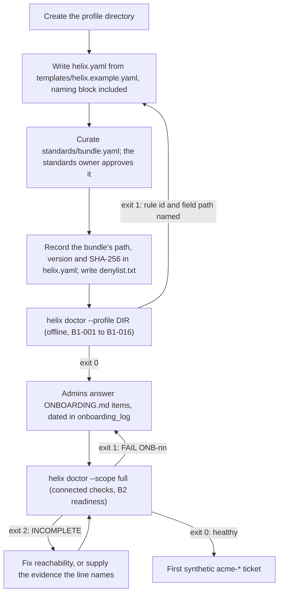
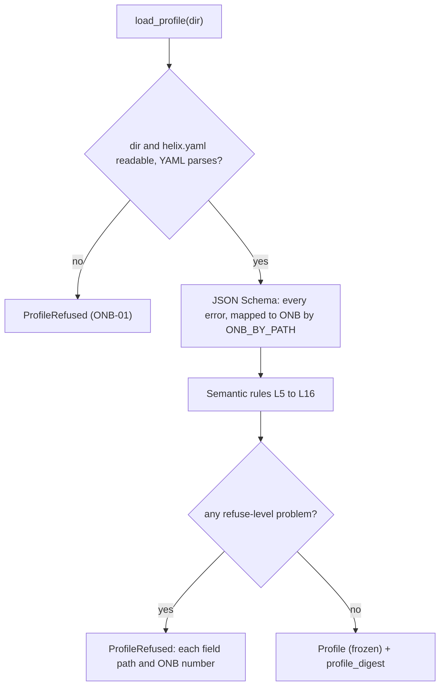

# 02 — Client profile and doctor

> Standalone revision, 2026-10-12: every dependency on Meridian is withdrawn (its four profile files, its commands, its exports and the profile write at merge), and the profile is now `helix.yaml` plus the client standards bundle it references.

## 1. Purpose and scope

This file designs the per-client `helix.yaml` profile and `helix doctor`, the first object of sub-phase **B1**. The profile is one directory per client, has no required companion product files, and holds only non-secret configuration plus references to approved standards material. The loader refuses an incomplete profile and names the invalid field. The doctor runs offline structural and policy checks; connected-service checks are explicitly deferred. B1 never writes Anypoint, Jira, GitHub, or the profile. Names, enums, exit codes, storage paths and the credential model come from `00-conventions.md` and are not redefined.

**Which document governs.** For B1, `docs/architecture/b1-client-profile-and-doctor.md` is the authoritative contract, and `docs/architecture/b1-implementation-notes.md` records what is built: a `helix.yaml` with `schema_version: 1`, the offline rules B1-001 to B1-016, and `helix doctor --profile <path> [--format text|json] [--strict]`. This file describes the fuller profile and doctor that later sub-phases grow into: the wider `helix_profile.v1` field set, the numbered onboarding items ONB-01 to ONB-38, and the connected-system checks, which are deferred to B2 readiness. Where the two disagree on a field name, a section or the doctor's interface, `docs/architecture/profile-schema-reconciliation.md` decides: version 1 as built is the base, its names stay, and this file's extra content arrives as additions. Section 6 lists each difference with its decision. Nothing in this file is a reason for the B1 doctor to make a network call, read a vault, or read any file other than `helix.yaml` and the standards bundle it references.

## 2. Traceability

| Source | What this file implements |
| --- | --- |
| Plan §1 (week zero) | Admin answers dated asked and answered; the account team's answers on `license.lic` (ONB-20) and on Einstein-backed generation's cost (ONB-37) |
| Standalone B1 contract (`docs/architecture/b1-client-profile-and-doctor.md`) | Profile directory, `helix.yaml` contents, loader refusals, offline `helix doctor` with rules B1-001 to B1-016, the approved standards reference, and naming contract validation. Authoritative for B1 (section 1) |
| Standalone architecture decisions (`docs/architecture/`) | The `naming` block and `naming_contract.v1` (B2 naming and environment contract); the `standards` reference and `client_standards_bundle.v1` (client standards bundle); deployment-property keys declared in the design bundle only (B2 design bundle contract), which withdraws section 3.10 |
| Plan §3.2 | Bot-only approval shown blocked, approve-and-run setting, `allowed_bots` (ONB-29 to ONB-31). The plan's write of `deployment_properties:` into the profile is withdrawn (section 3.10; plan amendment needed, section 6) |
| Plan §3.3, §3.5 traps | Jira points budget; fresh process per workflow; Fable 5.1 under zero-data-retention; EU only through Bedrock or Vertex; doctor refuses a forbidden route. Withdrawn (standalone decision): the authentication-mode trap, which guarded a Meridian subprocess that core Helix no longer starts (plan amendment needed, section 6) |
| Plan §4 decisions 1, 3, 6, 7, 10, 11 | Model route; one profile per client; gate owners; design standards; Draft status; caps |
| Files 01, 03, 05, 06, 07, 08, 09 | The profile keys they read (section 3.4, *Blocks other files define* and *Canonical key names*); 05's proposed ONB-35 and ONB-36; 01's pilot keys; 03's secret catalogue |
| Plan §3.7, §7 items 1 and 6 | Doctor cites `ONBOARDING.md` by number, a test holds them in step; admin items dated asked and answered |
| HLD *Components* row "Client profile and `helix doctor`" | Whole module |
| HLD gaps | #1 spike passes only with bearer auth (`toolchain.dx_mcp_spike`); #2 model route credential; #5 EE Nexus via proxy; #6 one vault; #7 approver lists and separation of duties; #8 required checks; #10 one connected app per Anypoint-using activity, checked as distinct apps; #11 generated-app repositories; #13 per-client scope and Temporal namespace; #14 residency hops; #15 caps, monthly ceiling, rate limit, kill switch; #16 approvals only as gate transitions (`jira.gates`); #17 preflight outcomes; #18 per-gate active and elapsed minutes fields |
| HLD *Lower severity* | Jira onboarding block (`[HLD-P lower: Jira]`); GitHub settings and bot role, read with an installation token narrowed to read permissions (`[HLD-P lower: GitHub]`, review item 25); per-client webhook secret (`[HLD-P lower: webhook]`); standalone adapter boundary |
| Review items not in the HLD table | Item 6: requester policy, Draft for email-originated requesters, deny-list on outbound comments (`[LLD]`, review item 6). Item 11: the DX MCP spike's evidence (`[LLD]`, review item 11) |

## 3. Design

### 3.1 Modules

| Module (under `src/helix/`) | Responsibility | Tag |
| --- | --- | --- |
| `schemas/helix_profile.v1.json` | JSON Schema (draft 2020-12) for `helix.yaml`; `additionalProperties: false` on every object | `[LLD]` |
| `profile/loader.py` | `load_profile()`: schema validation, semantic rules L1–L16, the frozen `Profile`, `profile_digest` | `[LLD]` |
| `naming.py` | `compile_contract()` and the immutable `NamingContract` it returns: the profile's `naming` block compiled to `naming_contract.v1`, with its digest (L15, B1-015). Built | Standalone architecture decision (B2 naming contract) |
| `standards.py` | `load()`: the `client_standards_bundle.v1` the profile references, checked for digest, version, client and approval metadata (L16, B1-016). Built | Standalone architecture decision (client standards bundle) |
| `profile/policy.py`, `profile/secrets.py` | The local, versioned policy table (provider and residency compatibility, production-like names, the expiry warning horizon) and the plaintext-secret tripwire (B1-005, B1-011, B1-012, B1-014). Built | B1 contract |
| `profile/onb.py` | `ONB_BY_PATH`: field-path prefix to ONB number, so every refusal names its item | `[LLD]` |
| `profile/doctor/catalogue.py` | `CATALOGUE`: one `CheckSpec` per ONB number: `title`, `parts[]` (each `name`, `mode`, `depends_on`, `function`), `scopes` | `[LLD]` |
| `profile/doctor/checks_*.py` | Check functions grouped by area: files, route, anypoint, jira, github, governance | `[LLD]` |
| `profile/doctor/report.py` | Text rendering, `doctor_report.v1`, verdict, exit code | `[LLD]` |
| `profile/deployment_keys.py` | Withdrawn (standalone decision): the gate-3 profile write of section 3.10. Helix writes nothing to the profile | — |
| `clientdata.py` | To build: `helix.clientdata`, the Helix-owned deny-list parser and client-data tripwire rules (section 3.4, *The deny-list*) | Standalone architecture decision |
| `cli/profile.py`, `cli/doctor.py` | `helix profile validate`, `helix doctor` (conventions §4) | `[PLAN]` CLI parity |

**Built in B1** (`docs/architecture/b1-implementation-notes.md`). The B1 doctor is one module, `profile/doctor.py`, with `profile/render.py` for its output and `cli/doctor.py` for the command. It is offline and read-only: it reads `helix.yaml` and the standards bundle that file references, applies rules B1-001 to B1-016 (structure, policy table, secret tripwire, non-production scope, naming contract, standards bundle), and lists the connected checks it deferred. `load_profile()` refuses a profile with any error-severity finding. The `profile/doctor/` package, `profile/onb.py`, the JSON Schema and `cli/profile.py` in the table are the later form and are not built.

Connected-service checks enter only through the interfaces of section 3.11 and never change the offline boundary: the offline doctor runs no external tool, reads no vault, loads no `.env`, and makes no network call.

### 3.2 The profile directory — Standalone architecture decision for the layout, `[LLD]` additions

`$HELIX_PROFILES_ROOT/{client_id}/` (conventions §7). The directory is the portable unit: it lives outside every repository and outside source control, and is moved between machines by hand `[PLAN]`. The B1 doctor loads only the path passed with `--profile` or `HELIX_CLIENT_PROFILE` and searches nowhere else (B1 contract, *Profile boundary*).

| File | Written by | Schema owner | Tag |
| --- | --- | --- | --- |
| `helix.yaml` | Operator, from `templates/helix.example.yaml` | This file (`helix_profile.v1`); for B1, the B1 contract's `helix.yaml` version 1 | `[PLAN]` |
| `standards/bundle.yaml`, at the path `helix.yaml` names | The client architect or a delegated standards owner, who curates the client's engineering standards into the bundle and approves it; the operator records its path, version and SHA-256 in `helix.yaml` | `client_standards_bundle.v1` (`docs/architecture/client-standards-bundle.md`) | Standalone architecture decision |
| `denylist.txt` | Operator | Parsed by `helix.clientdata.load_denylist` (to build): one token per line, `#` starts a comment, tokens shorter than 3 characters are ignored | `[PLAN]` deny-list, `[LLD]` fixed location and only copy (section 3.4, *The deny-list*); Standalone architecture decision for the parser |
| `standards/skills.md`, `standards/decision-table.json` | Client architect (decision 7) | Skills: free text; table: `decision_table.v1` (file 06) | `[PLAN-DEFAULT 7]` content, `[LLD]` location |
| `evidence/anypoint-grants.json` | Platform owner's dated export of each connected app's grants, used only when the platform's grant read is unavailable (ONB-18) | This file: `{exported_on: date, exported_by: string, apps: [{client_id, grants: [{scope, business_group, environment: string or null}]}]}`; export format `[VERIFY]` | `[LLD]`, optional |

Withdrawn (standalone decision): Meridian's four files (`tenant.yaml`, `environments.yaml`, `compare.yaml`, `.env`) and the `init-answers.yaml` that replayed its `init` are no longer part of the profile. Helix reads none of them, and a `.env` left in the directory is never read or loaded. What they carried now lives in the `naming` block (grammar, environments, configuration paths), in the standards bundle (project baseline and rules) and, for the Anypoint address and transport settings, in control-plane configuration that is To design (section 6).

The B1 doctor reads `helix.yaml` and the standards bundle only. The other files are read by later sub-phases: `denylist.txt` by `helix.clientdata`, the skills file and decision table by design (file 06), and the grants export by the connected doctor (ONB-18). `denylist.txt` and `evidence/` are not in conventions §7's list; section 6 asks for that list to be amended. The profile holds no secret and no vault path: the secrets it needs are named by 03's catalogue (03 §3.3; section 3.4, *Secrets*).

### 3.3 Onboarding flow

Withdrawn (standalone decision): this section used to describe Meridian's four profile files as its `init` command wrote them, an onboarding procedure that ran that command in a scratch directory, and the way a Meridian subprocess was pointed at the profile (`Profile.meridian_inputs()` and the environment built from it). All of it is withdrawn. Helix runs no external tool at onboarding, there is no answers file, and the profile's `.env`, including the `ANYPOINT_BASE_URL` value that 03 and 08 read from it, no longer exists (section 6 records where that address must now be declared).

**Onboarding procedure** — Standalone architecture decision. Helix adds no generator command: people write the files, and the doctor says what is missing.

| Step | Who | What |
| --- | --- | --- |
| 1 | Operator | Create the profile directory outside every repository (section 3.2) |
| 2 | Operator, with the platform owner | Write `helix.yaml` from `templates/helix.example.yaml`, including the `naming` block: the client's application grammar, its environments with their production flags, and its configuration paths and layout (`docs/architecture/b2-naming-and-environment-contract.md`) |
| 3 | Client architect or delegated standards owner | Curate the client's engineering standards into `standards/bundle.yaml` (`client_standards_bundle.v1`) and approve it; the approval is the bundle's `approved.by` and `approved.at` (`docs/architecture/client-standards-bundle.md`) |
| 4 | Operator | Record the bundle's `path`, `version` and SHA-256 in the `standards` block of `helix.yaml` |
| 5 | Operator | Write `denylist.txt` (section 3.4, *The deny-list*) |
| 6 | Operator | Run `helix doctor --profile DIR`. It is offline (rules B1-001 to B1-016) and names every independent defect in one run |
| 7 | Admins | Answer the `ONBOARDING.md` items; each request is dated in `onboarding_log` |
| 8 | Operator | Run the connected checks (`helix doctor --scope full`, section 3.7) once B2 readiness delivers them |



**A later change to the naming block or the bundle** gives a new naming-contract digest or a new standards digest. A standards update is a new bundle version, promoted by its owner. Neither change alters a ticket in flight: an approved design is never re-read under changed rules, so the design is regenerated and approved again (B2 design bundle contract, *Binding and integrity*).

**What a phase receives from the profile** — Standalone architecture decision. A phase never receives the profile directory, a `.env` value or a credential (07 §3.3). The control plane stages these immutable inputs for each attempt (07 §3.4.4):

| Input | Built from | Staged as |
| --- | --- | --- |
| Naming contract | `helix.naming.compile_contract(profile.naming).to_staged()`: `naming_contract.v1` with its digest. A reader rebuilds it with `load_contract`, which refuses content that no longer matches the digest | `/in/validation/naming-contract.json` |
| Standards bundle | The approved bundle file, byte for byte | `/in/validation/standards-bundle.yaml` |
| Validation policy | Compiled by the control plane from the bundle and the naming block (`docs/architecture/b2-standalone-mule-validation.md`) | `/in/validation/validation-policy.json` |

The connected-app pair is never part of the profile: the broker hands it out per call (conventions §9, file 03).

### 3.4 `helix_profile.v1` — field reference

Types: `date` is `YYYY-MM-DD`. `person` is a key of `people`. `env_key` is an environment `key` of the `naming` block (section 3.6). `logical_state` is a conventions §6 logical ticket state. The profile holds no secret value and no vault path `[HLD-P#6]`: each secret it needs has a fixed name in 03's catalogue (03 §3.3), under `helix/{client_id}/`, derived from the profile (*Secrets* below), so no field can point at another client's scope `[HLD-P#13]`. The **ONB** column is the item a missing or wrong value is reported under. Conditional requirements ("cond.") are JSON Schema `if`/`then` clauses, so the loader names them like any other missing field (L3).

This is the fuller schema that later sub-phases grow into. The B1 contract's `helix.yaml` version 1 names several of these fields and sections differently, and the built loader accepts the B1 contract's form. The differences are decided in `docs/architecture/profile-schema-reconciliation.md`: the B1 names govern, and this field reference and the example in section 3.5 are still to be re-expressed in them.

**Top level**

| Field | Type and constraints | Req | ONB | Tag |
| --- | --- | --- | --- | --- |
| `schema` | const `helix_profile.v1` | yes | 01 | `[LLD]` |
| `client_id` | `^[a-z0-9-]{2,32}$`; equals the directory name | yes | 01 | conventions §6 |
| `display_name` | string, 1–64 characters | no | 01 | `[LLD]` |
| `doctor.reuse_hours` | integer ≥ 1: how old a `full` report's ONB-17 and ONB-18 results may be and still serve the `run` scope (section 3.7) | yes | 01 | `[LLD]` |
| `toolchain.dx_mcp_route` | bool, default `false`; `true` only after the B1 spike passes | no | 15 | `[PLAN]` spike |
| `toolchain.dx_mcp_spike` | `{recorded_on: date, server_version: ^\d+\.\d+\.\d+$, command: string, args: [string], auth_mode: enum bearer or client_credentials, headless: const true, tools_hidable: bool, dx_tools_all: [string], at least 1, dx_tools: [string], a subset of dx_tools_all, hosts: [hostname], at least 1}`: the spike's record, which 04 §3.7 reads: the `dx` launcher's `command` and `args`, every tool the pinned server offers (`dx_tools_all`), the allowlist (`dx_tools`), and whether the non-allowlisted tools can be hidden from the model (`tools_hidable`). Required when `dx_mcp_route` is `true`, and then `auth_mode` must be `bearer` and `tools_hidable` `true` (04 §3.7) | cond. | 15 | `[HLD-P#1]` bearer auth; `[LLD]` review item 11 (stated auth mode, pinned version, recorded hosts, tool lists) |
| `onboarding_log` | list, at least 1, of requests `{request: ^[a-z0-9-]+$ (unique), asked_of: string, items: [ONB-nn] (at least 1), asked_on: date, answered_on: date or null, note: string ≤ 200 characters or null}`. Every item whose *Who answers* (section 3.8) names anyone other than the operator or the owner must be listed in a request | yes | each item listed | `[PLAN]` §1, §7 item 6 |

**`naming`, `standards`** — Standalone architecture decision. Both blocks are defined by architecture contracts and are included here by reference; their content is not repeated.

| Field | Type and constraints | Req | ONB | Tag |
| --- | --- | --- | --- | --- |
| `naming` | The versioned naming block (`schema_version: 1`, with `application`, `environments` and `configuration`), exactly as `docs/architecture/b2-naming-and-environment-contract.md` defines it. `helix.naming.compile_contract` must compile it to a valid `naming_contract.v1` with at least two non-production environments (L15, B1-015) | yes | 02 | Standalone architecture decision (B2 naming contract) |
| `naming.environments[]` | The client's environments, each `{key, suffix, order, production}`. The `key` values are this file's `env_key`. The entries with `production: false` are the non-production set, the only environments an agent may name (`NamingContract.allowed_environment_keys()`); a production entry may stay for naming completeness | yes | 02, 06 | Same |
| `naming.configuration.layout` | `environment_files` (the default) or `deployment_properties`: where environment values live in a generated application. It is a configuration layout, not a profile write (section 3.10) | no | 02 | Same; standards mapping decision D1 |
| `standards.path` | A safe relative path inside the profile directory to the client standards bundle; `standards/bundle.yaml` in the fixtures | yes | 33 | Standalone architecture decision (`docs/architecture/client-standards-bundle.md`) |
| `standards.version`, `standards.sha256` | The approved bundle's version, and the SHA-256 of the bundle file's bytes as 64 lowercase hexadecimal characters. Both must match the file, whose `client_id` must equal the profile's and which must carry approval metadata (L16, B1-016) | yes | 33 | Same |

Withdrawn (standalone decision): the `meridian` block. `meridian.version` pinned a wheel that core Helix no longer installs. `meridian.non_production_environments` is replaced by the non-production entries of `naming.environments`; a file that read the old key reads `NamingContract.allowed_environment_keys()` instead (section 6).

**`model_route`** — decision 1 `[PLAN]`

| Field | Type and constraints | Req | ONB | Tag |
| --- | --- | --- | --- | --- |
| `provider` | enum `anthropic`, `bedrock`, `vertex` | yes | 10 | `[PLAN]` |
| `region` | bedrock: an AWS region; vertex: `global`, `us`, `eu` or a region; anthropic: inference geography `global` or `us` | yes | 10 | `[PLAN]` region, `[VERIFY]` value sets |
| `gcp_project_id` | string; required when `provider: vertex` | cond. | 10 | `[LLD]` |
| `zero_data_retention` | bool: the provider organisation behind this route is under zero-data-retention | yes | 10 | `[PLAN]` |
| `models.{intake,design,build,test}` | bare model id known to the Helix release (`claude-opus-5-5` default); the gateway adds the `anthropic.` prefix on Bedrock | yes, all four | 10 | `[PLAN]` per phase, `[LLD]` bare ids |
| `background_model` | bare model id, or absent: the one extra model a session may call for the small requests Claude Code makes on its own (03 §3.7.3); held to rules R1–R7 like a phase model | no | 10, 11 | `[LLD]`; which ids Claude Code requests is `[VERIFY]` |

The route credential (API key, AWS role or GCP service account) is the vault secret `model_route/credential`, held by the gateway only `[HLD-P#2]`.

**`data_handling`** — the plan's "data-handling rules" `[PLAN]`; the fields that express them are this LLD's `[LLD]`

| Field | Type and constraints | Req | ONB | Tag |
| --- | --- | --- | --- | --- |
| `residency` | enum `none`, `eu`, `us` | yes | 11 | `[LLD]` implementing `[PLAN]` data rules |
| `requires_zero_data_retention` | bool: the client's rule (the route's flag must then be `true`) | yes | 11 | `[LLD]` implementing `[PLAN]` data rules |
| `allowed_providers` | list of `provider`, at least 1 | yes | 11 | `[LLD]` implementing `[PLAN]` data rules |
| `allowed_regions` | list of region strings, at least 1 | yes | 11 | `[LLD]` implementing `[PLAN]` data rules |
| `forbidden_models` | list of bare model ids | no | 11 | `[LLD]` implementing `[PLAN]` data rules |
| `redact_before_model` | list of regular expressions applied to Discover output, and to any estate provider's output, before any model sees it | no | 12 | `[HLD-P lower]` |
| `hops[]` | `{hop: enum, hosts: [hostname], region: string, data: string, inside_guarantee: bool}` | yes | 12 | `[HLD-P#14]` |
| `hops[].hop` | `model_route`, `jira_cloud`, `github`, `actions_runner`, `anypoint_control_plane`, `maven_nexus`, `dx_mcp_server`, `helix_control_plane`, `helix_workers` | — | 12 | `[HLD-P#14]` |
| `client_statement` | `{signed_by: string, signed_on: date}`; required when `residency` is not `none` and any hop has `inside_guarantee: false` | cond. | 12 | `[HLD-P#14]` |

**`caps`** — ONB-13 for every row

| Field | Type and constraints | Req | Tag |
| --- | --- | --- | --- |
| `run_usd` | number > 0; a run is one ticket workflow's lifetime (conventions §6 `run_id`) | yes | `[PLAN-DEFAULT 11]` default about $170; `[HLD-P#15]` what a run is |
| `phase_attempt_usd` | number > 0 and ≤ `run_usd` | yes | `[PLAN-DEFAULT 11]` half the run cap; `[HLD-P#15]` per attempt |
| `client_monthly_usd` | number ≥ `run_usd` | yes | `[HLD-P#15]` |
| `client_daily_usd` | number ≥ `phase_attempt_usd` and ≤ `client_monthly_usd` | no | `[HLD-P#15]` |
| `max_turns.{intake,design,build,test}` | integer ≥ 1; becomes `phase_brief.v1` `caps.max_turns` | yes | `[LLD]` |
| `build_retry_cap` | integer ≥ 0 (plan §3.2 "the profile's retry cap"; no number is given) | yes | `[PLAN]` |
| `intake_rate_limit` | `{tickets_per_requester_per_day: int ≥ 1, tickets_per_client_per_day: int ≥ 1}`; enforced by the webhook receiver (file 03) | yes | `[HLD-P#15]` |
| `kill_switch` | bool; `true` stops every phase start and every gateway call for the client | yes | `[HLD-P#15]` |

**`anypoint`, `maven`** — one connected app per Anypoint-using activity `[HLD-P#10]`; non-production, expiry set `[PLAN]`

| Field | Type and constraints | Req | ONB | Tag |
| --- | --- | --- | --- | --- |
| `connected_apps` | map keyed by activity: `discover`, `design`, `build`; all three required. Each app's id and secret are the vault secrets `anypoint/{app}/client_id` and `anypoint/{app}/client_secret`, held by the broker; ONB-16 checks that the three apps are distinct | yes | 15 | `[HLD-P#10]` |
| `connected_apps.*.business_group` | string: the business group the app belongs to. The register of the client's business groups that this was checked against is To design (section 6) | yes | 15 | `[PLAN]` |
| `connected_apps.*.environments` | list of `env_key`, each a non-production environment of the `naming` block (L7) | yes | 15, 18 | `[PLAN]` |
| `connected_apps.*.exchange_role` | enum `viewer`, `contributor`. If the owner rejects HLD-P#10, every app is `contributor`, as the plan grants, and no evidence is required | yes | 18 | `[HLD-P#10]` |
| `connected_apps.*.contributor_evidence` | string naming the B1 test that showed Viewer is not enough; required when `contributor` | cond. | 18 | `[HLD-P#10]` |
| `connected_apps.*.scopes_expected` | list of scope names exactly as the tenant spells them | yes | 18 | `[PLAN]`, `[VERIFY]` strings |
| `connected_apps.*.secret_expires_on` | date, in the future: the expiry the platform owner set | yes | 19 | `[PLAN]` |
| `expiry_warning_days` | integer ≥ 1 | yes | 19 | `[LLD]` |
| `license_lic.needed` | enum `yes`, `no`, `unknown`; dates live in `onboarding_log`. When `yes`, the vault secret `munit/license_lic` must resolve, and only `verify`-class containers receive it (*Secrets* below) | yes | 20 | `[PLAN]` question, `[LLD]` mechanism |
| `maven.extra_upstreams` | list of hosts, each on 03's operator-reviewed list (03 §3.8); default empty. The EE Nexus credential is the vault secret `maven/nexus_ee`, held by the Maven proxy `[HLD-P#5]` | no | 21 | `[LLD]` |

Withdrawn (standalone decision): the control plane's address used to be the `.env` value `ANYPOINT_BASE_URL`. The profile now states it only as the host of the `anypoint_control_plane` hop (ONB-12). The field the broker reads it from is To design (section 6).

**`jira`** — `[HLD-P lower: Jira]` unless marked

| Field | Type and constraints | Req | ONB | Tag |
| --- | --- | --- | --- | --- |
| `site` | `https://` URL of the Jira Cloud site | yes | 22 | |
| `project_key` | `^[A-Z][A-Z0-9]+$` | yes | 22 | |
| `issue_types` | list of issue type names Helix handles, at least 1 (03 §3.4.6) | yes | 22 | |
| `bot.account_id`, `bot.email` | strings. The API token is the vault secret `jira/bot_token`, held by the Jira client (basic auth with email and API token `[VERIFY]`) | yes | 22 | |
| `points_per_hour` | integer ≥ 1, default 65,000 points an hour (Jira's default) | no | 22 | `[PLAN]` §3.3 |
| `points_reserve` | number ≥ 0 and < 1, default 0.2 (03 §3.5.3) | no | 22 | `[LLD]` |
| `states.{new,needs_info,requirement_review,design_review,building,in_review,done,cancelled}` | `{status: string, transition_id: string}`; status names unique; `transition_id` required for the states the bot enters (`needs_info`, `requirement_review`, `design_review`, `in_review`, `draft`) | yes | 24 | conventions §6 |
| `states.draft` | same shape; required when Draft is used (below) | cond. | 27 | `[PLAN-DEFAULT 10]` |
| `gates.{gate1_requirement,gate2_design}.approve_transitions`, `.reject_transitions` | each a list, at least 1, of `{transition_id: string, to_state: logical_state}`. The from-state is the gate's review state (`requirement_review`, `design_review`). Approve and reject sets name different `to_state`s. The template carries 03's default table (03 §3.4.6): approve to `building`; gate-1 reject to `needs_info`; gate-2 reject to `requirement_review` | yes | 24 | `[HLD-P#16]` approval only as a transition; `[LLD]` keys (08 §3.17) |
| `onboarding_issue_key` | ticket key of the walk issue (ONB-24) | yes | 24 | `[LLD]` |
| `onboarding_walk_label` | Jira label the walk issue carries, default `helix-onboarding-walk`; the receiver excludes an issue with this label or key from runs (section 3.11) | no | 24 | `[LLD]` |
| `fields.{accepted,change_requests,hand_rewrite,pr_url}` | `^customfield_[0-9]+$` | yes | 25 | `[PLAN]` §3.2 for the first three; `[LLD]` `pr_url`, the PR link 07 writes (07 §3.8.2) |
| `fields.gate{1,2,3}_active_minutes`, `fields.gate{1,2,3}_wait_minutes` | `^customfield_[0-9]+$`; active minutes typed by the reviewer, elapsed wait written by Helix (03 §3.5.7, 09 §3.13) | yes | 25 | `[HLD-P#18]` |
| `fields.gate1_redundant_facts`, `fields.gate1_return_facts` | `^customfield_[0-9]+$`; 05's fact-id measurement fields | no | 25 | `[LLD]` (05 §3.10) |
| `fields.hand_rewritten_self_report` | `^customfield_[0-9]+$`: the merger's own answer on hand rewrites; absent, no self-report is read | no | 25 | `[LLD]` (09 §3.16) |
| `webhook.id`, `webhook.receiver_url`, `webhook.registered_on` | string; `https://` URL whose path ends in `/hooks/jira/{client_id}` (03 §3.4.1); date. The HMAC secret is the vault secret `webhook/jira_hmac` (`current` and `previous` keys, 03 §3.3) | yes | 26 | `[HLD-P lower: webhook]` |
| `requester_policy` | enum `internal_only` (only an internal reporter gets a run), `external_draft` (every reporter gets a run; every comment to an external audience is held for Draft), `all_draft` (every comment is held, decision 10's opt-in Draft). The meanings are 03 §3.5.5's table. An email-originated reporter is never internal (03 §3.5.5) | yes | 27 | `[LLD]` review item 6; `all_draft` `[PLAN-DEFAULT 10]` |
| `internal_groups` | list of Jira group names, at least 1; a reporter in one of them is internal | yes | 27 | `[LLD]` review item 6 |
| `extra_answerers` | list of `person`, default empty: people besides the reporter whose comments may answer questions (05) | no | 32 | `[LLD]` (05) |
| `mail_handler` | `{enabled: bool, address: email or null, marker: string or null}`; `address` and `marker` (the label the handler sets on issues it creates `[VERIFY]`) required when `enabled` | yes | 27 | `[HLD-P lower: Jira]`, `[LLD]` marker (05) |
| `draft_visibility` | `{kind: enum role, group; name: string}`: who may read a held comment; required when Draft is used | cond. | 27 | `[LLD]` review item 6 |

**Draft is used** when `requester_policy` is `external_draft` or `all_draft`, or when `mail_handler.enabled` is `true`. Jira notification email carries a public comment to an email-originated requester, which counts as "by email" under decision 10 (review item 6), so email intake always needs Draft. Then `states.draft` and `draft_visibility` are required, and the Draft releasers are `gates.draft_reviewers`, which defaults to the gate-1 approvers, so a releaser always exists `[LLD]` review item 6. Under `internal_only` an email-originated reporter gets no run at all (03 §3.5.5), so a mail handler there is a WARN under ONB-27, not a FAIL.

**`github`** — `[HLD-P#11]` repositories, `[HLD-P lower: GitHub]` settings and role

| Field | Type and constraints | Req | ONB | Tag |
| --- | --- | --- | --- | --- |
| `org` | the client's GitHub organisation | yes | 28 | |
| `app.app_id`, `app.installation_id` | strings. The private key is the vault secret `github/app_private_key`, held by the git writer; the App's webhook secret is `webhook/github_hmac` | yes | 28 | |
| `bot_login` | the App's bot login, `^[a-z0-9-]+\[bot\]$` | yes | 28 | |
| `bot_user_id` | integer: the bot's numeric GitHub id, which 03's receiver ignores as its own actor | yes | 28 | `[LLD]` (03) |
| `repo_convention` | enum `per_integration` (name from the grammar's repository form) or `client_defined` | yes | 29 | |
| `default_branch` | string | yes | 29 | |
| `required_checks` | list of status-check names, at least 1, holding `helix/verify` | yes | 29 | `[HLD-P#8]` |
| `repositories[]` | `{name, onboarded_on: date, bot_approval_proof: {pull_request: int, recorded_on: date}}`; at least 1 | yes | 29, 31 | |
| `pilot` | the B2 pilot (01 §3.8); required while the Action runs | cond. | 30 | `[PLAN]` pilot, `[HLD-P#11]` repository |
| `pilot.repository` | the pilot repository in `org`; it holds only the pilot workflow (01 §3.8) | yes, in `pilot` | 30 | `[LLD]` (01) |
| `pilot.workflow_path` | repository-relative path, default `.github/workflows/helix-pilot.yml` | no | 30 | `[LLD]` (01 §3.8) |
| `pilot.runner_labels.control`, `.agent` | lists of runner labels, each at least 1, holding `self-hosted` and no GitHub-hosted label (01 lint L5); rendered into the workflow's `runs-on` | yes, in `pilot` | 30 | `[HLD-P#4]` `[HLD-P#14]` (01 §3.8) |
| `pilot.mode` | enum `synthetic`, `real`, default `synthetic`; `helix run --mode` may lower it, never raise it (01 §3.9) | no | 30 | `[HLD-P#4]` |
| `pilot.jira_actor_login` | the GitHub login that stands for the Jira side in `allowed_bots`, as the plan requires. Under 01 §3.8 and 03 §3.2 only the App dispatches the pilot, so this login triggers nothing unless the owner picks a machine-user trigger (01 §6) | yes, in `pilot` | 30 | `[LLD]` |
| `pilot.allowed_bots` | list of logins: exactly `jira_actor_login` and `bot_login`. Whether an entry carries the `[bot]` suffix follows what `github.actor` reports `[VERIFY]` | yes, in `pilot` | 30 | `[PLAN]` "the Jira and GitHub bots" |
| `pilot.allowed_operators` | list of logins, default empty | no | 30 | `[LLD]` (01) |

There is no separate settings-reader credential: the settings check uses the git writer's installation token narrowed to administration read and metadata read (03 §3.9.1, §3.9.4), never the token that writes `[LLD]` `[HLD-P lower: GitHub]`. 03 §3.9.1 and 07 §3.8 read settings the same way.

**`people`, `gates`, `design_standards`**

| Field | Type and constraints | Req | ONB | Tag |
| --- | --- | --- | --- | --- |
| `people.{key}` | `{jira_account_id: string, github_login: string, github_user_id: integer, optional}`; key `^[a-z0-9-]+$`. `github_user_id` lets 08 match a GitHub actor by numeric id rather than by login (08 §3.9.3, §3.17) | yes, ≥1 | 32 | `[HLD-P#7]`; `github_user_id` `[LLD]` (08) |
| `gates.{gate1_requirement,gate2_design,gate3_merge}.approvers` | list of `person`, at least 1 | yes | 32 | `[PLAN-DEFAULT 6]`, `[HLD-P#7]` |
| `gates.*.turnaround_business_days`, `.reminder_after_business_days` | integers ≥ 1; when absent, 2 and 1 | no | 32 | `[LLD]` defaults taken from decision 6's recommendation; decision 6's default concerns only who signs |
| `gates.draft_reviewers` | list of `person`, at least 1: who may release a held comment by moving the ticket out of `draft` (03 §3.5.5, 05 §3.11); when absent, the gate-1 approvers | no | 27 | `[LLD]` review item 6 |
| `gates.waiver` | `{reason: string, recorded_on: date, max_tickets: 1}` or absent; waives separation of duties for the pilot | no | 32 | `[HLD-P#7]` |
| `gates.gate4_deploy` | must be absent in B1–B5 | — | 34 | `[PLAN]` |
| `design_standards.contract_format` | enum `oas30`, `raml10` | yes | 33 | `[PLAN-DEFAULT 7]` |
| `design_standards.ruleset` | `{group_id: string, asset_id: string, version: ^\d+\.\d+\.\d+$}`: the Exchange coordinates of the ruleset; the Best Practices ruleset's group id and asset id are `[VERIFY]` | yes | 33 | `[PLAN-DEFAULT 7]` |
| `design_standards.max_ruleset_violations` | const `0` | yes | 33 | `[PLAN-DEFAULT 7]` |
| `design_standards.layers_policy` | enum `fewest_with_reuse`, `api_led_three_layer` | yes | 33 | `[PLAN-DEFAULT 7]` |
| `design_standards.logging` | enum `json_logger_module` | yes | 33 | Client standards bundle decision; requires the approved Exchange logger module |
| `design_standards.skills_file`, `.decision_table` | relative paths inside the profile directory | yes | 33 | `[PLAN-DEFAULT 7]`, `[LLD]` location |

**`orchestration`** — names and defaults are file 08's (08 §3.17); ONB-38

| Field | Type and constraints | Req | Tag |
| --- | --- | --- | --- |
| `orchestration.driver` | enum `controlplane`, `draining`, `temporal`; default `controlplane` until B5 | no | `[HLD-P#12]` |
| `orchestration.namespace` | string, default `helix-{client_id}` | no | `[HLD-P#13]` |
| `orchestration.max_parallel_agents` | integer ≥ 1, default 2 (08's choice) | no | `[LLD]` |
| `orchestration.profile_hold_hours` | integer ≥ 1, default 72 (08's choice, 08 §3.7) | no | `[LLD]` |

**Secrets the profile needs** `[HLD-P#6]` `[HLD-P#13]`. Every name is fixed by 03's catalogue (03 §3.3), under `helix/{client_id}/`, and derived from the profile; `Profile.secret_names()` returns the list. No profile field names a vault path (L8), so one client's profile cannot point at another client's secret, and 03's `CrossClientRef` refuses a name with `..`, a leading `/`, `_system/` or `deploy/` as a second layer.

| Secret name | Needed when | Read by role (03 §3.3) | Used by |
| --- | --- | --- | --- |
| `jira/bot_token` | always | `receiver`, `control` | Jira client |
| `github/app_private_key` | always | `receiver`, `control` | git writer |
| `webhook/jira_hmac`, `webhook/github_hmac` | always | `receiver` | webhook receiver |
| `anypoint/{app}/client_id`, `anypoint/{app}/client_secret`, for `app` in `discover`, `design`, `build` | always | `broker` | credential broker |
| `model_route/credential` | always | `gateway` | model gateway |
| `maven/nexus_ee` | always | `mavenproxy` | Maven proxy |
| `munit/license_lic` | `anypoint.license_lic.needed: yes` | `control` | Mounted read-only, outside `/work`, only into containers of class `verify` (03 §3.6.1: 07's `verify` with no agent session, `helix-worker-build`, 01 §3.7), never into an agent-class container. Agent-session MUnit runs skip the suites that need it, and 07 then runs its `test` evidence stage in a `verify` container rather than in the agent's container after the session `[LLD]` (section 6) |

**The deny-list** `[PLAN]` per client, never committed; `[LLD]` location and uses. One copy only: `denylist.txt` in the profile directory, at that fixed path, parsed by `helix.clientdata.load_denylist`. `helix.clientdata` is a Helix-owned module, to build (Standalone architecture decision). It keeps the rule behaviours that 03 §3.5.5 and 10 §3.13 rely on: tokens are lower-cased, `#` starts a comment, tokens shorter than 3 characters are ignored, a token matches at word boundaries without regard to case, and the shape rules find real UUIDs, internal hosts and real email addresses. It depends on nothing outside Helix and the standard library. No `helix.yaml` key names the file, so a profile cannot point the scan at another client's file, and there is no vault copy. 03 §3.3 and §3.5.5, 05 §3.14 and 10 §3.13 read it at that path. Its uses are the targets below; they replace the earlier `denylist.apply_to` key.

| Target | What is scanned | Against | On a hit | Owner |
| --- | --- | --- | --- | --- |
| `helix_repo_tripwire` | Commits to Helix's own repository | The union of every client's list (`$HELIX_PROFILES_ROOT/*/denylist.txt`) | The commit is refused | 01 (G27), 10 §3.13 |
| Generated-app commits | The tree the git writer pushes | Other clients' lists only. This client's own tokens belong in its own code: every name renders a prefix the naming contract allows, and the list may also hold environment keys and suffixes | Push refused, `FAILED` | 03 §3.9.2 `sync` (07's `push_tree`), 10 §3.13 |
| `outbound_comments` | Every Jira comment before it is posted | Every client's list | Another client's token: blocked, `comment_withheld`, `FAILED` (03 §3.5.5 check 2). This client's token: counted on the hold and in the chain, never blocking (03 §3.5.5 check 3), because an internal audience may read its own estate's names and an external audience is held for Draft anyway | 03, 05 |

**Blocks other files define** `[LLD]`. `helix_profile.v1` includes these blocks by reference. Their fields are exactly the owning file's table, compiled into the schema's `$defs` with `additionalProperties: false`, so the loader refuses an unknown key in them as in any other block. A key there that duplicates a canonical key of this file is left out, and the owner reads the canonical one.

| Block | Fields defined in | ONB |
| --- | --- | --- |
| `discover` | 05 §3.14 | 35 |
| `intake` | 05 §3.14 | 36 |
| `build`, `test` | 07 §3.12 | 21 |
| `metering` | 09 §3.16 | 13 |
| `measurement` | 09 §3.16 | 25 |
| `design_standards` additions | 06 §3.16: `async_contract`, `standards_trace`, `ruleset_files[]`, `pins`, `layer_words`, `max_attempts`, `validation_route`, `repository_wait_business_days`. The fields in the `design_standards` table above stay this file's | 33 |

**Canonical key names and their consumers** `[LLD]`. 02 owns `helix_profile.v1` (conventions §8). The other files read every key under this file's names, including the keys they proposed and this file adopted: `jira.gates.*` (08), `jira.points_reserve`, `model_route.background_model`, `maven.extra_upstreams`, `github.bot_user_id` and the walk keys (03), `jira.internal_groups`, `jira.mail_handler`, `jira.draft_visibility`, `jira.extra_answerers`, `gates.draft_reviewers` and the two fact-id fields (05), `jira.fields.pr_url` (07), `jira.fields.hand_rewritten_self_report` (09), `github.pilot.repository`, `.workflow_path`, `.runner_labels`, `.mode` and `.allowed_operators` (01), `people.{key}.github_user_id` and `orchestration.profile_hold_hours` (08), and the blocks above. These names still differ; each listed file renames to the canonical key (section 6).

| Canonical (this file) | Name used elsewhere | File |
| --- | --- | --- |
| `jira.requester_policy` | `data_handling.requester_trust`, `jira.draft_all_comments` | 04 §3.8, block 2 (04 §6 item 7 waits for this name) |
| `jira.fields.hand_rewrite`, `jira.fields.gate{1,2,3}_wait_minutes` | `hand_rewritten`, `gate{1,2,3}_elapsed_minutes` | 09 §3.16 (03 §6 item 15 asks the same) |
| No label key: label names are fixed (03 §3.9.3, 07 §3.8) | `github.labels.reverify` | 10 G-P08-b; 11 §3.10 |

### 3.5 Complete annotated example (`tests/fixtures/acme-b/profile/helix.yaml`)

Every value is synthetic. Values marked *fixture value* are test data, not recommendations; the owner sets the real numbers. The fixture also carries the blocks other files define (section 3.4, *Blocks other files define*); they are not repeated here. This fixture is not in the repository yet: the built B1 fixture is `tests/fixtures/acme-a/`, written to the B1 contract's schema (section 6).

```yaml
schema: helix_profile.v1
client_id: acme-b                      # equals the directory name (ONB-01)
display_name: "Acme EU (fixture)"
doctor: {reuse_hours: 24}              # fixture value (ONB-01, section 3.7)

naming:                                # B2 naming contract; compiles to naming_contract.v1 (ONB-02, B1-015)
  schema_version: 1
  application:
    separator: "-"
    repository: {parts: [prefix, layer, name, version]}                # acmeb-sapi-order-v1
    deployed:   {parts: [prefix, layer, name, version, environment]}   # acmeb-sapi-order-v1-dev
    allowed: {prefix: [acmeb], scope: [app], region: [eu], layer: [eapi, papi, sapi]}   # the compiler wants a list for all four fixed parts; this grammar uses neither scope nor region
    version_pattern: "v[1-9][0-9]*"
    name_pattern: "[a-z][a-z0-9-]{1,48}"
  environments:                        # the non-production entries are the only environments an agent may name (ONB-06)
    - {key: DEV,  suffix: dev,  order: 10, production: false}
    - {key: SIT,  suffix: sit,  order: 20, production: false}
    - {key: PROD, suffix: prod, order: 90, production: true}   # kept for naming completeness; refused everywhere in B1–B5
  configuration:
    layout: deployment_properties      # a configuration layout, not a profile write (section 3.10)
    directory: src/main/resources
    base_file: config.yaml
    secure_file: config-secure.yaml
    test_directory: src/test/resources
    test_file: config-munit.yaml
    secure_test_file: config-secure-munit.yaml

standards:                             # client standards bundle (ONB-33, B1-016)
  path: standards/bundle.yaml
  version: 1.0.0
  sha256: <64 lowercase hexadecimal characters>   # the SHA-256 of the bundle file's bytes

model_route:                           # decision 1 (ONB-10); credential: vault model_route/credential
  provider: bedrock
  region: eu-central-1
  zero_data_retention: true            # so claude-fable-5-1 is refused (ONB-11)
  models: {intake: claude-opus-5-5, design: claude-opus-5-5, build: claude-opus-5-5, test: claude-opus-5-5}
  # background_model absent: a session may call the phase model only (03 §3.7.3)

data_handling:
  residency: eu                        # EU only through Bedrock or Vertex (ONB-11, R6)
  requires_zero_data_retention: true
  allowed_providers: [bedrock, vertex]
  allowed_regions: [eu-central-1, eu-west-1]
  forbidden_models: [claude-fable-5-1]
  redact_before_model: ['\b10\.\d{1,3}\.\d{1,3}\.\d{1,3}\b']   # internal addresses in Discover output
  hops:                                # one row per hop data crosses (ONB-12)
    - {hop: model_route, hosts: [bedrock-runtime.eu-central-1.amazonaws.com], region: eu-central-1, data: "prompts, fact sheet, code", inside_guarantee: true}   # [VERIFY] Mantle host
    - {hop: jira_cloud, hosts: [jira-b.acme.test], region: eu, data: "ticket text, comments", inside_guarantee: true}   # [VERIFY] the site's data residency
    - {hop: github, hosts: [api.github.com], region: us, data: "generated code, PR body", inside_guarantee: false}
    - {hop: actions_runner, hosts: [runners.acme-b.test], region: eu-central-1, data: "pilot job workspace", inside_guarantee: true}
    - {hop: anypoint_control_plane, hosts: [eu1.anypoint.mulesoft.com], region: eu, data: "connected-app checks, Exchange search", inside_guarantee: true}
    - {hop: maven_nexus, hosts: [repository.mulesoft.org], region: unknown, data: "artefact coordinates only", inside_guarantee: false}   # [VERIFY] EE Nexus host
    - {hop: helix_control_plane, hosts: [helix.acme-b.test], region: eu-central-1, data: "everything above", inside_guarantee: true}
    - {hop: helix_workers, hosts: [workers.acme-b.test], region: eu-central-1, data: "fact sheet, code", inside_guarantee: true}
  client_statement: {signed_by: "Acme EU data protection (fixture)", signed_on: 2026-10-01}

caps:                                  # ONB-13
  run_usd: 170                         # estimate: 3 x $33 x 1.3 rework x 1.3 tokenizer (decision 11 default)
  phase_attempt_usd: 85                # half the run cap (decision 11 default)
  client_monthly_usd: 1700             # fixture value
  max_turns: {intake: 40, design: 80, build: 150, test: 120}   # fixture values
  build_retry_cap: 3                   # fixture value
  intake_rate_limit: {tickets_per_requester_per_day: 5, tickets_per_client_per_day: 20}   # fixture values
  kill_switch: false

anypoint:
  connected_apps:                      # one app per activity (ONB-15 to ONB-19); secrets: vault anypoint/{app}/client_id and client_secret
    discover:
      business_group: "Acme Core"
      environments: [DEV, SIT]
      exchange_role: viewer
      scopes_expected: ["Exchange Viewer", "Environment Viewer", "View APIs Configuration", "Read Applications"]   # [VERIFY] tenant spelling
      secret_expires_on: 2027-03-31
    design:
      business_group: "Acme Core"
      environments: [DEV]
      exchange_role: viewer
      scopes_expected: ["Exchange Viewer"]
      secret_expires_on: 2027-03-31
    build:
      business_group: "Acme Core"
      environments: [DEV]
      exchange_role: viewer
      scopes_expected: ["Exchange Viewer"]
      secret_expires_on: 2027-03-31
  expiry_warning_days: 30              # fixture value
  license_lic: {needed: "no"}          # dates in onboarding_log (ONB-20)

toolchain: {dx_mcp_route: false}       # until the B1 spike passes; then dx_mcp_spike is required (ONB-15)

jira:                                  # ONB-22 to ONB-27; bot token: vault jira/bot_token
  site: https://jira-b.acme.test
  project_key: ACME
  issue_types: [Integration]
  bot: {account_id: "acme-b-bot-0001", email: helix-bot@acme-b.test}
  states:
    new:                {status: "Open"}
    needs_info:         {status: "Needs info", transition_id: "21"}
    requirement_review: {status: "Requirement review", transition_id: "31"}
    design_review:      {status: "Design review", transition_id: "41"}
    building:           {status: "Building"}
    in_review:          {status: "In review", transition_id: "61"}
    done:               {status: "Done"}
    cancelled:          {status: "Cancelled"}
    draft:              {status: "Draft", transition_id: "71"}   # Draft is used (external_draft, mail handler on)
  gates:                               # human gate transitions, 03's default table (ONB-24)
    gate1_requirement:
      approve_transitions: [{transition_id: "51", to_state: building}]
      reject_transitions:  [{transition_id: "52", to_state: needs_info}]
    gate2_design:
      approve_transitions: [{transition_id: "53", to_state: building}]
      reject_transitions:  [{transition_id: "54", to_state: requirement_review}]
  onboarding_issue_key: ACME-1
  onboarding_walk_label: helix-onboarding-walk
  fields:                              # 10 fields (ONB-25)
    accepted: customfield_10101
    change_requests: customfield_10102
    hand_rewrite: customfield_10103
    pr_url: customfield_10104
    gate1_active_minutes: customfield_10111
    gate1_wait_minutes: customfield_10112
    gate2_active_minutes: customfield_10113
    gate2_wait_minutes: customfield_10114
    gate3_active_minutes: customfield_10115
    gate3_wait_minutes: customfield_10116
  webhook: {id: "7", receiver_url: "https://helix.acme-b.test/hooks/jira/acme-b", registered_on: 2026-10-02}   # HMAC: vault webhook/jira_hmac
  requester_policy: external_draft     # review item 6 (ONB-27); Draft is therefore used
  internal_groups: [acme-b-staff]
  mail_handler: {enabled: true, address: integrations@acme-b.test, marker: acme-b-mail-intake}   # [VERIFY] the handler sets a label
  draft_visibility: {kind: role, name: "Helix reviewers"}

github:                                # ONB-28 to ONB-31; App key: vault github/app_private_key
  org: acme-b-apps
  app: {app_id: "100001", installation_id: "200001"}
  bot_login: acme-b-helix[bot]
  bot_user_id: 300001
  repo_convention: per_integration
  default_branch: main
  required_checks: [helix/verify]
  repositories:
    - {name: acmeb-sapi-order-v1, onboarded_on: 2026-10-03, bot_approval_proof: {pull_request: 1, recorded_on: 2026-10-03}}   # ACME-101's repository name for acme-b (10 §3.11); it parses only under this fixture's grammar, prefix acmeb
  pilot:
    repository: acme-b-helix-pilot
    # workflow_path absent: .github/workflows/helix-pilot.yml
    runner_labels: {control: [self-hosted, helix-acme-b-control], agent: [self-hosted, helix-acme-b-agent]}
    mode: synthetic
    jira_actor_login: acme-b-jira-bot
    allowed_bots: [acme-b-jira-bot, "acme-b-helix[bot]"]   # [VERIFY] the [bot] suffix
    allowed_operators: [acme-b-owner]

people:
  owner: {jira_account_id: "acme-b-user-0001", github_login: acme-b-owner}
  dana:  {jira_account_id: "acme-b-user-0002", github_login: acme-b-dana}

gates:                                 # decision 6 default plus separation of duties (ONB-32)
  gate1_requirement: {approvers: [owner]}   # turnaround 2, reminder 1 business days by default
  gate2_design:      {approvers: [owner]}
  gate3_merge:       {approvers: [dana]}
  # draft_reviewers absent: the gate-1 approvers release a held comment (ONB-27)

design_standards:                      # decision 7 default (ONB-33)
  contract_format: oas30
  ruleset: {group_id: "00000000-0000-0000-0000-000000000000", asset_id: "acme-fixture-best-practices", version: "1.6.5"}   # fixture placeholders; real group id and asset id [VERIFY]; 1.6.5 at research time
  max_ruleset_violations: 0
  layers_policy: fewest_with_reuse
  logging: json_logger_module
  skills_file: standards/skills.md
  decision_table: standards/decision-table.json

orchestration: {driver: temporal, namespace: helix-acme-b}   # a B5 client in this fixture (ONB-38)

onboarding_log:                        # plan §7 item 6: every item answered outside the operator and owner
  - {request: platform-owner-anypoint, asked_of: "platform owner", items: [ONB-02, ONB-06, ONB-15, ONB-16, ONB-17, ONB-18, ONB-19], asked_on: 2026-09-20, answered_on: 2026-09-27, note: null}
  - {request: client-data-protection, asked_of: "client data protection", items: [ONB-10, ONB-11, ONB-12], asked_on: 2026-09-20, answered_on: 2026-10-01, note: null}
  - {request: account-team-license, asked_of: "account team", items: [ONB-20], asked_on: 2026-09-20, answered_on: 2026-09-28, note: "not needed for the fixture connectors"}
  - {request: account-team-einstein, asked_of: "account team", items: [ONB-37], asked_on: 2026-09-20, answered_on: 2026-09-30, note: "fixture answer; generation unused (decision 2)"}
  - {request: mulesoft-support-nexus, asked_of: "MuleSoft Support", items: [ONB-21], asked_on: 2026-09-20, answered_on: 2026-09-29, note: null}
  - {request: jira-admin, asked_of: "Jira admin", items: [ONB-22, ONB-23, ONB-24, ONB-25, ONB-26, ONB-27], asked_on: 2026-09-22, answered_on: 2026-10-02, note: null}
  - {request: github-org-admin, asked_of: "GitHub org admin", items: [ONB-28, ONB-29, ONB-30, ONB-31], asked_on: 2026-09-22, answered_on: 2026-10-03, note: null}
  - {request: client-architect-standards, asked_of: "client architect", items: [ONB-33], asked_on: 2026-09-22, answered_on: 2026-10-01, note: null}
```

The second fixture, `tests/fixtures/acme-a/profile/`, differs where plan §7 item 1 needs it: `provider: anthropic`, `region: us`, `zero_data_retention: false`, `residency: us`, `allowed_regions: [us]`, and a different naming grammar: parts `prefix, scope, region, name, layer, version` with prefix `acme` and the default `environment_files` layout, where `acme-b` uses `prefix, layer, name, version` with prefix `acmeb`. Each contract therefore refuses the other client's names (B2 naming contract, acceptance criterion 1; 10 §3.11). The built `tests/fixtures/acme-a/` allows the prefix `acme` instead (section 6). The second fixture also covers the other branches: `requester_policy: internal_only`, `mail_handler.enabled: false` and no `states.draft` or `draft_visibility` (Draft unused), no `github.pilot` and no `actions_runner` hop, and `orchestration.driver: controlplane`, so ONB-38 is not applicable.

### 3.6 The loader

**Interface** `[LLD]`. `load_profile(profile_dir: Path, *, purpose: "phase" | "doctor" | "validate", phase: str | None = None) -> Profile`. With `purpose: "phase"` it raises `ProfileRefused(problems: list[ProfileProblem])`, where `ProfileProblem = {onb: "ONB-nn", path: "jira.states.design_review", message: str, level: "refuse" | "warn", blocked_by: "ONB-nn" | None}`. With `"doctor"` or `"validate"` it returns `LoadResult(profile: Profile | None, problems: list[ProfileProblem])` instead, so each problem lands under its own ONB line and unaffected checks still run. Every problem is collected; the first is never the only one.

`ONB_BY_PATH` maps a field path to its item by the longest matching pattern, so `anypoint.connected_apps.design.secret_expires_on` reports under ONB-19, not ONB-15, and `gates.draft_reviewers` under ONB-27, not ONB-32. A schema error with no path (an unknown top-level key) reports under ONB-01. A schema error inside an `onboarding_log` request reports under every item that request lists. Any key named `*_ref` reports under ONB-09 (L8).

**When the naming block does not compile** (L15), every problem another rule finds because of it is reported with `blocked_by` set to ONB-02, and the doctor shows that item as BLOCKED, not FAIL. For example, with the `naming` block removed, L7's "DEV is not an environment of the naming block" is ONB-06 BLOCKED by ONB-02 `[LLD]`.

`Profile` is a frozen dataclass mirroring the schema, plus:

| Member | What it is |
| --- | --- |
| `directory` | The profile directory |
| `profile_digest` | SHA-256 over the sorted `name:sha256(bytes)` lines of every profile file. It changes only when a person edits a profile file, because Helix writes none (section 3.10). The naming-contract digest and the standards-bundle digest are separate values, bound to gate 2 through the design bundle (B2 design bundle contract) |
| `naming_contract` | The compiled `NamingContract` (`helix.naming.compile_contract`): immutable, with its digest. `to_staged()` gives the per-attempt `naming-contract.json` (section 3.3) |
| `environments` | `key` → `production`, from the naming contract; `allowed_environment_keys()` gives the non-production keys in their `order` |
| `standards` | The loaded `StandardsBundle` (`helix.standards.load`): `client_id`, `version`, `digest` and the bundle's data |
| `secret_names()` | The vault names of section 3.4, *Secrets* |
| `draft_used` | Section 3.4's rule |

It is loaded fresh in each phase CLI process and never cached at import: a value bound at import would let a worker that switches clients run the second client under the first one's rules (plan §3.5) `[PLAN]`.

**Environments come from the naming contract** — Standalone architecture decision. The loader takes the environments from the compiled `naming` block and from nowhere else, in process, so `helix profile validate` needs no subprocess. The rules are the *Environment rules* of the B2 naming contract: keys match `^[A-Z][A-Z0-9_]{1,31}$` and are unique, suffixes and `order` values are unique, `production` is a required true-or-false value, and at least two entries are non-production. There is no default and no fallback set: a block without usable environments does not compile (L15).

Withdrawn (standalone decision): the rules that read environments out of Meridian's tenant file exactly as Meridian does (the accepted spellings of the suffix, the defaulted flags, the built-in generic environments), and the contract test that held Helix to them.



| Rule | Refuses when | ONB | Tag |
| --- | --- | --- | --- |
| L1 | Profile directory or `helix.yaml` missing, unreadable or not YAML | 01 | `[PLAN]` |
| L2 | `schema_version` is not `1` (reconciliation decision 1; built as B1-002) | 01 | `[LLD]` |
| L3 | Any required field missing, including a conditional one; the message names its full path | per path | `[PLAN]` |
| L4 | Any unknown key: a warning, refused under `--strict` (reconciliation decision 1; built as B1-018 for top-level keys) | per path | `[LLD]` |
| L5 | `client_id` differs from the directory name (built as B1-017) | 01 | `[LLD]` |
| L6 | Withdrawn (standalone decision): this rule required Meridian's four profile files. The only files a profile must hold are `helix.yaml` (L1) and the standards bundle (L16) | — | — |
| L7 | **A production environment for any agent**: a key in any `connected_apps.*.environments` is `production: true` in the `naming` block, or is not one of its environments | 06 | `[PLAN]` rule; Standalone architecture decision for where environments are read |
| L8 | Withdrawn (reconciliation decision 4): the `vault` block and `vault://` references stay. A reference outside `vault.scope` is refused (to build), so `vault://acme-b/../acme-a/jira/bot_token` still cannot be used | 09 | `[HLD-P#13]` |
| L9 | The route breaks the data rules (ONB-11 rules R1–R7) | 11 | `[LLD]` rules implementing `[PLAN]` data rules; refuse, not warn |
| L10 | Caps out of order (`phase_attempt_usd` > `run_usd`, `client_monthly_usd` < `run_usd`) | 13 | `[HLD-P#15]` |
| L11 | `caps.kill_switch: true` and `purpose: "phase"` | 13 | `[HLD-P#15]` |
| L12 | Withdrawn (reconciliation decision 10): `gates.deploy` names who will own gate four and grants nothing in B1–B5; a deploy credential is still refused | 34 | `[PLAN]` |
| L13 | Withdrawn (standalone decision): this rule refused credential names in the profile's `.env`. Helix reads no `.env`. A plaintext secret in `helix.yaml` is caught by the B1 secret tripwire (B1-014), which names the field path and never the value | — | — |
| L14 | Withdrawn (standalone decision): this rule limited the profile's `.env` to the keys Meridian's `init` wrote plus transport settings. There is no `.env` to limit | — | — |
| L15 | The `naming` block is missing, does not compile to a valid `naming_contract.v1` (`helix.naming.compile_contract`), or has fewer than two non-production environments (B1-015) | 02 | Standalone architecture decision |
| L16 | The `standards` reference is missing or names an unsafe path, or the bundle there is missing, is not `client_standards_bundle.v1`, differs from the recorded SHA-256, version or `client_id`, or lacks approval metadata (`helix.standards.load`; B1-016) | 33 | Standalone architecture decision |

Withdrawn (standalone decision): the single `.env` rule that tied L13 and L14 to a second layer of handling in Meridian's bridge. Core Helix has neither the file nor the bridge.

`helix profile validate --profile DIR [--json]` runs the loader with `purpose: "validate"` and nothing else: no subprocess, no vault, no network. It prints one line per problem, `ONB-24 jira.states.design_review: required field missing`. Exit **0** no problems; **1** problems named; **2** the directory itself is missing or unreadable `[PLAN]` exit codes. In B1 only `helix doctor` is built; `helix profile validate` arrives with this fuller loader (section 6).

### 3.7 The doctor

**B1 interface (built).** `helix doctor --profile <absolute-path> [--format text|json] [--strict]`, with `HELIX_CLIENT_PROFILE` as the only fallback for the path. It runs rules B1-001 to B1-016 offline, prints findings by rule id and field path, records the policy-table version, lists the connected checks it deferred (`deferred_checks`), and exits 0, 1 or 2 as the B1 contract and its implementation notes state. That contract governs it. The rest of this section is the later doctor, which adds scopes, onboarding item numbers and connected checks. The connected checks are deferred to B2 readiness, and the differences between the two interfaces are listed in section 6.

**Interface.** `helix doctor --profile DIR [--scope full|offline|run|pr] [--repo NAME] [--only ONB-nn[,ONB-nn]] [--json] [--out FILE]`. Default scope `full`. `--repo` is required with `--scope pr`. `--out` writes `doctor_report.v1`. Every `full` run also stores its report at `$HELIX_STATE_ROOT/{client_id}/doctor/{started_at}.json`, for the `run` scope's reuse (below). In code: `doctor.run(profile_dir, *, scope, repo=None, only=None, clients: DoctorClients) -> DoctorReport`, where `DoctorClients` bundles the vault adapter, broker, gateway, Maven proxy, Jira, GitHub, store and Temporal clients so tests inject fakes `[LLD]`.

**Statuses** `[LLD]`:

| Status | Meaning | Exit contribution |
| --- | --- | --- |
| `OK` | Checked and right | 0 |
| `WARN` | Right, with a fact to know (kill switch on, expiry near, waiver in force, evidence declared but not read from the platform) | 0 |
| `FAIL` | Checked and wrong; the line names the field or setting and the ONB item | 1 |
| `BLOCKED` | Not run because an item it depends on is FAIL; names that item | 1 (never alone: its cause is reported too) |
| `INCOMPLETE` | Could not run: a network error, an unexpected response, a check that raised, missing evidence the item names, or an item it depends on is INCOMPLETE (named) | 2 |
| `N/A` | The profile does not use what the item checks; the line says why (ONB-38 before B5; ONB-17 with no `EstateProvider`) | 0 |
| `NOT_RUN` | Outside the requested scope; listed in the verdict, never silently dropped | — |

**Exit code** `[PLAN]`: **2** if any check is INCOMPLETE, or nothing was checked (every item in scope is `NOT_RUN` or `N/A`); else **1** if any FAIL or BLOCKED; else **0**. A check that raises becomes INCOMPLETE and the others still run.

**Read-only.** The doctor writes nothing to Anypoint, Jira, GitHub, the vault, Temporal or the profile. Toward those systems, Nexus and the model route, the only HTTP methods are GET and HEAD, plus two POSTs that change nothing: the client-credentials token exchange (made by the broker) and the route's `count_tokens` call (made by the gateway). The doctor's own calls to the broker, the gateway and the Maven proxy are requests to Helix's internal services (section 3.11). Its one write is its own report file, under the state root.

**Text output** (stable shape; additions go at the end):

```
helix doctor  client acme-b  profile /srv/helix/profiles/acme-b  digest 3f9a1c0e  helix 0.1.0  policy 1
  OK       ONB-06 non-production set     DEV, SIT; none is production
  FAIL     ONB-24 statuses and transitions  jira.states.design_review: required field missing
           -> docs/ONBOARDING.md item 24: ask the Jira admin for the status name and its transition id
  BLOCKED  ONB-25 measurement fields  needs ONB-24
34 checks: 31 ok, 1 n/a, 1 failed, 1 blocked -- acme-b is NOT healthy (ONB-24)
```

A healthy run ends `34 checks: 33 ok, 1 n/a -- acme-b is healthy`: ONB-17 is `N/A` while no `EstateProvider` is configured (section 3.8). With a second inapplicable item it ends `34 checks: 32 ok, 2 n/a -- acme-a is healthy`. Secret values are never printed; a secret is printed by its vault name only.

**`doctor_report.v1`** `[LLD]` (owned here):

| Field | Type | Example |
| --- | --- | --- |
| `schema` | const `doctor_report.v1` | `"doctor_report.v1"` |
| `client_id`, `profile_digest` | string, hex SHA-256 | `"acme-b"`, `"3f9a1c0e…"` |
| `helix_version`, `policy_version` | string | `"0.1.0"`, `"1"` |
| `scope`, `repo` | enum, string or null | `"full"`, `null` |
| `started_at`, `ended_at` | RFC 3339 UTC | `"2026-10-08T09:00:00Z"` |
| `checks[]` | `{number: "ONB-nn", title, status, detail, action, blocked_by: [ONB-nn], parts: [{name, mode, status}], reused_from: RFC 3339 or null, duration_ms}` | see output above |
| `actions_approval` | list of `{repo, state: on or off, read_at}`: the approve-and-run state the plan asks to record (ONB-30) | `[{"repo":"acmeb-sapi-order-v1","state":"on","read_at":"2026-10-08T09:00:12Z"}]` |
| `verdict` | string | `"34 checks: 33 ok, 1 n/a -- acme-b is healthy"` |
| `exit_code` | 0, 1 or 2 | `0` |

**Parts and dependencies** `[LLD]`. A check has one or more parts, each with its own mode and `depends_on`. A part whose dependency FAILed is BLOCKED; one whose dependency was INCOMPLETE is INCOMPLETE. The check's status is the worst of its parts that ran. A part outside the scope is reported in the detail ("Anypoint part not in scope") and does not change the status. A dependency on ONB-09 is per secret, and one on ONB-16 is per app: a part is affected only when a secret it uses did not resolve, or the app it uses did not authenticate. The dependency table is at the end of section 3.8.

**Scopes** `[LLD]`. Callers: files 01 and 08 (`run`), 03 and 07 (`pr`). The dependency closure is computed from the catalogue and held by a test (section 5):

| Scope | Asked for | Pulled in by dependencies | Parts not run | Reused |
| --- | --- | --- | --- | --- |
| `full` | All 34 | — | — | — |
| `offline` | Every item's offline parts | — | Vault, REST and store parts: `NOT_RUN` | — |
| `run` (before a ticket's first phase) | 01, 06, 09, 10, 11, 13, 19, 23, 32, 34 | 02, 15, 16, 17, 18, 22, 28 | — | ONB-17 and ONB-18, from the newest stored `full` report whose `profile_digest` equals the current one and which ended within `doctor.reuse_hours`; the detail says "reused from {ended_at}". Otherwise they run |
| `pr` (`--repo`; before a push or PR write, and before the merge signal is accepted) | 01, 09, 28, 29, 30, 31, 34 | — | ONB-34's Anypoint part | — |

So `pr` makes no Anypoint call: an Anypoint outage at merge time cannot make the GitHub preflight INCOMPLETE. `run` reuses ONB-18's grant read, and ONB-17's estate read where an `EstateProvider` is configured, rather than repeating them before every ticket. The `pr` scope is `[HLD-P lower: GitHub]`.

```mermaid
sequenceDiagram
  autonumber
  participant Op as Operator or workflow
  participant D as helix doctor
  participant V as Vault adapter
  participant G as Model gateway
  participant B as Credential broker
  participant AP as Anypoint
  participant MP as Maven proxy
  participant J as Jira Cloud
  participant S as the Helix store
  participant GH as GitHub
  participant T as Temporal
  Op->>D: helix doctor --profile DIR --scope full
  D->>D: load_profile(purpose="doctor"), in process: naming contract and standards bundle (ONB-02, 33); structure of ONB-01, 06, 10-13, 15, 20, 27, 32, 35-37
  D->>V: metadata(name) for every derived secret name, never the value (ONB-09, 19)
  D->>G: POST /internal/doctor/probe: count_tokens, no session, no spend (ONB-14)
  D->>B: POST /v1/doctor/anypoint per app, fixed probe list
  B->>AP: token exchange, /me, grant read, deployments read, Exchange reads
  B-->>D: organisation id, app client id, grants, probe statuses; never a token (ONB-08, 16, 18, 19, 33)
  D->>D: ONB-17 is N/A, estate not_checked, unless an EstateProvider is configured
  D->>MP: HEAD /m2/{client_id}/{probe path}, mTLS (ONB-21)
  D->>J: GET myself, mypermissions, statuses, walk changelog, fields, editmeta, groups, roles (ONB-22 to 27)
  D->>S: onboarding_evidence, waiver use (ONB-26, 32)
  D->>GH: installation (App JWT); rules, Actions settings, pilot file, proof PR (narrowed read tokens) (ONB-28 to 31)
  D->>T: describe namespace (ONB-38)
  D-->>Op: one line per ONB item, verdict, exit 0, 1 or 2
```

### 3.8 Check catalogue

Mode: **offline** (files only, in process), **vault** (metadata read), **REST** (read-only call), **store** (Helix database read). Every FAIL exits 1 and every INCOMPLETE exits 2 (section 3.7). Every external endpoint below is `[VERIFY]`. Every part whose mode is not offline is a connected check, deferred to B2 readiness (B1 contract, *Acceptance criteria*); until it is built it is never reported as done.

Withdrawn (standalone decision): the modes *local CLI* and *credentialed CLI*, which ran Meridian as a subprocess. No check runs an external tool, and the items that existed only for that tool's files and state are withdrawn below (ONB-03, 04, 05, 07).

**Offline rules built in B1** — B1 contract, authoritative. These are the checks the doctor runs today. The last column says which onboarding item each rule belongs to once the catalogue below exists; that mapping is this file's proposal `[LLD]`. The field names each rule reads are the B1 contract's until the schemas are reconciled (section 6).

| B1 rule | Holds | Reports under |
| --- | --- | --- |
| B1-001 to B1-003 | `helix.yaml` exists, parses, carries the schema version, and has a well-formed `client_id` | ONB-01 |
| B1-004, B1-005 | The model route and its caps are declared, and the route complies with the data-handling rules under the local policy table | ONB-10, ONB-11, ONB-13 |
| B1-006 | `allowed_hosts` holds only approved HTTPS hosts | ONB-12 |
| B1-007 | Jira identity, webhook reference and statuses are declared | ONB-22, ONB-24, ONB-26 |
| B1-008 | GitHub organisation, bot, repositories and `allowed_bots` are declared | ONB-28, ONB-29, ONB-30 |
| B1-009, B1-014 | The vault provider and scope are opaque identifiers; no plaintext secret anywhere in the profile, found by key name and value shape, with the path named and the value never echoed | ONB-09 |
| B1-010, B1-012 | Anypoint business group, connected-app reference, environments and secret expiry are declared; the expiry is in the future, with a warning inside the horizon | ONB-15, ONB-19 |
| B1-011 | No configured Anypoint environment is production-like | ONB-06 |
| B1-013 | Design defaults and gate owners are declared | ONB-32, ONB-33 |
| **B1-015** | The `naming` block compiles to a valid `naming_contract.v1` under the grammar, environment and configuration-path rules of the B2 naming contract, with at least two non-production environments | ONB-02 |
| **B1-016** | The `standards` reference names a safe relative path inside the profile directory, and the file there is a `client_standards_bundle.v1` whose SHA-256, version and `client_id` match the profile and which carries approval metadata | ONB-33 |

**Week-zero dates** `[PLAN]` §1, §7 item 6. Every item whose *Who answers* (dependency table below) names anyone other than the operator or the owner has an extra offline part: it must be listed in an `onboarding_log` request. Not listed: FAIL under that item (a request without `asked_on` is already refused by the schema, L3). Listed, but every request that lists it has `answered_on: null`: WARN naming the request. Items with this part: 02, 06, 10, 11, 12, 15–31, 33, 37.

**A. Profile files**

| ONB | Checks | How | OK prints | FAIL prints | INCOMPLETE when |
| --- | --- | --- | --- | --- | --- |
| 01 | **helix.yaml**: present, YAML, `helix_profile.v1`, `client_id` = directory, no unknown top-level key, no profile file tracked by git | offline (L1–L5; `git ls-files` when inside a work tree) | `helix_profile.v1, client_id acme-b` | `helix.yaml: missing` / `unknown key 'jria' (did you mean 'jira'?)` | — |
| 02 | **Naming block**: the `naming` block compiles to a valid `naming_contract.v1` under the grammar, environment and configuration-path rules of the B2 naming contract, with at least two non-production environments (L15, B1-015). Withdrawn (standalone decision): the earlier form of this item, which ran Meridian's doctor and tenant validation over its tenant file | offline, in process: `helix.naming.compile_contract`; no subprocess | `naming contract compiles; DEV, SIT allowed` | `naming: block is missing or violates naming_contract.v1` | — |
| 03 | Withdrawn (standalone decision): the check that Meridian's `environments.yaml` loaded and agreed with its tenant file. Environments are `naming.environments`, checked under ONB-02 | — | — | — | — |
| 04 | Withdrawn (standalone decision): the check that Meridian's `compare.yaml` rulebook loaded. There is no gate rulebook and no client rulebook; a generated project is judged by `helix validate` and `helix verify` (07 §3.4.4) | — | — | — | — |
| 05 | Withdrawn (standalone decision): the check of the profile's `.env`. Helix reads no `.env` and never loads one into its environment (B1 contract) | — | — | — | — |
| 06 | **Non-production set**: L7, against the environments of the naming contract; B1-011 also refuses a production-like environment name | offline | `DEV, SIT; none is production` | `PROD is production: true in the naming block; no agent may reach it` | — |
| 07 | Withdrawn (standalone decision): the check of the pinned Meridian version, its state directory and its version record. The audit chain is Helix-owned (`helix.audit.chain`, file 09) and lives under `$HELIX_STATE_ROOT/{client_id}/audit/`. To design: a doctor check that this directory exists and is writable before the first chained event (section 6) | — | — | — | — |
| 08 | **Deny-list**: `denylist.txt` present and parsed by `helix.clientdata.load_denylist` (to build); every token at least 3 characters; holds every `prefix` the naming block allows (in place of the tenant name the withdrawn tenant file carried), every business group the profile declares, the GitHub org, every onboarded repository, the pilot repository, the Jira project key, the Jira site's first label; and every Exchange asset name the discover app sees in the client's business groups (plan §6). Business-group ids join the list once the profile declares them (section 6) | offline; asset names through the broker's `exchange_assets` probe (section 3.11; listing endpoint `[VERIFY]`) | `denylist.txt: 31 tokens; 12 asset names covered` | `denylist.txt lacks business group 'Acme Core'` / `lacks asset 'acme-order-sapi'` | asset listing errors |
| 09 | **Vault secrets**: every name in section 3.4, *Secrets*, resolves under `helix/{client_id}/`; no `*_ref` key or `vault://` value (L8) | vault: `ClientVault.metadata(name)` (03 §3.3) under a metadata-only doctor role (section 3.11), never the value | `12 secrets resolve under helix/acme-b/` | `jira/bot_token: not found` / `jira.bot.token_ref: the profile names no vault path` | vault unreachable |

**B. Model route and data handling**

| ONB | Checks | How | OK prints | FAIL prints | INCOMPLETE when |
| --- | --- | --- | --- | --- | --- |
| 10 | **Route declared**: provider, region, project (Vertex), all four phase models and any background model known to the release | offline | `bedrock eu-central-1, ZDR; opus-5-5 for all phases` | `model_route.models.test: required field missing` | — |
| 11 | **Route allowed by the data rules**, for every phase model and the background model: R1 provider in `allowed_providers`; R2 region in `allowed_regions`; R3 no model in `forbidden_models`; R4 `requires_zero_data_retention` implies route `zero_data_retention: true`; R5 a route under zero-data-retention uses no `claude-fable-5-1` (it needs 30-day retention); R6 `residency: eu` needs provider `bedrock` or `vertex` and an EU region; R7 `residency: us` needs a US region: anthropic `us`, bedrock `us-*`, vertex `us` or `us-*` (`[VERIFY]` value sets) | offline (L9) | `route allowed: bedrock eu-central-1 under ZDR` | `models.design is claude-fable-5-1, unavailable under zero-data-retention` / `residency us, but route anthropic global (R7)` | — |
| 12 | **Residency hops**: every hop in use is listed (`actions_runner` when `github.pilot` is set; `dx_mcp_server` when `dx_mcp_route`); the `dx_mcp_server` hop's hosts are a subset of `toolchain.dx_mcp_spike.hosts`; the `model_route` hop's region equals the route's; the `anypoint_control_plane` hop is the profile's one statement of the client's control-plane host (US `anypoint.mulesoft.com`, EU `eu1.anypoint.mulesoft.com`; `[VERIFY]`), and holding the broker's address equal to it is To design (section 6); a hop outside the guarantee has a `client_statement`; the union of hosts is the control plane's egress allowlist for this client (files 03, 10) | offline | `8 hops; 2 outside the guarantee, statement signed 2026-10-01` | `hop 'github' not listed` / `dx_mcp_server host x.test not recorded by the spike` | — |
| 13 | **Caps**: all present, positive and ordered (L10); kill switch state; the `metering` block (09) | offline | `run $170, attempt $85, month $1700; kill switch off` | `caps.client_monthly_usd: required field missing` | — (kill switch on is WARN) |
| 14 | **Route answers**: the gateway's doctor probe sends one `count_tokens` request for a fixed one-line text on the client's route, region and intake model. It opens no session and writes no meter row | REST: `POST /internal/doctor/probe` on the gateway (section 3.11). Whether token counting is offered on each route through the Anthropic SDK clients (`Anthropic`, `AnthropicBedrockMantle`, `AnthropicVertex`) is `[VERIFY]`, as is its cost on Bedrock and Vertex | `route answered from eu-central-1 in 412 ms` | `gateway: route credential refused (403)` | gateway unreachable; the route has no token counting (the gateway answers 404, 03 §3.7.1) |

**C. Anypoint** — `[PLAN]` non-production and expiry, `[HLD-P#10]` one app per activity. Every Anypoint call goes through the broker's doctor probe (section 3.11), which returns results and never a token.

| ONB | Checks | How | OK prints | FAIL prints | INCOMPLETE when |
| --- | --- | --- | --- | --- | --- |
| 15 | **Apps declared**: `discover`, `design`, `build` present, each with a business group (the register it is checked against is To design, section 6) and with environments within the non-production set of the naming block. When `toolchain.dx_mcp_route` is `true`, `toolchain.dx_mcp_spike` records bearer auth, a headless run, a pinned server version, the launcher command and arguments, the server's tools with an allowlist drawn from them, that the non-allowlisted tools can be hidden, and the hosts the server called (`[HLD-P#1]`; `[LLD]` review item 11; 04 §3.7) | offline | `3 apps: discover, design, build; DX MCP route off` | `anypoint.connected_apps.design: required field missing` / `toolchain.dx_mcp_spike: required while dx_mcp_route is true` | — |
| 16 | **Each app authenticates in the right organisation, and the three apps are distinct**: the `identity` probe succeeds for each app; `/me` organisation id equals the id the profile declares for that app's business group (WARN when none is declared: wrong-tenant detection off; the field that declares it is To design, section 6); the three apps report three different client ids, else FAIL naming the pair `[HLD-P#10]` | REST through the broker: `POST /accounts/api/v2/oauth2/token`, `GET /accounts/api/me` (both `[VERIFY]`). The client id is not a secret: it identifies the app, as a user name does | `discover, design, build authenticate in Acme Core as 3 distinct apps` | `build: token exchange refused (401)` / `design and build are the same app (client id acme-b-ca-0002)` | broker or network error |
| 17 | **Estate read agrees with the profile** — To design (section 6). Needed behaviour: where an optional `EstateProvider` is configured, the doctor confirms under the discover app that the business groups and environments the profile declares exist on the platform, and that no environment the naming block calls non-production is a production environment there. With no provider configured the item is `N/A` and records the estate as `not_checked`; it is never printed `OK` without a read. Withdrawn (standalone decision): the earlier form, which ran Meridian's tenant discovery as a credentialed subprocess | connected, through the optional `EstateProvider`; To design | With no provider: `N/A`, `estate not_checked: no EstateProvider configured`. With one: To design | To design | To design |
| 18 | **Grants and environments**: no grant in a production environment; Exchange role as declared, `contributor` only with `contributor_evidence`; every `scopes_expected` entry is granted, and no scope outside it other than those ONB-34 classifies. For `discover`, `scopes_expected` holds the least privilege under which Discover's reads work, which the B1 spike records (05 §3.2) `[VERIFY]`. Evidence, in order: (1) the platform's grant read, the broker's `grants` probe (`[VERIFY]` endpoint and the privilege it needs); (2) otherwise `evidence/anypoint-grants.json`, the platform owner's dated export, listed in an `onboarding_log` request for ONB-18; (3) neither: INCOMPLETE. Negative probes run in every case: a deployments read (the CloudHub 2.0 deployments list, `[VERIFY]`) in each of the client's production environments, through the broker's `deployments_read` probe. The probe needs each environment's platform id, which came from the withdrawn tenant read; where the doctor learns it now is To design (ONB-17, section 6). 401 or 403 is the expected refusal (`[VERIFY]` the codes for an environment the app has no grant in); 200 with any body, an empty list included, means the read is permitted: FAIL; 404 or anything else: INCOMPLETE | REST through the broker; the export offline | `discover: Exchange Viewer, DEV and SIT only; production refused`; from the export, WARN `grants from the export dated 2026-09-27, not read from the platform` | `build: granted in PROD` / `build: deployments in PROD readable (200)` / `design: Exchange Contributor without evidence` | no grant source; a probe answers 404 or errors |
| 19 | **Secret expiry**, per app, from three sources: the platform (the broker's `secret_expiry` probe, when the platform exposes it `[VERIFY]`), the vault (`metadata("anypoint/{app}/client_secret").expires_at`: KV version 2 has no expiry field, so this is the custom-metadata `expires_on` that the RUNBOOK's rotation step sets, null when absent, 03 §3.3) and the declared `secret_expires_on`. FAIL when any source shows the secret expired, when the platform shows no expiry set, or when two sources that give a date disagree. WARN within `expiry_warning_days`, or when neither the platform nor the vault gives a date ("declared, not verified"). OK otherwise | REST through the broker; vault metadata; offline | `all secrets expire 2027-03-31 (platform, vault and profile agree)` | `design: platform shows no expiry` / `discover: expired 2026-09-30` / `build: vault says 2027-01-31, profile says 2027-03-31` | broker or vault error |
| 20 | **license.lic answer** (plan §1 open question): `needed` set; `yes` needs `munit/license_lic` to resolve (ONB-09); `unknown` is WARN naming the open question | offline (+ vault through ONB-09) | `license.lic not needed (answered 2026-09-28)` | `anypoint.license_lic: required field missing` | — |
| 21 | **EE Nexus through the proxy**: the Maven proxy fetches the probe artefact from EE Nexus with this client's credential (`maven/nexus_ee`); the `build` and `test` blocks (07) validate | REST: `HEAD {proxy}/m2/{client_id}/{probe path}` (03 §3.8), authenticated by the doctor's mTLS certificate in place of a per-attempt Maven access token; the probe coordinates are control-plane configuration `[VERIFY]` | `EE Nexus reachable via proxy (200)` | `upstream refused the credential (401)` | proxy unreachable |

**D. Jira** — `[HLD-P lower: Jira]`; every call runs as the bot, so it proves the bot's own access; `[VERIFY]` endpoints

| ONB | Checks | How | OK prints | FAIL prints | INCOMPLETE when |
| --- | --- | --- | --- | --- | --- |
| 22 | **Site, project, bot**: token works; `accountId` equals `bot.account_id`; the project and every `issue_types` entry exist | REST: `GET /rest/api/3/myself`, `GET /rest/api/3/project/{key}` | `bot acme-b-bot-0001 on ACME (Integration)` | `token belongs to another account` | network error |
| 23 | **Bot permissions**: browse, add comments, transition and edit in the project; no project administration; the bot sees no other project (plan: "Helix's project only") | REST: `GET /rest/api/3/mypermissions?projectKey=…`, `GET /rest/api/3/project/search` | `browse, comment, transition, edit; 1 project visible` | `TRANSITION_ISSUES not granted` / `bot can browse 12 projects` | network error |
| 24 | **Statuses and transitions**: every mapped status exists for each handled issue type; a move into every status the bot enters, and every gate approve and reject transition, is proven; the walk issue carries `onboarding_walk_label` | REST: `GET /rest/api/3/project/{key}/statuses`; the workflow read when the bot may read it; otherwise the **walk** (below), read from `GET /rest/api/3/issue/{walk}/changelog` (status items: from, to, author). A transition id is matched when the workflow read or the changelog carries it; otherwise WARN "path proven, transition id declared", and 03's client falls back to the target status at run time (03 §3.5.6) | `9 states mapped; 5 bot and 4 gate transitions proven` | `jira.gates.gate2_design.reject_transitions: no move from Design review to Requirement review in the walk` / `transition 41 ends at 'Building', not 'Design review'` | statuses or changelog read errors |
| 25 | **Measurement fields**: each id exists, has a type that fits its use (number, option or text), and is editable on the walk issue; the `measurement` block (09) validates | REST: `GET /rest/api/3/field`, `GET /rest/api/3/issue/{walk}/editmeta` | `10 fields present and editable` | `fields.gate3_active_minutes: required field missing` | network error |
| 26 | **Webhook**: `receiver_url` path ends in `/hooks/jira/{client_id}` (03 §3.4.1); `webhook/jira_hmac` resolves (ONB-09); for each event type Helix needs (`jira:issue_created`, `jira:issue_updated`, `comment_created`; `[VERIFY]` names), a verified delivery for the walk issue is recorded since `registered_on` | offline; store: `onboarding_evidence` (below), which does not expire, unlike `webhook_delivery` (30 days, 03 §3.4.3) | `webhook 7: created, updated and comment deliveries verified (last 2026-10-02)` | `no verified comment_created delivery since registration` | store unreachable |
| 27 | **Requester policy, mail handler and Draft** (review item 6): `requester_policy` set; every `internal_groups` entry exists; when Draft is used (section 3.4), `states.draft` is among ONB-24's statuses, `draft_visibility` names an existing project role or group, every Draft releaser resolves, and every gate approver and Draft releaser is in that role or group (08 §3.8 posts restricted reminders there); `mail_handler.enabled` needs `address` and `marker`, and makes Draft used. A mail handler under `internal_only` is WARN: every email-originated reporter is refused (03 §3.5.5) | offline; REST: group and project-role reads (`GET /rest/api/3/group/member?groupname=…`, `GET /rest/api/3/project/{key}/role`; `[VERIFY]` both) | `external_draft; mail via integrations@…; held comments visible to role 'Helix reviewers'` | `mail handler on, no Draft status` / `draft_visibility role 'Helix reviewers' not found` | network error |

**The walk** `[LLD]`. After registering the webhook, the Jira admin creates one issue in `project_key` with a handled issue type and the label `onboarding_walk_label`, adds one comment, and moves it through every bot transition and every gate approve and reject transition. The operator records its key in `onboarding_issue_key`. 03's receiver recognises the issue by its label or key and never starts a run for it: the disposition is `ignored_onboarding_walk`, and the verified delivery's event type goes to `onboarding_evidence` (section 3.11). The label covers the creation delivery, which arrives before the key is in the profile.

**`onboarding_evidence`** `[LLD]` (owned here; written by 03's receiver; read by ONB-26). One row per client and event type, updated on each verified walk delivery, never deleted by a retention job.

```sql
CREATE TABLE onboarding_evidence (
  client_id      text        NOT NULL CHECK (client_id ~ '^[a-z0-9-]{2,32}$'),
  source         text        NOT NULL CHECK (source IN ('jira')),
  event_type     text        NOT NULL CHECK (length(event_type) <= 64),   -- e.g. jira:issue_created
  ticket_key     text        NOT NULL CHECK (ticket_key ~ '^[A-Z][A-Z0-9]+-[0-9]+$'),
  delivery_id    text        NOT NULL CHECK (length(delivery_id) <= 200), -- the latest verified delivery
  secret_slot    text        NOT NULL CHECK (secret_slot IN ('current','previous')),
  first_seen_at  timestamptz NOT NULL,
  last_seen_at   timestamptz NOT NULL,
  PRIMARY KEY (client_id, source, event_type)
);
ALTER TABLE onboarding_evidence ENABLE ROW LEVEL SECURITY;   -- the per_client policy of 03 §3.4.3
```

Example row: `('acme-b','jira','comment_created','ACME-1','6f0c…e1','current','2026-10-02T09:12:00Z','2026-10-02T09:12:00Z')`.

**E. GitHub** — `[HLD-P#11]`, `[HLD-P lower: GitHub]`; `[VERIFY]` endpoints and the permission each needs. Every call goes through 03's git-writer client: installation reads with the App's JWT, everything else with the App's installation token narrowed to the read the call needs (administration read for settings, contents read for the pilot file, pull-requests read for the proof PR; 03 §3.9.1, §3.9.4)

| ONB | Checks | How | OK prints | FAIL prints | INCOMPLETE when |
| --- | --- | --- | --- | --- | --- |
| 28 | **App installation**: installed on `org`; its permissions equal the App permission list below, no more and no fewer; repository selection covers the onboarded repositories and, with `github.pilot`, the pilot repository (WARN when "all"); `bot_user_id` is the bot's id | REST: App JWT, `GET /app/installations/{id}`, `GET /users/{bot_login}` | `installed on acme-b-apps; permissions as listed` | `installation holds administration: write` / `actions: write without github.pilot` / `checks: write missing` | network error |
| 29 | **Branch rules per repository** (`--repo`, or every listed one): at least one onboarded repository; the default branch requires an approving review, approval of the most recent push by someone other than its pusher and dismissal of stale approvals, and the rules apply to administrators (GH3); neither the App nor the bot is in a bypass list, and the bot's repository role is `write` where GitHub gives an App a role `[VERIFY]` (GH2); required status checks hold every `required_checks` name, and `helix/verify` accepts only this client's App as its source `[VERIFY]` (GH4) | REST with the installation token narrowed to administration read and metadata read (03 §3.9.1): branch rules and branch protection reads, `GET /repos/{o}/{r}/collaborators/{bot}/permission` | `acmeb-sapi-order-v1: non-pusher review, helix/verify from the App only, admins included, no bypass` | `required check helix/verify missing` / `helix/verify accepts any source` / `last-push approval not required` | network error |
| 30 | **Actions settings and the pilot**: for every onboarded repository, the approve-and-run-workflows setting is on, and its state goes into the report's `actions_approval` (GH5). With `github.pilot`: the pilot repository exists and the App is installed on it (01 §3.8's dispatch); the file at `pilot.workflow_path` equals 01's template rendered from this profile (Helix version, image digests, `runner_labels`, both login lists) byte for byte, and passes 01's workflow lint L1–L11; `pilot.allowed_bots` holds exactly `pilot.jira_actor_login` and `bot_login`, and the workflow's `jobs.gate.env.PILOT_ALLOWED_BOTS` lists the same logins (01 lint L8; GH6), which the byte comparison covers. With `pilot.mode: real`: 01 §3.8's environment test over the newest synthetic run's captures passes | REST: Actions permissions read with the token narrowed to administration read; `GET /repos/{o}/{pilot}/contents/{workflow_path}` with the token narrowed to contents read; offline read of the captures under the state root (`attempts/*/env-at-start.json`, 04 §3.12) | `approval on in 1 repository; pilot workflow matches the template; allowed_bots holds both bots` | `approve-and-run is off in acmeb-sapi-order-v1` / `pilot workflow differs from the rendered template at line 12` / `pilot.allowed_bots lacks acme-b-jira-bot` / `real mode, but no synthetic run's captures under the state root` | network error |
| 31 | **Bot-approval proof per repository** (plan §3.2, GH7): the recorded pull request exists, is open and not merged, its only approval is the bot's, and GitHub reports it blocked now (`mergeable_state: blocked` `[VERIFY]`). Any other state (for example `clean`) is FAIL; a closed proof PR is FAIL ("re-run the proof"). The proof PR therefore stays open as a standing proof (07 §3.8.8, step P5) | REST with the App's token narrowed to pull-requests read: `GET /repos/{o}/{r}/pulls/{n}` and its reviews; a `mergeable_state` of `unknown` is read once more | `acmeb-sapi-order-v1: proof PR 1 blocked now; recorded 2026-10-03` | `acmeb-sapi-order-v1: proof PR 1 is mergeable (clean); protection does not block a bot-only approval` | network error; still `unknown` after the second read |

**The App permission list** `[LLD]`, the one list 03 §3.9.1 and 07 GH1 cite. Permission names are `[VERIFY]`. GitHub App permissions apply to every repository the installation selects `[VERIFY]`; the git writer narrows each installation token to one repository and the permissions its call needs (03 §3.9.1).

| Permission | Level | Used for | Present when |
| --- | --- | --- | --- |
| `contents` | write | Push the run's branch, named by the standards bundle's `review.branch_pattern`, for example `feature/{ticket_key}-{slug}` (03 §3.9.2 `sync`, 07's `push_tree`); read the pilot workflow (ONB-30) | always |
| `pull_requests` | write | Open, update and label pull requests; read the proof PR (ONB-31) | always |
| `checks` | write | The `helix/verify` check run (03 §3.9.1; 07 §3.8's `post_check`). Whether branch protection can require a check from this App only is `[VERIFY]` (GH4) | always |
| `metadata` | read | Required by GitHub | always |
| `administration` | read | The settings check, always through a token narrowed to administration read and metadata read, never the token that writes (ONB-29, ONB-30; 03 §3.9.1) | always |
| `actions` | write | The receiver's dispatch of the pilot workflow through the App, on the pilot repository (01 §3.8, 03 §3.2) | only with `github.pilot`; dropped if the owner gives the pilot its own App or a machine-user token (01 §6, section 6) |
| Anything else | none | No administration write; no statuses, workflows, variables, deployments, environments or organisation permission. `variables` read is not needed: the pilot's bot list is a literal in the workflow file (01 lint L8; GH6) | — |

**Settings-check items mapped to ONB numbers**. The checks are 07 §3.8.1's GH1–GH7, which 03 §3.9.4 runs under the same ids, so the doctor and the git writer report the same number.

| Check (07 §3.8.1) | What it holds | ONB |
| --- | --- | --- |
| GH1 | Repository onboarded; App installed on it with ONB-28's permission list | 28 |
| GH2 | No permission beyond that list (ONB-28's half); the App in no bypass list and the bot's role `write` (ONB-29's half). 03 §3.9.4 maps GH2 to 29 only | 28, 29 |
| GH3 | Approving review, stale approvals dismissed, latest push approved by someone other than its pusher, rules applied to administrators | 29 |
| GH4 | `helix/verify` required, from this client's App only | 29 |
| GH5 | Approve-and-run locked on; its state recorded | 30 |
| GH6 | Pilot `allowed_bots` holds both bots, and the pilot workflow lists the same logins | 30 |
| GH7 | Bot-only-approval proof recorded, and blocked now | 31 |

**F. Gates, standards, prohibitions, week zero and orchestration**

| ONB | Checks | How | OK prints | FAIL prints | INCOMPLETE when |
| --- | --- | --- | --- | --- | --- |
| 32 | **Gate owners and separation of duties** `[HLD-P#7]`: each gate has an approver; every person (approvers, Draft releasers, `extra_answerers`) resolves in Jira and GitHub; neither bot is an approver (plan §6); gate 3 has an approver who is in neither gate 1 nor gate 2; otherwise a `waiver` (WARN) whose `max_tickets` is 1 and not yet used up (runs counted in the store) | offline; REST `GET /rest/api/3/user?accountId=…`, `GET /users/{login}`; store | `gate 3 signer independent of gates 1 and 2` | `gate3_merge approvers all sign gate 1; no waiver` / `waiver used by 2 runs; it covers 1` | network error |
| 33 | **Design standards** (decision 7): the client standards bundle the profile references is present, is `client_standards_bundle.v1`, matches the recorded SHA-256, version and `client_id`, and carries approval metadata (L16, B1-016); its `configuration.layout`, when it states one, equals the profile's `naming.configuration.layout` (client standards bundle decision; designed, not built); skills file present and non-empty; decision table validates as `decision_table.v1` (file 06); the ruleset `{group_id, asset_id, version}` exists in Exchange. 404: FAIL. 401 or 403: FAIL ("the design app cannot read Exchange") | offline (`helix.standards.load` for the bundle); REST through the broker's `exchange_asset` probe under the design app: `/exchange/api/v2/assets/{groupId}/{assetId}/{version}`, built from the three fields (`[VERIFY]`) | `bundle 1.0.0 matches its digest; oas30; ruleset 1.6.5 found; table 14 rows` | `standards: bundle is missing or violates client_standards_bundle.v1` / `standards/decision-table.json: not decision_table.v1` / `ruleset {group_id}/{asset_id}/1.6.5 not found (404)` | Exchange errors |
| 34 | **No deploy-capable credential** `[PLAN]`, in three parts. *Profile* (L12): no `gates.gate4_deploy`, no deploy key. *Anypoint*, from ONB-18's evidence: no app holds a deploy-capable scope (Runtime Manager create or deploy, API Manager manage, MQ manage, Design Center developer; exact strings `[VERIFY]` and kept in one list), and `create:generations` is absent (decision 2). *GitHub*, from ONB-28: the App holds no administration write, no workflows, deployments or environments permission, and `actions` write only with `github.pilot` | offline; the results of ONB-18 and ONB-28 | `no credential in scope can deploy` | `build: holds 'Create Applications'` | a part's source item was INCOMPLETE |
| 35 | **Discover settings**: the `discover` block (05 §3.14) validates; every `discover.business_groups` entry is one of the client's business groups (the register this is checked against is To design, section 6); every source in `discover.required_sources` has a configured route; `discover.repos_root`, when set, is a readable directory (`ONBOARDING.md` item 35 says how that mirror is fetched and refreshed) | offline | `4 required sources configured` | `discover.required_sources: exchange_search has no route` | — |
| 36 | **Intake threshold and wording**: the `intake` block (05 §3.14) validates; every fact id in `intake.blocking_facts` and `intake.assumed_allowed` is a conventions §6 fact id or an `intake.facts_extra` id; every `intake.threshold_history` entry has `reason` and `evidence` (05 §3.10) | offline | `9 blocking facts; history 0 entries` | `intake.threshold_history[1]: evidence missing` | — |
| 37 | **Einstein-backed generation cost** (plan §1 week-zero question): an `onboarding_log` request lists ONB-37 with `asked_on`; `answered_on: null` is WARN naming the open question; the `note` holds the answer's summary | offline | `answered 2026-09-30: generation unused (decision 2)` | `ONB-37: not in onboarding_log` | — |
| 38 | **Temporal namespace** `[HLD-P#13]`: with `orchestration.driver` `draining` or `temporal`, namespace `orchestration.namespace` exists (08 §3.3). With `controlplane`, `N/A` | Temporal namespace describe through 08's client `[VERIFY]` call name | `namespace helix-acme-b exists` | `namespace helix-acme-b not found` | Temporal unreachable |

**Dependencies and who answers**

| ONB | Depends on | Who answers (`ONBOARDING.md`) |
| --- | --- | --- |
| 01 | — | Operator |
| 02 | 01 | Platform owner, through the operator |
| 03, 04, 05 | Withdrawn | — |
| 06 | 01, 02 | Platform owner |
| 07 | Withdrawn | — |
| 08 | 01, 02; asset-name part 16 | Operator |
| 09 | 01 | Operator (vault) |
| 10, 11 | 01 (11 also 10) | Owner and client data protection |
| 12 | 01 | Client data protection |
| 13 | 01 | Owner |
| 14 | 09, 10, 11 | Operator |
| 15 | 01, 06 | Platform owner |
| 16 | 09, 15 | Platform owner |
| 17 | 02, 16 | Platform owner |
| 18 | 16; negative probes 17 | Platform owner |
| 19 | 09, 15; platform part 16 | Platform owner |
| 20 | 01; vault part 09 | Account team, through the owner |
| 21 | 09 | MuleSoft Support, through the owner |
| 22 | 09 | Jira admin |
| 23, 24 | 22 | Jira admin |
| 25 | 22, 24 | Jira admin |
| 26 | 09, 22 | Jira admin |
| 27 | 01, 22, 24 | Owner (decision 10) and Jira admin |
| 28 | 09 | GitHub org admin |
| 29, 30, 31 | 28 | GitHub org admin |
| 32 | 22, 28 | Owner (decision 6) |
| 33 | 01; Exchange part 16 | Client architect |
| 34 | profile part 01; Anypoint part 18; GitHub part 28 | Operator |
| 35 | 01 | Operator |
| 36 | 01 | Owner |
| 37 | 01 | Account team, through the owner |
| 38 | 01 | Operator (08 creates the namespace at onboarding) |

### 3.9 Doctor numbers and `ONBOARDING.md` `[PLAN]`

One numbering only: each ONB number is the item number of Helix's `docs/ONBOARDING.md` (01 §3.11 owns the document). The file has one heading per item, `## 24. Jira statuses and transitions`, and each section says what to ask for, who answers, how the answer must be spelled and how you know it is right (`helix doctor` prints `OK ONB-24`). Every doctor action line ends `docs/ONBOARDING.md item N`. A closing *Day one* table maps each doctor FAIL line to its item. The admin requests of plan §1 are these items grouped by who answers; each request gets `asked_on` and `answered_on` in `onboarding_log`.

**Withdrawn numbers.** ONB-03, ONB-04, ONB-05 and ONB-07 are withdrawn (section 3.8). The other numbers do not move, because other files and the fixtures cite them, and a withdrawn number is never reused. The catalogue therefore holds 34 items, numbered within 01 to 38, and `ONBOARDING.md` has no heading 3, 4, 5 or 7.

**B1 rule ids.** The built doctor reports by B1 rule id (B1-001 to B1-016), not by ONB number. Section 3.8, *Offline rules built in B1*, says which item each rule belongs to. Which id a line prints once both exist is part of the reconciliation in section 6.

Withdrawn (standalone decision): the citations of Meridian's own onboarding pack from inside Helix items, the `CheckSpec.meridian_items` field that listed them, and the test that each cited item was a heading in a pinned wheel's document. Helix's onboarding pack stands alone.

`tests/unit/test_onboarding_numbers.py` holds the document and the catalogue in step in both directions `[PLAN]`: the set of `## N.` headings equals the set of `CATALOGUE` numbers; each check's action text cites its own item number; every ONB number in `ONB_BY_PATH` and in the *Day one* table exists in both; each *Day one* row's title and mode equal its `CheckSpec`'s; and no withdrawn number appears in any of them.

### 3.10 `deployment_properties` handling — withdrawn

Withdrawn (standalone decision): Helix does not write deployment-property keys into the profile. This section used to design that write: a per-run overlay of the profile's tenant file from the design phase until merge, a durable append at gate 3 (`profile.deployment_keys.append`), the client's profile lock, the backup under the state root, the round-trip YAML edit rules, the `DeploymentKeysRefused` error (`DEPLOYMENT_KEYS_REFUSED`) and the `profile_keys_appended` chain event. All of it is withdrawn, and the owner decision on when the write should happen is closed with it. The plan still describes the write, so a plan amendment is needed (section 6).

**What replaces it** — Standalone architecture decision. Deployment-property keys are declared in the design bundle only: `design_bundle.v1` `deployment_property_keys[]`, exactly the keys of class `deployment` (`docs/architecture/b2-design-bundle-contract.md`). They are never written to a generated file (`DEPLOYMENT_PROPERTY_WRITTEN`), the validator satisfies a reference to one from the bundle itself, and the pull request lists them for the release owner (07 §3.4.4). Nothing outside the run is edited. So an unmerged or rejected design cannot widen what another application may reference, two tickets of one client cannot race on a shared file, and no profile write happens at merge.

Helix now writes nothing to the profile at all; 07 §3.8.8 still proposes one write, for the bot-approval proof, which section 6 records. `profile_digest` changes only when a person edits a profile file, and the `run` scope's reuse of ONB-17 and ONB-18 (section 3.7) lapses only then.

**A different thing with the same words: `configuration.layout: deployment_properties`.** The naming contract's `configuration.layout` has a value called `deployment_properties`. It is a configuration layout: a generated application then carries one base file and one secure file, and the client's pipeline supplies the other environments' values as deployment properties. The operator sets it in the `naming` block, the naming-contract digest binds it, and it involves no profile write. See `docs/architecture/b2-naming-and-environment-contract.md`, *Layout*, and 07 §3.4.4.

### 3.11 What the doctor needs from other files `[LLD]`

The doctor calls only interfaces its owners define. The **State** column says whether the owner's file defines it yet; section 6 records each open one as an item on its owner.

| Need | Interface | Inputs | Outputs | Errors | Owner, state |
| --- | --- | --- | --- | --- | --- |
| Anypoint facts without a token in the doctor | Broker doctor purpose `POST /v1/doctor/anypoint` (mTLS, control plane only; audited like other broker actions) | `client_id`, `app` (`discover`, `design`, `build`), `probes[]` from a fixed list: `identity`; `grants`; `secret_expiry`; `deployments_read {env_id}`; `exchange_asset {group_id, asset_id, version}`; `exchange_assets` (names in the app's business group) | Per probe: HTTP status and the parsed result (organisation id, the app's client id, grants, expiry date, item count, asset names). Never a token or secret. An expired secret is reported, not refused, so ONB-19 owns the finding | 403 unknown probe; 424 secret missing; 502 exchange failed; 503 vault down | 03 §3.6.2, defined |
| The estate read for ONB-17 | An optional `EstateProvider` interface; with none configured the estate is recorded as `not_checked`. Withdrawn (standalone decision): the discover pair that the doctor took from the broker's `POST /v1/meridian-env` to run Meridian's tenant discovery | To design | To design | To design | To design (section 6); files 05 and 03 |
| The naming contract | `helix.naming.compile_contract(naming) -> NamingContract` | The profile's `naming` block | An immutable contract with its SHA-256 digest; `allowed_environment_keys()`, `is_production()`, `configuration_paths()`, `to_staged()` | `NamingInvalid` | B2 naming contract; built |
| The standards bundle | `helix.standards.load(profile_dir, client_id, reference) -> StandardsBundle` | The profile directory, the profile's `client_id` and its `standards` block | `client_id`, `version`, `digest` and the bundle's data | `StandardsInvalid` | Client standards bundle decision; built |
| The deny-list | `helix.clientdata.load_denylist(path)` | The path of `denylist.txt` | The token set | An unreadable path | To build; the rule behaviours are in 10 §3.13 |
| A route probe with no spend | Gateway `POST /internal/doctor/probe` (mTLS): one `count_tokens` call, no session token, no meter row, no dollar cap | `client_id` | `route`, `region`, `model`, `status`, `latency_ms` | 404 when the route has no token counting (ONB-14 then INCOMPLETE); 502 when the route credential is refused | 03 §3.7.1, defined |
| EE Nexus without an attempt | Maven proxy `HEAD /m2/{client_id}/{probe path}`, authenticated by the doctor's mTLS certificate | Probe path | Upstream status | 401 or 403 from the upstream; 502 upstream unreachable | 03 §3.8, defined |
| Walk exclusion and evidence | Receiver disposition `ignored_onboarding_walk` for an issue with `onboarding_walk_label` or key `onboarding_issue_key`, plus an upsert into `onboarding_evidence` for each verified walk delivery | The verified delivery | No run, no signal; one evidence row | — | 03 §3.4.3, §3.4.4, defined |
| Secret metadata for every name | `ClientVault.metadata(name)` (03 §3.3), called under a `doctor` role that may read metadata, and never a value, for every name of section 3.4, *Secrets*. 03's roles each read only their own rows | A name from section 3.4, *Secrets* | `version`, `created_at`, `updated_at`, `expires_at` (the custom-metadata `expires_on`, or null) | `VaultNotFound`, `VaultForbidden`, `VaultUnavailable`, `CrossClientRef` | 03 §3.3; the `doctor` role is open |
| Namespace describe | A read of `orchestration.namespace` | Namespace name | Exists or not | Unreachable | 08; open |
| Withdrawn (standalone decision): the `init` surface this file asked 01 to add to its command table. Onboarding runs no external command (section 3.3) | — | — | — | — | — |

## 4. Errors and exits

| Failure | Detected by | Outcome | Exit | Posted on the ticket |
| --- | --- | --- | --- | --- |
| Profile refused at a phase start: any L-rule problem, unless L11 is the only one | Loader in the phase CLI | `FAILED` | 2 | "Helix's setup for this client is incomplete (ONB-24); the operator has the detail." With L11 among the problems, the line also says the kill switch is on. Field paths go to the operator log and the chain, not the ticket (review item 6) |
| Kill switch on (L11), and it is the only problem | Loader | `CAPPED` | 2 | "Stopped: this client's kill switch is on. Spent on this run: $X." |
| Monthly or daily ceiling reached | Phase start, from the meter (file 09) | `CAPPED` | 2 | Where and what was spent (conventions §5) |
| `run` preflight has a FAIL or BLOCKED | `helix run` (01), workflow start (08) | `FAILED` | 2 | The ONB numbers only |
| `pr` preflight has a FAIL, BLOCKED or INCOMPLETE before a push or PR write | The git writer's `preflight` (03 §3.9.4), called by `helix pr` (07) | `INCOMPLETE`: nothing is written to GitHub; excluded from measurement. This is the outcome 07 §3.8.1 and §4 give, as the owner of `helix pr`, and 03 §3.9.4 cites it | 1 | 07's `b2.stopped` comment, with the reason code and the ONB item number |
| `pr` preflight has a FAIL, BLOCKED or INCOMPLETE at the merge signal | 08's `verify_gate_decision`, through the git writer (03 §3.9.4) | `INCOMPLETE`: 08 records `gate3_merge` with `accepted = false` (`repo_settings_changed`, 08 §3.9.3), so the merge is not accepted as gate 3; excluded from measurement | 1 | 03's `incomplete` template, with the GH and ONB numbers |
| `run` preflight has an INCOMPLETE | Caller | `INCOMPLETE` | 1 | "A required check could not run (ONB-18)"; run excluded from measurement |
| Withdrawn (standalone decision): the gate-3 deployment-key append and its refusal (`DEPLOYMENT_KEYS_REFUSED`). No profile write happens at merge (section 3.10) | — | — | — | — |
| `helix profile validate` | — | — | 0 none, 1 problems, 2 directory unreadable | — |
| `helix doctor` | — | — | 0 healthy, 1 FAIL or BLOCKED, 2 INCOMPLETE or nothing checked | — |
| A doctor check raises | Doctor | that check `INCOMPLETE`; its dependants INCOMPLETE, naming it | 2 | — |
| Withdrawn (standalone decision): Meridian's doctor output lacking an expected check name, or an exit code outside 0–2. No check reads another tool's output | — | — | — | — |

## 5. Guards and tests

**Fixtures** `[LLD]`. `tests/fixtures/acme-b/profile/` and `tests/fixtures/acme-a/profile/` (complete; section 3.5), each with `helix.yaml`, `standards/bundle.yaml`, `denylist.txt`, `evidence/` and fake responses under `tests/fixtures/acme-*/fakes/`. Built today: `tests/fixtures/acme-a/`, holding `helix.yaml` and `standards/bundle.yaml` in the B1 contract's schema, which `tests/unit/test_doctor.py` uses.

- Helix's own clients (vault, broker, gateway, Maven proxy, Jira, GitHub, store, Temporal) are fakes injected through `DoctorClients`.
- No external tool runs in these tests, and no Anypoint server is needed: every Anypoint fact reaches the doctor through the broker fake. The broker's own calls to Anypoint are 03's to test. Withdrawn (standalone decision): running Meridian from a pinned wheel against a local fake Anypoint server, and the byte-for-byte `init` guard that needed the committed fixture.
- The broker's fake answers its doctor probes from fixture data.
- Mutations are applied to a temporary copy by a helper `mutate(copy, path, operation)`.

**Guard pairs**

| Guard | Passing case | Failing case | Test |
| --- | --- | --- | --- |
| Complete profile prints healthy `[PLAN]` | `acme-b`: exit 0, verdict exactly `34 checks: 33 ok, 1 n/a -- acme-b is healthy` (ONB-17, no `EstateProvider`). `acme-a`: exit 0, verdict exactly `34 checks: 32 ok, 2 n/a -- acme-a is healthy` (ONB-17, and ONB-38 with driver `controlplane`) | `acme-b` with `kill_switch: true`: exit 0 but verdict `32 ok, 1 warn, 1 n/a`; the guard asserts the exact verdict, so any drift from OK to WARN or FAIL fails it. The omission matrix below is the other direction | `tests/guards/test_doctor_healthy.py` |
| Each single omission names its number `[PLAN]` | as above | each row of the matrix below: the FAIL set is exactly that ONB number, every BLOCKED names a failed prerequisite, exit 1 | `tests/guards/test_doctor_omissions.py` (parametrised) |
| Loader names the missing field `[PLAN]` | `acme-b` loads | `jira.states.design_review` removed: `ProfileRefused` with that path and ONB-24; three fields removed: all three named | `tests/guards/test_profile_loader.py` |
| A failed prerequisite blocks, it does not multiply | `acme-b` loads | The `naming` block removed: ONB-02 FAIL (L15, B1-015); L7's problems are ONB-06 BLOCKED by ONB-02, never FAIL | same |
| No production environment for any agent `[PLAN]` | Every `connected_apps.*.environments` entry is `DEV` or `SIT` | `PROD` (`production: true` in the naming block) or `UAT` (not in it) added to `connected_apps.build.environments`: refused, ONB-06 | same |
| The naming block compiles (B1-015) — Standalone architecture decision | For `acme-a` and `acme-b`: the block compiles; every repository and deployed name renders and parses back to the same parts and environment key; each contract refuses the other client's name (`acme-src-glb-order-sys-v1`, `acmeb-sapi-order-v1`) | The block removed, a malformed grammar, or only one non-production environment: B1-015 on path `naming`, ONB-02, and the loader refuses the profile | `tests/unit/test_naming.py`, `tests/unit/test_doctor.py` (built, for `acme-a`) |
| Connected app scoped to production or without expiry `[PLAN]` | Fake grant read: DEV and SIT only; production deployments probe 403; expiry 2027-03-31 from the platform, the vault and the profile | Grant read lists PROD for `build`: FAIL ONB-18. Probe returns 200 with an empty list: FAIL ONB-18. Grant read unsupported and no export: INCOMPLETE ONB-18 and ONB-34, exit 1 (reconciliation decision 12). Declaration removed: refused (L3), ONB-19. Platform and vault give no date: WARN ONB-19 "declared, not verified". Platform shows no expiry set: FAIL ONB-19. Vault date differs from the declaration: FAIL ONB-19 | `test_doctor_omissions.py` |
| Grant evidence from an export | Grant read unsupported; `evidence/anypoint-grants.json` dated and logged: WARN ONB-18 "from the export" | The same export listing PROD for `build`: FAIL ONB-18 | same |
| One app per activity `[HLD-P#10]` | Three distinct client ids: ONB-16 OK | `design` and `build` report the same client id: FAIL ONB-16 naming `design` and `build` | same |
| Route versus data rules `[PLAN]` | `acme-a` (no ZDR) with `models.design: claude-fable-5-1`: OK. `acme-a` (`residency: us`, anthropic `us`): OK | `acme-b` (ZDR) with the same model: FAIL ONB-11 (R5). `acme-b` with `provider: anthropic`: FAIL ONB-11 (R1, R6). `acme-a` with region `global`: FAIL ONB-11 (R7). `acme-b` with `background_model: claude-fable-5-1`: FAIL ONB-11 (R5) | `tests/guards/test_route_rules.py` |
| No deploy-capable credential `[PLAN]` | Fake grants Exchange Viewer only; App permissions as listed | `build` gains "Create Applications": FAIL ONB-34 only. App gains `deployments: write`: FAIL ONB-28, ONB-34 BLOCKED | `test_doctor_omissions.py` |
| Clients cannot reach each other `[HLD-P#13]` | `acme-b` derives its 12 secret names under `helix/acme-b/`, and all resolve | `jira.bot.token_ref: "vault://acme-b/../acme-a/jira/bot_token"` added: refused, ONB-09 (L8). Any other string starting `vault://` added anywhere: refused, ONB-09 (L8). The `acme-a` profile copied into a directory named `acme-b`: refused, ONB-01 (L5) | `test_profile_loader.py` |
| The offline doctor reads only the profile's two files (B1 contract, test 11) | A profile directory that also holds a `.env` with a sentinel value: the doctor opens `helix.yaml` and the standards bundle and nothing else, opens no socket, starts no subprocess, and the sentinel is not in its environment | A doctor that loads `.env`, resolves a `vault://` reference or opens any other file: the test fails | `tests/guards/test_guards.py` (built) |
| Email intake needs Draft (review item 6) | `acme-b`: mail handler on, `external_draft`, Draft status and visibility set, gate-1 approvers as releasers: ONB-27 OK. `acme-a`: mail handler off, `internal_only`, no Draft: OK | `acme-a` with `mail_handler.enabled: true` and no `states.draft`: refused, ONB-27. `acme-a` with `requester_policy: all_draft` and no `states.draft`: refused, ONB-27 | same |
| DX MCP route needs the spike's evidence (review item 11) | `dx_mcp_route: false`, no spike record: OK. Route on, spike record with bearer auth and hosts, `dx_mcp_server` hop within those hosts: OK | Route on with no spike record, or with `auth_mode: client_credentials` or `tools_hidable: false`: refused, ONB-15. Hop host not among the recorded hosts: FAIL ONB-12 | `test_doctor_omissions.py` |
| An estate that was not checked is reported so | No `EstateProvider` configured: ONB-17 is `N/A` with the detail `estate not_checked` | A doctor that prints ONB-17 `OK` with no provider: the test fails | `test_doctor_omissions.py` |
| Gate transitions are proven | The fake changelog shows every bot move and every gate approve and reject move: ONB-24 OK | The gate-2 reject move missing: FAIL ONB-24 | same |
| Pilot workflow is the rendered template | Committed file equals 01's render for `acme-b`: ONB-30 OK | One byte changed: FAIL ONB-30, naming the line | same |
| Real pilot mode needs the environment test (01 §3.8) | `pilot.mode: real` and a synthetic run whose captures pass 01's environment test: ONB-30 OK | `pilot.mode: real` with no synthetic run's captures, or one capture holding `ANYPOINT_CLIENT_SECRET`: FAIL ONB-30 | same |
| Proof PR is blocked now `[PLAN]` | `mergeable_state: blocked`: ONB-31 OK | `clean`: FAIL ONB-31; `unknown` twice: INCOMPLETE ONB-31 | same |
| The standards bundle matches its reference (B1-016) — Standalone architecture decision | The bundle at `standards.path` has the recorded SHA-256, version and `client_id`, and carries approval metadata | The bundle missing, one byte changed, another client or version named, approval metadata removed, or a path outside the profile directory: B1-016 on path `standards`, ONB-33, and the loader refuses the profile | `tests/unit/test_standards.py`, `tests/unit/test_doctor.py` (built, for `acme-a`) |
| Week-zero answers dated `[PLAN]` §7 item 6 | Every logged item listed with `asked_on`: OK | ONB-24 removed from the `jira-admin` request: FAIL ONB-24 only. The `account-team-einstein` request with `answered_on: null`: ONB-37 WARN | same |
| Scope closure | `--scope pr` on `acme-b` runs exactly 01, 09, 28, 29, 30, 31 and 34 (its GitHub and profile parts), and the broker fake records no request. `--scope run` runs the 17 items of section 3.7 | A catalogue change that gives an item in `pr` an Anypoint dependency: the closure test fails | `tests/unit/test_doctor_scopes.py` |
| `run` reuses a fresh grant read | A stored `full` report with the same digest, 2 hours old, `reuse_hours: 24`: ONB-17 and ONB-18 reused, "reused from {ended_at}" | The same report after a person edited a profile file, so the digest differs: both run again | same |
| Helix never writes the profile — Standalone architecture decision | After a `full` doctor run on a copy of `acme-b`, every profile file's SHA-256 is unchanged, and so is `profile_digest` | A check or helper that writes any file under the profile directory: the test fails | `tests/guards/test_doctor_read_only.py` |
| Secrets never printed | Fake vault values are canary strings; text and JSON output hold none | A check that formats a resolved value: the test fails | `tests/guards/test_doctor_no_secrets.py` |
| Doctor is read-only | Methods recorded at the Jira, GitHub and Maven-proxy fakes are GET and HEAD; the gateway fake receives only the doctor's `count_tokens` probe; the broker fake receives only doctor probes from the fixed list | Any other method or probe recorded: test fails | `tests/guards/test_doctor_read_only.py` |
| A check that raises does not hide the others | Nothing raises: all 34 reported, exit 0 | Fake GitHub raises: ONB-28 INCOMPLETE, its dependants INCOMPLETE naming it, all 34 lines printed, exit 2 | `tests/unit/test_doctor_report.py` |
| Fresh load per process `[PLAN]` | Two phase CLIs in one test, two profiles: each sees its own | A module-level cached profile: test fails | `tests/unit/test_loader_no_cache.py` |
| Doctor and `ONBOARDING.md` in step `[PLAN]` | Headings equal `CATALOGUE`; there is no heading 3, 4, 5 or 7 | A heading without a check, a check without a heading, or a heading for a withdrawn number: test fails | `tests/unit/test_onboarding_numbers.py` |
| Core stays standalone (B1 implementation notes, decision 0) | `src/` and `pyproject.toml` hold no reference to Meridian; a future integration can enter only as the optional, version-pinned adapter that core Helix works without | Any such reference added to core: test fails | `tests/guards/test_guards.py` (built) |

Withdrawn (standalone decision): the guards *Environments are read as Meridian reads them*, *`.env` holds only init's keys*, *Tenant read: exit 2 is INCOMPLETE*, *Version record*, *Gate-3 append keeps the file whole* and *Meridian surface*, with the test files `tests/contract/test_meridian_profile_surface.py` and `tests/unit/test_deployment_keys.py`. Each guarded a mechanism this revision withdraws. The rows above for B1-015, B1-016, the offline doctor, the estate and the profile that is never written take their places.

**Single-omission matrix** (`acme-b`; one mutation per row)

| ONB | Mutation | ONB | Mutation |
| --- | --- | --- | --- |
| 01 | delete `helix.yaml` | 20 | delete `anypoint.license_lic` |
| 02 | remove the `naming` block | 21 | fake proxy: upstream 401 |
| 03 | withdrawn | 22 | fake `/myself` returns another `accountId` |
| 04 | withdrawn | 23 | fake `mypermissions`: `TRANSITION_ISSUES` false |
| 05 | withdrawn | 24 | fake changelog lacks the gate-2 reject move |
| 06 | `connected_apps.build.environments: [DEV, PROD]` | 25 | delete `jira.fields.gate3_active_minutes` |
| 07 | withdrawn | 26 | no `onboarding_evidence` row for `comment_created` |
| 08 | delete `denylist.txt` | 27 | delete `jira.states.draft` (Draft is used) |
| 09 | fake vault: `jira/bot_token` absent | 28 | fake installation holds `administration: write` |
| 10 | delete `model_route.models.test` | 29 | fake rules lack `helix/verify` |
| 11 | `models.design: claude-fable-5-1` | 30 | fake pilot workflow differs from the rendered template by one byte |
| 12 | delete the `github` hop | 31 | fake proof PR reports `mergeable_state: clean` |
| 13 | delete `caps.client_monthly_usd` | 32 | `gate3_merge.approvers: [owner]`, no waiver |
| 14 | fake gateway probe: route credential refused | 33 | `standards/decision-table.json` not `decision_table.v1` |
| 15 | delete `anypoint.connected_apps.design` | 34 | fake grant read adds "Create Applications" to `build` |
| 16 | fake broker: `discover` exchange refused (401) | 35 | a `discover.required_sources` entry with no configured route |
| 17 | To design; none while ONB-17 is `N/A` (no `EstateProvider`) | 36 | an `intake.threshold_history` entry without `evidence` |
| 18 | fake grant read lists PROD for `build` | 37 | delete the `account-team-einstein` request |
| 19 | delete `anypoint.connected_apps.design.secret_expires_on` | 38 | fake Temporal: namespace `helix-acme-b` absent |

## 6. Open items

| Item | Kind | Owner or settles it |
| --- | --- | --- |
| Withdrawn here, still in the plan: the B1 profile that holds Meridian's four files beside `helix.yaml`, written by its `init`, and the per-workflow exports that point Meridian at them (plan §3.1 *Reads*, *Writes* and *Traps*). Under the standalone decision the profile is `helix.yaml` plus the client standards bundle, core Helix exports none of those variables, and the non-production limit comes from the naming contract (L7, ONB-06) | Plan amendment needed (standalone decision) | Owner |
| Withdrawn here, still in the plan: writing the LLD's deployment-property keys into the client profile's `deployment_properties:` (plan §3.2 *Traps*). Section 3.10 withdraws the write; the keys are declared in the design bundle only. The earlier open item on whether the write happens at gate 3 is closed with it | Plan amendment needed (standalone decision) | Owner |
| Withdrawn here, still in the plan: the authentication-mode export for a Meridian subprocess, and that tool's import-time values as the reason for a fresh process per workflow (plan §3.1 *Writes* and §3.5 *Traps*). The fresh-process rule itself stays (section 3.6) | Plan amendment needed (standalone decision) | Owner |
| The estate and tenant read (ONB-17). Needed: where an optional `EstateProvider` is configured, the doctor confirms that the business groups and environments the profile declares exist on the platform and that production flags agree; with none, the estate is `not_checked`. Not designed: the provider interface, the opt-in profile capability that names a provider, and the broker purpose that would serve it | To design | Files 05 and 03; owner |
| Platform ids of the client's production environments, which ONB-18's negative probes need and which came from the withdrawn tenant read | To design | With the estate read; file 03 |
| A register of the client's business groups, names and ids. ONB-08, ONB-15, ONB-35 and ONB-16's wrong-tenant check were checked against the withdrawn tenant file; the B1 contract carries one `anypoint.business_group_id` | To design; profile schema reconciliation | Owner; file 05 for `discover.business_groups` |
| Where the Anypoint control-plane address and the transport settings (CA bundle, proxy) are declared, now that the profile's `.env` is withdrawn. 03 and 08 still read `ANYPOINT_BASE_URL` from it. The `anypoint_control_plane` hop is the profile's only statement of the host | To design | File 03; this file adds the field once 03 names it |
| A doctor check that `$HELIX_STATE_ROOT/{client_id}/audit/` exists and is writable before the first chained event, in place of the withdrawn ONB-07 and under a new number | To design | File 09 (owner of `helix.audit.chain`); this file |
| `helix.clientdata`, the Helix-owned deny-list parser and tripwire rules, with the same rule behaviours as the module it replaces. It is not built, and no file owns its design yet: 10 §3.13 states the rules and 01 the tripwire | To build | Files 10 and 01 |
| The doctor should refuse a profile whose standards bundle states a `configuration.layout` different from `naming.configuration.layout` (client standards bundle decision). Designed, not built; this file places it under ONB-33 | Implementation gap | B2 |
| `review.branch_pattern` must let a branch be mapped back to its ticket. Needed: an offline check, under B1-016, that the pattern holds the ticket placeholder exactly once. The placeholder is spelled `{ticket}` in the client standards bundle decision and `{ticket_key}` in conventions §6 | To design | Client standards bundle decision; conventions |
| **Schema marker, identity and unknown keys.** B1 contract: `schema_version: 1`; `client_id` matches `^[a-z0-9]+(?:-[a-z0-9]+)*$` and is not compared with the directory name; unknown keys are ignored, so the schema can grow by addition. This file: `schema: helix_profile.v1` (L2); `client_id` matches `^[a-z0-9-]{2,32}$` and equals the directory name (L5, conventions §6); any unknown key is refused (L4) | Decided 2026-10-12, decision 1 of `docs/architecture/profile-schema-reconciliation.md` | Closed |
| **Model route and caps.** B1 contract: `model_route.phases.*`, `model_route.run_cap_usd`, `model_route.phase_cap_usd`. This file: `model_route.models.*`, `model_route.zero_data_retention`, `gcp_project_id`, `background_model`, and a separate `caps` block (`run_usd`, `phase_attempt_usd`, monthly and daily ceilings, turns, retry cap, rate limit, kill switch) | Decided 2026-10-12, decision 2 of `docs/architecture/profile-schema-reconciliation.md` | Closed |
| **Data handling.** B1 contract: `permitted_regions`, `zero_data_retention_required` and `allowed_hosts`, judged against a local, versioned policy table (B1-005, B1-006). This file: `residency`, `requires_zero_data_retention`, `allowed_providers`, `allowed_regions`, `forbidden_models`, `redact_before_model`, `hops[]` and `client_statement`, judged by rules R1–R7 (L9). Whether the policy table or the profile holds the provider and model rules is not decided | Decided 2026-10-12, decision 3 of `docs/architecture/profile-schema-reconciliation.md` | Closed |
| **Secret references.** B1 contract: a `vault` block (`provider`, `scope`) and `vault://` references (`jira.webhook_secret_ref`, `anypoint.connected_app_ref`), required by B1-007, B1-009 and B1-010. This file: no `vault` block, and any `*_ref` key or `vault://` value is refused (L8), because secret names are derived from 03's catalogue | Decided 2026-10-12, decision 4 of `docs/architecture/profile-schema-reconciliation.md` | Closed |
| **Jira.** B1 contract: `cloud_id`, `bot_account_id`, and `statuses.{needs_info, requirement_review, design_review}` as status names. This file: `site`, `issue_types`, `bot.account_id`, `bot.email`, `states.*` as `{status, transition_id}` for every logical state, gate transitions, fields, the webhook and the requester policy | Decided 2026-10-12, decision 5 of `docs/architecture/profile-schema-reconciliation.md` | Closed |
| **GitHub.** B1 contract: `organisation`, `bot_account`, `repositories` as a list of names, and `allowed_bots` directly under `github`, holding the Jira bot's account id and the GitHub bot. This file: `org`, `app.*`, `bot_login`, `bot_user_id`, `repositories[]` as objects with a bot-approval proof, and `pilot.allowed_bots` holding two GitHub logins | Decided 2026-10-12, decision 6 of `docs/architecture/profile-schema-reconciliation.md` | Closed |
| **Anypoint.** B1 contract: one `business_group_id`, one `connected_app_ref`, one `secret_expiry` timestamp, and `environments` as platform environment names checked for production-like words (B1-011); the 30-day warning horizon is in the policy table. This file: three `connected_apps` (HLD-P#10), each with a `business_group` name, `environments` as naming keys, `exchange_role`, `scopes_expected` and `secret_expires_on`, plus `expiry_warning_days` in the profile | Decided 2026-10-12, decision 7 of `docs/architecture/profile-schema-reconciliation.md` | Closed |
| **Environments stated twice.** The B1 contract's `anypoint.environments` and `naming.environments` are unrelated lists (B1 implementation notes, open question 1). This file makes every `connected_apps.*.environments` entry a non-production key of the naming block (L7); the platform's own environment names and ids then need a home (the estate read above) | Decided 2026-10-12, decision 8 of `docs/architecture/profile-schema-reconciliation.md` | Closed |
| **Design standards stated three times.** B1 contract: a `design` block (`contract_format: oas3`, `governance_ruleset`, `logging: json-logger-module`). This file: `design_standards` (`contract_format: oas30`, `ruleset {group_id, asset_id, version}`, `layers_policy`, `logging: json_logger_module`, a skills file and a decision table). The standards bundle carries the same facts again (`api.default_contract`, `architecture.layer_policy`, `logging.style`) and can hold a decision table and guidance text. One of the three should be the source | Decided 2026-10-12, decision 9 of `docs/architecture/profile-schema-reconciliation.md` | Closed |
| **Gates.** B1 contract: `gates.{requirement, design, merge, deploy}`, each a non-empty list of email addresses, `deploy` included (B1-013). This file: `gates.{gate1_requirement, gate2_design, gate3_merge}.approvers` as keys of a `people` map, and `gates.gate4_deploy` must be absent in B1–B5 (L12) | Decided 2026-10-12, decision 10 of `docs/architecture/profile-schema-reconciliation.md` | Closed |
| **Files read from the profile directory.** B1 contract: Helix reads `helix.yaml` and the one standards bundle, and no other file, from a path passed explicitly. This file also reads `denylist.txt`, `standards/skills.md`, `standards/decision-table.json` and `evidence/anypoint-grants.json`, and conventions §7 finds a profile at `$HELIX_PROFILES_ROOT/{client_id}/` | Decided 2026-10-12, decision 11 of `docs/architecture/profile-schema-reconciliation.md` | Closed |
| **Doctor and loader interface.** B1 contract and code: `helix doctor --profile <absolute-path>` with `--format` (`text` or `json`) and `--strict`; findings by B1 rule id with severity `error` or `warning`; a JSON result with `schema_version`, `status`, `policy_version`, `findings[]` and `deferred_checks`; exit 2 only for an operational failure; `load_profile(profile_dir, *, now, policy)` raising `ProfileInvalid`. This file: `--scope`, `--only`, `--json`, `--out`; ONB items with seven statuses; `doctor_report.v1`; exit 2 for INCOMPLETE, where conventions §5 gives an incomplete required check exit 1; `load_profile(profile_dir, *, purpose, phase)` raising `ProfileRefused`; and `helix profile validate`, which is not built | Decided 2026-10-12, decision 12 of `docs/architecture/profile-schema-reconciliation.md` | Closed |
| **Blocks only this file has**: `doctor`, `toolchain`, `onboarding_log`, `maven`, `people`, `orchestration`, and the blocks other files define (`discover`, `intake`, `build`, `test`, `metering`, `measurement`). The B1 contract allows only additive change until a migration command exists, so each enters as an addition; the renames in the rows above need that migration | Decided 2026-10-12, decision 13 of `docs/architecture/profile-schema-reconciliation.md` | Closed |
| The fuller fixtures of section 3.5 (`tests/fixtures/acme-a/profile/`, `tests/fixtures/acme-b/profile/`) do not exist. The built fixture is `tests/fixtures/acme-a/`, in the B1 contract's schema, and its naming block allows the prefix `acme` where this file and 10 §3.11 use `acme` (07 §6 records the same) | Fixture mismatch | 10 §3.11; B2 |
| The naming compiler requires an allow-list for all four fixed parts, whether or not the grammar uses them: `acme-b` uses neither `scope` nor `region` and must still list both. Rule 8 of the B2 naming contract can be read either way | Confirm | B2 naming contract |
| Other files still cite parts of this file that are withdrawn: 01 (§3.5's bridge inputs and `.env` handling, §3.11's `ONBOARDING.md` text, its open item on `init`), 03 (§3.6.2's doctor caller for the discover pair, the control-plane address read from the profile's `.env`, the deny-list parser), 05 (the withdrawn non-production key as a `profile` source), 08 (§3.14's `.env` rules), 09 (the `profile_keys_appended` event and the append of section 3.10), 10 (the deny-list's writer and parser, G-B1-10, G-B1-11, the fixture grammars), 11 (profile files staged for deploy), and `README.md` (the gate-3 write decision; "ONB-01 to ONB-38"). Each needs the matching change | Cross-file | Each file's standalone revision |
| The pilot's dispatch credential. 01 §3.8 and 03 §3.2 dispatch through the App's narrowed token, so ONB-28 lists `actions` write with `github.pilot`. 01 §6 leaves two alternatives open: a second App installed only on the pilot repository, or a machine-user token with its own conventions §9 row. With either, `actions` leaves ONB-28's list and ONB-30 checks that credential instead | Owner decision | Owner; files 01, 03 |
| GitHub App permissions apply to every repository the installation selects `[VERIFY]`. If so, `actions` write for the pilot also reaches generated-app repositories, where a client workflow could deploy, and token narrowing (03 §3.9.1) is the only control; the second App above would avoid it | `[VERIFY]`; owner decision | B1; owner |
| Conventions §7 lists `helix.yaml` and the `standards/` bundle material; this file adds `denylist.txt` and `evidence/`, and under the state root `doctor/`. The `locks/` and `profile-backups/` directories this file used to add are withdrawn with section 3.10. §8 gains `doctor_report.v1` and the `onboarding_evidence` table. `phase_brief.v1` may carry `profile_digest` (file 04) | Conventions amendment | Owner of `00-conventions.md`, file 04 |
| Conventions §9. A new row, **`license.lic`**: held in the vault (`munit/license_lic`), read by the control plane; scope: this client's MUnit runtime; lifetime: the licence's; reaches agent: never, because it is mounted read-only only into `verify`-class containers, which run no agent session. The GitHub App row gains the pilot repository (with `actions` write there only) and administration read for the settings check, never administration write (01 §6 and 03 §6 item 15 ask the same). No settings-reader credential is added | Conventions amendment | Owner of `00-conventions.md` |
| File 03: a `doctor` vault role that may read metadata, never a value, for every name of section 3.4 (section 3.11); §3.9.1's copy of ONB-28's list drops `variables` read, because the pilot's bot list is a literal in the workflow file (GH6); how `munit/license_lic` reaches a `verify` container, which 03 §3.3 leaves open (proposed: a `license_lic` content in the `verify` lease, mounted by the launcher read-only outside `/work`) | Cross-file | File 03 |
| File 07: 07 §3.8.8 runs the bot-approval proof as `helix doctor --github-proof REPO`, but the doctor writes nothing and the proof submits an approval, so this file asks for its own command. Step P4 writes `bot_approval_proof` into `helix.yaml` "under 02's profile lock with a backup"; that lock and backup belonged to section 3.10 and are withdrawn, so Helix now has no profile write at all. Either the proof command prints the values for the operator to record, which keeps it so, or the owner accepts this one write and its lock and backup rules are To design. 07 §3.9 also still says of `record-merge` that "the append still happens"; it does not (section 3.10). When `license_lic.needed: yes`, 07 runs its `test` evidence stage in a `verify` container | Cross-file; owner decision for the profile write | File 07; owner |
| File 01: `docs/ONBOARDING.md` has no items 3, 4, 5 and 7 and cites no other tool's onboarding pack (section 3.9). The request to add an `init` command to 01's command table is withdrawn | Cross-file | File 01 |
| Files 04, 09, 10, 11: the renames of section 3.4, *Canonical key names* | Cross-file | Files 04, 09, 10, 11 |
| Files 03 to 09 and 11: use 01's fixture pair `acme-a` and `acme-b` (01 §3.1; 10 §3.11 and §6 item 7), which section 3.5 now follows, with ACME-101's repository names `acme-src-glb-order-sys-v1` and `acmeb-sapi-order-v1` (10 G-P13-10). 01's pilot guards G15 and G16 render the workflow for `acme-a`, but here only `acme-b` carries `github.pilot`: 01 renders for `acme-b`, or `acme-a` gains a pilot block | Cross-file | Files 03 to 09 and 11; file 01 |
| Requests not adopted yet, each needing its owner's decision first: 08's doctor item that each status Helix may restore to is reachable from every status `[VERIFY]` (the walk proves only the moves it makes) and its business-day holiday calendar (08 §6 items 7, 9); 09's doctor checks for price-table coverage of every routed model and for `flock` and WAL support on the state directory (09 O5(b); a WAL check needs a write the doctor does not make today; 09 restates this request for the Helix-owned chain, with the audit-directory check above); 10's operators list for G-P19-b (08 §3.18 keeps the second operator in `RUNBOOK.md`) | Cross-file; owner decision | Files 08, 09, 10; owner |
| File 11 §3.11 proposes ONB-34 sub-checks a to i. This file adopts a (the Anypoint part) and b (the profile part) and adds the GitHub part. c to i need a vault ACL read (03), a Temporal poller read (08), process-environment and keyring reads, a filesystem listing as the control-plane identity, and the client's onboarding answer; each needs an owner decision. Withdrawn (standalone decision): the sub-check that ran a Meridian command in preflight mode | Cross-file | Files 11, 03, 08, 01; owner |
| Token counting on each route through the Anthropic SDK clients, and its cost on Bedrock and Vertex. If a route lacks it, ONB-14 stays INCOMPLETE until 03 defines a minimal probe with a stated cost | `[VERIFY]` | B1; file 03 |
| Conventions §6 has no logical state between gate 1 and design review; this file reads `building` as "Helix is working" after either approval | Confirm | File 08 |
| Jira Cloud: `myself`, `mypermissions`, project statuses, workflow read and its permission, the issue changelog and whether it carries a transition id, `field`, `editmeta`, group and project-role reads, user lookup, webhook event names, whether the mail handler sets a label, the webhook signature header | `[VERIFY]` | B1, against a Jira Cloud sandbox |
| Jira workflow conditions (for example, assignee only) can block a bot transition the admin's walk passed | Residual risk | ONB-24 records the path; the Jira client refuses and posts at run time (file 03) |
| Bot sees only Helix's project: strict FAIL may block clients whose permission schemes grant browse widely | Owner decision | Owner |
| GitHub: permission names; reading rules and protection with administration read; collaborator permission for an App bot; the approve-and-run Actions API; `mergeable_state` values; whether a required check can be bound to one App; the `[bot]` suffix in `github.actor` | `[VERIFY]` | B1, per repository |
| Anypoint: the grant read and its privilege, the export format, the expiry read, exact scope strings, the least privilege Discover's reads need, the refusal codes for an ungranted environment, Exchange asset listing, the `/me` organisation for an app in a business group, and the token-exchange, `/me`, deployments-list and Exchange-asset endpoints themselves, which are no longer taken as verified from another tool's register | `[VERIFY]` | B1, platform owner |
| Bedrock Mantle host and region names; Vertex regions; first-party inference geography values; the US region sets of R7 | `[VERIFY]` | B1 |
| EE Nexus host and probe coordinates; the Best Practices ruleset's group id, asset id and current version | `[VERIFY]` | B1, MuleSoft Support |
| Temporal namespace describe call; KV version 2 metadata fields and the custom-metadata `expires_on` that ONB-19 reads | `[VERIFY]` | B1, B5 |
| Whether Exchange Viewer suffices for search and ruleset validation `[HLD-P#10]` | B1 test | B1; `contributor_evidence` records the result |
| Fixture numbers for monthly ceiling, retry cap, rate limits, `max_turns`, expiry warning and `doctor.reuse_hours` are test data; real values need the owner | Owner decision | Owner, then the meter (file 09) |
| Who creates a per-integration repository: the client's GitHub admin at onboarding, before `helix pr --stage design` (07 §6), since the App never holds administration write `[HLD-P#11]` | Owner decision | Owner |
