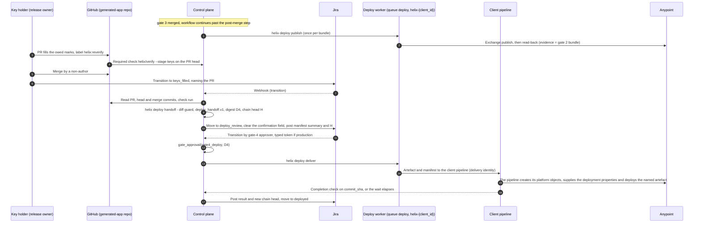

# 11 — B6: Deploy interface (sketch)

> Standalone revision, 2026-10-12: the deploy interface is now the hand-off contract between Helix and the client's deployment pipeline, and every mechanism that built on Meridian's promotion, comparison, captures or state is withdrawn or marked "To design (optional adapter)".

B6 is not built in this phase. This file fixes two things: what B1–B5 reserve so deploy remains open, and what Helix hands to the client's deployment pipeline once a pull request is merged. The reference standard (`docs/mulesoft-development-standards.md`, *Build and deployment configuration*; STD-BLD-01 in `docs/architecture/standards-bundle-mapping.md`) says shared environments are deployed only through the client's CI/CD pipeline, so Helix core deploys nothing and creates no platform object. Any future Meridian integration is optional, version-pinned, adapter-bound, and must not alter B1–B5 standalone behavior.

## 1. Purpose and scope

Sub-phase **B6**. Scope: the deploy worker class and the `helix deploy` CLI it reserves, gate 4's placement, the Exchange publish, the key-holder step and the hand-off contract: what Helix provides at merge (the names per environment, the keys owed per environment, the deployment property keys, and the validation and test evidence). It also covers confirming deploy-only scope names before any deploy credential exists, and the B1–B5 invariant that nothing holds a deploy-capable credential. Out of scope: anything B6 would size, schedule or operate. Not core, and so not designed here: platform objects, post-deploy estate reads, drift comparison, environment promotion, inventory and deployment captures (3.6, 3.7).

**Binding part and B6 sketch** `[LLD]`. Only these parts bind B1–B5: 3.1 (what B1–B5 reserve), 3.11 (the invariant and its doctor sub-checks), section 4 (the open questions), the B1–B5 rows of section 5, guards 1–3 and 6–8 (guards 4, 5, 24 and 25 were binding and are withdrawn), and the "B1–B5 must reserve" rows of open item 8. Sections 3.2 to 3.10, the other rows of sections 5 and 6, and the "B6 sketch" rows of open item 8 are a **B6 sketch, not binding**. They exist to show that the reservations are enough. B6's own design may change any of them, and their identifiers are not proposed to owner files until then.

## 2. Traceability

| Source | What this file implements |
| --- | --- |
| Plan §0 rule 2, §5, §7 item 5 | Nothing in B1–B5 holds a deploy-capable credential; the doctor refuses one |
| Plan §3.1 | Deploy permission set; deploy-only scope names confirmed by B6 before any deploy credential exists (3.8) |
| Plan §3.4 | Exchange publish only after gate 2. Helix keeps no register of platform writes, so the publish carries its own evidence record (3.4; Standalone architecture decision) |
| Plan §3.6 | The publish, the key-holder step, gate 4 and the hand-off. The rest of the plan's sequence is withdrawn or to design (3.6, 3.7; section 4) |
| Plan §4 decisions 6, 8 | Release owner signs gate 4; the hand-off to the client's pipeline is the one core route (3.9) |
| Plan §6 parity | Every B6 step is a `helix deploy` sub-command (3.2) |
| HLD *Deploy sketch*, gate table row 4 | Order: publish, gate 4, hand-off; separate deploy worker class |
| HLD-P#1, #7, #8, #9, #10, #13, #14, #16, #17, #19 | Credential split; gate digest; head-commit evidence; key-holder step; publish identity; tenancy; egress; approvals as transitions; outcomes; deploy host operations |
| HLD lower bullets (review item 24) | Chain-head digest at gate 4 |
| Review item 11 | DX MCP Server publish and deploy tools are certified separately before B6 uses them |
| Standalone decisions in `docs/architecture/` | `b2-naming-and-environment-contract.md`: names, environments and the two configuration layouts. `b2-design-bundle-contract.md`: the key list and the deployment property keys. `b2-standalone-mule-validation.md`: the validation evidence, and the estate checks it defers. `standards-bundle-mapping.md`: STD-BLD-01, STD-CFG-02, STD-CFG-06, STD-SEC-01 and STD-SEC-05, which leave deployment, platform objects and keys with the client's pipeline. `plan-amendments.md` records where these replace the plan and the HLD |

## 3. Design

### 3.1 What B1–B5 reserve

| Reserved item | Reserved as | B1–B5 behaviour | Owner file | Tag |
| --- | --- | --- | --- | --- |
| Phase and CLI | `deploy` (00 §6); `helix deploy {publish,handoff,deliver,verify}` plus two admin commands (3.2). The names `plan` and `apply` stay reserved, though the design behind them is withdrawn (3.6) | Every `helix deploy` sub-command exits 2: `helix deploy is reserved for B6`. The workflow has no deploy activity | 00, 11 | `[PLAN]` parity, `[LLD]` names |
| Gate | `gate4_deploy` (00 §6) | A signal for it is refused as a gate never reached | 08 | `[PLAN]` |
| Worker class | `helix worker --class deploy` | Exits 2: `deploy worker class is reserved for B6` | 08 | `[LLD]` |
| Task queue | 08's identifier: task queue `deploy` in the client's namespace `helix-{client_id}`; under 08's fallback (one namespace), `{client_id}.deploy` (08 §3.3) | No worker polls it; the doctor checks this (3.11 d) | 08 | `[LLD]` (08; HLD deploy sketch, review item 12) |
| Logical ticket states | `keys_filled`, `deploy_review`, `deployed` | `jira.states` may not map them. `profile validate` exits 1 naming the key (02 §3.6 exit codes): `jira.states.deploy_review` and `jira.states.deployed` under 02 L12 (a key naming deploy); `jira.states.keys_filled` under 02 L4 (unknown key) | 02 | `[LLD]` |
| Profile keys | A `deploy:` block (`deploy.scope_admins`, `deploy.handoff_wait_minutes`, `deploy.handoff_done_check`); `gates.gate4_deploy.approvers`; `jira.fields.deploy_confirmation`; `jira.fields.keyholder_pr` | Must be absent. `profile validate` exits 1 naming each one. 02 L12 refuses `gates.gate4_deploy`, the `deploy:` block and `jira.fields.deploy_confirmation`, because each names deploy (ONB-34). `jira.fields.keyholder_pr` names no deploy, so it falls to L4 (unknown key). Every key in this row and the row above is also an unknown key under L4, because 02's schema sets `additionalProperties: false` on every object (02 §3.1); L12 adds the ONB-34 attribution where the key names deploy. Proposed for 02: L12 takes an explicit list of every key in this row and the row above, so each is refused under ONB-34 by name (open item 8). No deploy reference can be stored early. The B1 profile contract (`docs/architecture/b1-client-profile-and-doctor.md`, rule B1-013) today requires a non-empty `gates.deploy` owner list, which this row would refuse; the B1 contract governs until the two are reconciled (open item 20) | 02 | `[PLAN]` refusal, `[LLD]` names |
| Vault scope | `helix/{client_id}/deploy/*` (03 §3.3 naming) | No control-plane vault role and no B1–B5 identity holds a policy on it. The control-plane adapter has no path to it | 03, 11 | `[LLD]` |
| Meridian state for deploys | Withdrawn (standalone decision): this row reserved one Meridian state directory per deploy app on a deploy-class volume. Helix keeps no Meridian state, so nothing is reserved. Whether B6 needs durable state of its own is To design (open item 19) | Nothing to create or check | — | Standalone architecture decision |
| B1–B5 read-only export | Withdrawn (standalone decision): this row set Meridian's read-only switch in every credentialed child process. B1–B5 run no Meridian command, so there is nothing to switch. What keeps B1–B5 from writing to the platform is 3.11: no B1–B5 credential can | Nothing to export | — | Standalone architecture decision |
| Post-merge continuation | The ticket workflow's merge handler is one named step that B6 extends | Ends the workflow at `done` | 08 | `[LLD]` |
| Evidence the hand-off consumes | Gate 3's merged-head `build_report.v1`, with its `validation_report.v1`, and `test_report.v1`; `design_bundle.v1`'s `keys[]` with each key's `environments[]`, its `deployment_property_keys[]` and its `applications[]` with `deployed_names` and `configuration_paths` (3.10). The build report is a **baseline** for the built jar: the artefact B6 hands over is a different build, the key-holder commit's (3.10) | All of it is recorded by B1–B5 (06 §3.13; 07 §3.10; `docs/architecture/b2-design-bundle-contract.md`). Two fields are **proposals, not yet recorded**: (1) `build_report.v1` has no built-jar digest or Maven coordinates today; its `project.archive.sha256` is the source tarball (07 §3.10.1). Proposed for 07: `artefact {file, group_id, artifact_id, version, classifier, sha256}` on stage `head`. (2) `design_bundle.v1` `contract` has no Exchange group id or asset id (06 §3.13). Proposed for 06: `contract.exchange {group_id, asset_id}`; how `group_id` relates to the business group's organisation id is `[VERIFY]`. Both in open item 8 | 06, 07 | `[HLD-P#8]` `[HLD-P#9]`; the two fields `[LLD]` proposals |

Temporal mechanics B6 relies on are `[VERIFY]`: an activity scheduled onto a named task queue from the ticket workflow, and workflow versioning (`workflow.patched`) so in-flight B5 workflows can gain B6 steps.

**Sections 3.2 to 3.10 are the B6 sketch, not binding** (section 1).

### 3.2 Deploy worker class and the `helix deploy` CLI — B6 sketch, not binding

| Property | Design | Tag |
| --- | --- | --- |
| Runs | The `helix deploy` sub-commands marked *deploy worker* below, as Temporal activities on task queue `deploy` in namespace `helix-{client_id}` (08 §3.3); a terminal runs the same commands | `[PLAN]` parity, `[LLD]` |
| Never runs | An Agent SDK session, an agent sandbox, or any agent's tools | `[LLD]` |
| Queue | Task queue `deploy` in namespace `helix-{client_id}`, or `{client_id}.deploy` under 08's fallback (08 §3.3); one client per worker, never switched | `[HLD-P#13]` |
| Lifetime | Ephemeral, as HLD-P#13 has every worker. The long-lived option existed only for the withdrawn capture question (section 4, Q1) | `[HLD-P#13]` |
| Holds | The deploy apps of 3.8 and the delivery identity of 3.9, read through the `deploy` vault role; each secret is exported only to the one subprocess that needs it | `[HLD-P#1]` |
| Vault role | `deploy`, its own workload identity (auth method `[VERIFY]`, as 03 §3.3). Read on `helix/{client_id}/deploy/*`. It is not the control-plane adapter of 03 §3.3, which has no write API and no path to this scope | `[LLD]` |
| Anypoint control plane | The publish and its read-back go to the Anypoint control-plane host the client profile names, passed in the brief. The worker refuses, `FAILED`, when the brief names none, so an EU-plane client is never sent to the US host. Which `helix.yaml` key holds the host is file 02's; the earlier source, a `.env` value, is withdrawn (open item 17) | `[LLD]` |
| Never holds | A secure-properties key (`secure.key`) of any environment. No Helix process encrypts or decrypts: the key holder encrypts the values, and the client's pipeline supplies the key as a protected deployment property (reference standard, *Secure key clarification*; STD-SEC-01, STD-SEC-05) | `[LLD]`, extending plan §5 ("no agent holds a key") |
| Storage | The deploy worker runs on a deploy-class host, separate from the control-plane host, and never mounts the control-plane host's `$HELIX_STATE_ROOT` (08 §3.2). Mounts: the activity workdir `/work/{phase_attempt_id}/` and its own attempt spool directory, as 08 §3.4 gives agent hosts. Run artefacts travel through the spool: the control plane stages the bundle, the publish record and the manifest into `in/` with their SHA-256 (never a credential); the worker writes its outputs to `out/`; the control plane checks their SHA-256 and copies them into `runs/{ticket_key}/deploy/{env}/{repo_name}/` | `[LLD]` |
| Audit | The deploy worker writes no chain record, because the state root is not mounted on it. It returns its results to the control plane, which appends one `deploy_result` record per sub-command to the run's chain through `helix.audit.chain` (event type proposed to file 09). `helix audit verify` checks those records with the rest of the run's chain | `[LLD]` |
| Egress | The profile's Anypoint control plane and Exchange hosts, for the publish only; the GitHub API for delivery; the spool export; the vault, the Temporal frontend and the Helix store (PostgreSQL) endpoints | `[HLD-P#14]` |

Withdrawn (standalone decision): the rows that built a Meridian subprocess environment, cloned the repository for it, checked which connected app its cached bearer belonged to, and set its acknowledgement switch. No Meridian subprocess runs, so none of them has a replacement.

**`helix deploy`** (reserved; every sub-command exits 2 in B1–B5). Phase sub-commands take 00 §4's common flags (`--profile --ticket --run-dir --brief --out`) and write `phase_result.v1` with a `PhaseOutcome` (00 §5). A design bundle may hold several applications, exactly one `primary` (06 §3.13), so every environment-scoped sub-command also takes `--app REPO_NAME` and works on one (application, environment) pair. Outputs land under `runs/{ticket_key}/deploy/{env}/{repo_name}/` (00 §7 run artefacts); for deploy-worker sub-commands the control plane copies them there from the spool (Storage row above). `[PLAN]` parity, `[LLD]` names.

| Sub-command | Runs on (app) | Extra inputs | Outputs | Outcomes |
| --- | --- | --- | --- | --- |
| `publish` | Deploy worker (`publish`, one app with no tier; read-back under `read-nonprod`) | `--gate-approval ID` (the live gate-2 row) | `exchange_publish.v1`, once per bundle | `DONE`, `INCOMPLETE`, `FAILED` |
| `handoff --env ENV --app REPO_NAME` | Control plane | `--pr N` (from the `keys_filled` transition) | `deploy_handoff.v1` as `handoff.{n}.json`; ticket moved to `deploy_review` | `AWAITING_GATE`, `FAILED` |
| `deliver --env ENV --app REPO_NAME` | Deploy worker (the delivery identity, 3.9) | `--handoff FILE`, `--gate-approval ID` (gate 4) | `delivery.json`: mechanism, reference, time, completion signal or elapsed wait | `DONE`, `INCOMPLETE`, `FAILED`, `AWAITING_GATE` (gate 4 reopened) |
| `verify --env ENV --app REPO_NAME` | To design (3.7) | `--handoff FILE` | To design: the estate result, or `not_checked` when no estate provider is configured | To design |
| `confirm-scopes` (admin) | Any host; no credential | `--file FILE` | `deploy_scope_confirmation.v1` (3.8) | exit 0 or 1 |
| `admit-app --role R [--tier T]` (admin; no `--tier` for `publish`) | A deploy-class host, run by a platform admin | Client id and secret at a no-echo prompt | `deploy_app_verification.v1` (3.8); the secret in the vault only when admitted | exit 0 admitted, 1 refused, 2 error |
| `plan`, `apply` | Withdrawn (standalone decision): they planned and applied platform objects through Meridian's promotion runner (3.6) | — | — | Exit 2, like every other `helix deploy` name |

### 3.3 Sequence (one pass per application and target environment) — B6 sketch, not binding



Order is `[PLAN]` §3.6 and the HLD sketch, less the steps this revision withdraws. Helix makes one platform write, the Exchange publish, after gate 2 (3.4). The hand-off delivery comes after gate 4 `[LLD]`, and every write that follows it is the client pipeline's. The chain-head digest is posted at gate 4 `[HLD-P lower]`.

**Target environments and order** (Standalone architecture decision). The target list is the environments named in the design bundle's `applications[].deployed_names` (file 06), in the naming contract's order: its `environments[].order` (`docs/architecture/b2-naming-and-environment-contract.md`, *Environment rules*). A pass for an environment needs a `DONE` pass for its predecessor in that list on the same `merge_commit_sha`. A hand-off that breaks this is refused, `FAILED`. A B1–B5 bundle lists only non-production environments (`PRODUCTION_ENVIRONMENT_REFUSED`), so how a production target's names and owed keys reach the hand-off is To design (open item 13); production is never the first target.

**Applications and order** `[LLD]`. Each application in `applications[]` gets its own pass per environment and its own manifest. Within an environment, a called application goes before its caller: `system`, then `process`, then `experience` (the bundle's `role`, 06 §3.13). A hand-off whose application's callees have no `DONE` pass in that environment in the same run is refused, `FAILED`. The contract is committed in the integration's repository, which holds every application of the integration, the primary at its root (06 §3.14), so the publish reads it there and runs once per bundle, before any application's first pass.

### 3.4 Exchange publish (the one platform write) — B6 sketch, not binding

Helix keeps no register of platform writes and asks for no captured request as proof, so the publish's evidence is its own record, `exchange_publish.v1` (Standalone architecture decision). Command: `anypoint-cli-v4 exchange:asset:upload` `[VERIFY flags and auth mode]`. The DX MCP Server's publish tool is used only if a B6 spike certifies it headless with a stated auth mode `[LLD]` (review item 11) `[VERIFY]`. The publish runs on the deploy worker under the `publish` app (3.8; one app, no tier, because an Exchange asset belongs to the business group, not to an environment) `[HLD-P#10]`. Whether Helix or the client's pipeline should make this write is an owner question (section 4, Q4).

**Read-back and idempotence** `[LLD]`. After the upload, the `read-nonprod` app reads the version back with `anypoint-cli-v4 exchange:asset:describe` `[VERIFY]`. That sets `result.confirmed_by_read`. Before uploading, the same read is made. If the version already exists, its contract file is downloaded `[VERIFY command]` and compared by SHA-256. Equal gives `DONE` with `result.already_present: true` and no write. Different gives `FAILED`.

Its approval evidence is its own, recorded as `exchange_publish.v1` in the run directory and in the audit chain `[LLD]`:

| Field | Type | Constraint |
| --- | --- | --- |
| `schema` | string | `"exchange_publish.v1"` |
| `run_id`, `client_id`, `ticket_key` | string | 00 §6 formats |
| `asset` | object | `group_id`, `asset_id`, `version` (semver string). `group_id` and `asset_id` equal the bundle's proposed `contract.exchange {group_id, asset_id}` (3.1; open item 8, owner 06); `version` equals the bundle's `contract.version`. Until 06 accepts the field, the publish has no source for them and refuses, `FAILED` |
| `contract` | object | `path` (the bundle's `contract.path`, repo-relative in the integration's repository, 06 §3.14), `sha256` (64 hex) at `merge_commit_sha` |
| `approval` | object | `gate: "gate2_design"`; `gate_approval_id`; `digest` = the row's `decided_digest`, the SHA-256 of the `design_bundle.v1` file (08 §3.9); `bundle_path` = the row's `subject_ref`. The bundle at `bundle_path` must hash to `digest`, and its `contract.sha256` (06) must equal `contract.sha256` here |
| `merge_commit_sha` | string | 40 hex; gate 3's merge in the integration's repository |
| `method` | enum | `anypoint_cli`, `dx_mcp` |
| `argv_redacted` | string[] | The command, with no secret |
| `result` | object | `exit_code` (int); `confirmed_by_read` (bool: the read-back saw the version); `already_present` (bool) |
| `published_at` | string | RFC 3339 UTC |

```json
{"schema":"exchange_publish.v1","run_id":"acme-retail.ACME-123","client_id":"acme-retail","ticket_key":"ACME-123",
 "asset":{"group_id":"acme-group","asset_id":"acme-order-sapi","version":"1.0.0"},
 "contract":{"path":"src/main/resources/api/acme-order-sapi.yaml","sha256":"9f2c…e1"},
 "approval":{"gate":"gate2_design","gate_approval_id":"ga-0007","digest":"4b1a…77",
  "bundle_path":"runs/ACME-123/design/1/design-bundle.json"},
 "merge_commit_sha":"3e5d…a0","method":"anypoint_cli","argv_redacted":["exchange:asset:upload","…"],
 "result":{"exit_code":0,"confirmed_by_read":true,"already_present":false},"published_at":"2026-10-08T10:00:00Z"}
```

**Precondition** `[HLD-P#7]` `[LLD]`: the bundle check in the `approval` row above. A reviewer edit to the contract before merge is caught earlier: stage `head` of `helix/verify` compares the head's contract with the same bundle entry (07's check SC7, `DESIGN_ARTEFACT_CHANGED`) and fails the required check, which reopens gate 2 (08 `invalidated_reason: design_edited`) `[HLD-P#8]`. After merge, the check can only have been bypassed. The publish is then refused, `FAILED`, and a corrected contract needs the ticket reopened (re-entry at Discover, 08 G12) or a new ticket `[LLD]`. A rejected design therefore never leaves an asset version behind `[PLAN]`.

### 3.5 Gate 4 placement and the typed confirmation — B6 sketch, not binding

| Rule | Design | Tag |
| --- | --- | --- |
| Subject | One `deploy_handoff.v1` manifest per (application, target environment) (3.10). The gate digest is the manifest's SHA-256 (canonical JSON: sorted keys, no whitespace, UTF-8) | `[HLD-P#7]` (gate 4 approves the artefact checksum), `[LLD]` (the manifest) |
| Channel | A Jira transition into the client's status mapped from `deploy_review`'s exit, by an actor in `gates.gate4_deploy.approvers`; never comment text | `[HLD-P#16]` |
| Typed token | When the target is a production environment (`NamingContract.is_production(environment_key)`), the typed value must equal `"APPLY-"` plus the sorted upper-case environment keys joined by `-`, for example `APPLY-PROD`. Helix computes the expected value itself. Non-production: the transition alone | `[PLAN]` typed confirmation; the token's form `[LLD]` |
| Token placement | Typed into the transition's `deploy_confirmation` field (`jira.fields.deploy_confirmation`), never into a comment | `[LLD]` `[HLD-P#16]` |
| Stale token | A custom field keeps its value on the issue, so a later transition could carry the previous round's token. The control plane clears the field each time the ticket enters `deploy_review`. It accepts the token only when the gate transition's own changelog entry set the field; a value present on the issue but not set by that transition is refused | `[LLD]`; changelog read over REST `[VERIFY]` |
| Jira mechanics | A text field on a transition screen, readable over REST; clearing it by REST | `[VERIFY]` |
| Separation | The approver is not the gate-3 merger and not the requester. A waiver follows the profile's pilot rule (02 `gates.waiver`) and is recorded | `[LLD]`, extending HLD-P#7 (which states separation for gates 1–3) |
| Before any delivery | `deploy deliver` refuses to start without an accepted `gate_approval` row for `gate4_deploy` whose digest equals the manifest now on disk. A manifest that changed after approval invalidates the row (08) and reopens gate 4, with nothing delivered | `[PLAN]` before the write, `[HLD-P#7]` digest |

Withdrawn (standalone decision): the rows that re-computed Meridian's platform plan and inventory digest before a write, required its `apply` step to end before delivery, and passed the typed token on to Meridian's own confirmation check.

### 3.6 Platform objects — withdrawn

Withdrawn (standalone decision): this section created API instances, policies, MQ destinations, client applications and contracts through Meridian's promotion runner, with its preflight, dry run, capture gate, secret sink and run log. Helix core creates no platform object and stores no client-application secret. Under the reference standard the client's pipeline creates API Manager resources and queues (STD-CFG-06) and deploys every shared environment (STD-BLD-01).

To design (optional adapter): if a client wants Helix to plan or apply platform objects after gate 4, that enters only through an optional, version-pinned adapter with its own contract tests. The hand-off of 3.10 works with none installed (open item 14).

### 3.7 Post-deploy confirmation — withdrawn

Withdrawn (standalone decision): this section confirmed a deploy with Meridian's assertions, its runtime report for artefact identity and its API security baseline. All three are reads of the client's estate, which is not core.

To design (optional estate provider): after the pipeline's completion signal, B6 should be able to confirm that the named artefact is running under the manifest's deployed name and that its API is protected. An optional estate provider or adapter may supply those reads. With none configured the estate is recorded as `not_checked`, never as a pass, and the completion signal is the only confirmation Helix has (open item 15).

### 3.8 Deploy credentials, scope confirmation and app verification — B6 sketch, not binding

One connected app per client per Anypoint-using activity `[HLD-P#10]`. Production and non-production use separate apps, so a role that reads an environment has a `prod` and a `nonprod` tier `[LLD]`; `read` keeps both, though the publish read-back needs only `read-nonprod`. `publish` is one app with no tier: an Exchange asset belongs to the business group, not to an environment, and `deploy publish` takes no `--env` `[LLD]`. Exact scope names are `[VERIFY]` for every row: the plan says they were never enumerated.

| Role | Used by | Permissions as the plan names them (§3.1), or reads the checks need |
| --- | --- | --- |
| `publish` (no tier) | `deploy publish` | Exchange Contributor |
| `read` | The publish read-back (under `read-nonprod`) | Exchange Viewer. Any estate read beyond it belongs to an optional estate provider, which would name its own grants (3.7) |
| `objects` | Withdrawn (standalone decision): it served Meridian's promotion runner (3.6) | None. Helix core holds no API Manager or Anypoint MQ manage grant, in B6 as in B1–B5 |
| `app` | Withdrawn (standalone decision): it served the registered CloudHub 2.0 write (3.9) | None. Helix core holds no Runtime Manager or Design Center grant |

**Step 1, before any app exists: `deploy_scope_confirmation.v1`** `[PLAN]` (plan §3.1: confirmed "before any deploy credential exists"), record `[LLD]`. Written by `helix deploy confirm-scopes`, run by a platform admin listed in `deploy.scope_admins` (B6, reserved). It holds names only: no app and no secret exists yet.

| Field | Type | Constraint |
| --- | --- | --- |
| `schema` | string | `"deploy_scope_confirmation.v1"` |
| `confirmation_id` | string | `{client_id}.scopes.{n}`, `n` from 1 |
| `client_id` | string | 00 §6 |
| `roles[]` | object[] | `role` (`publish`, `read`); `tier` (`prod`, `nonprod`; null for `publish`); `environments` (env keys: only production environments for `prod`; no production environment for `nonprod`; empty for `publish`); `scopes` (exact platform names, non-empty); `source` (required): a **platform read**, `{kind: "platform_read", via: "console" or "api", read_at: RFC 3339}`, meaning the scope catalogue Access Management showed to the admin's own session `[VERIFY]` where and how; `context` (optional string, for example a documentation page and its date). Documentation alone never satisfies `source` |
| `confirmed_by` | string | Actor id (`jira:{accountId}`) in `deploy.scope_admins` |
| `confirmed_at` | string | RFC 3339 UTC |

```json
{"schema":"deploy_scope_confirmation.v1","confirmation_id":"acme-retail.scopes.1","client_id":"acme-retail",
 "roles":[{"role":"read","tier":"nonprod","environments":["DEV","SIT","UAT"],
   "scopes":["acme-scope:view-assets"],
   "source":{"kind":"platform_read","via":"console","read_at":"2026-10-08T08:40:00Z"},
   "context":"Access Management docs, 2026-10-01"}],
 "confirmed_by":"jira:5f…aa","confirmed_at":"2026-10-08T09:00:00Z"}
```

Scope strings in fixtures are placeholders; real names are `[VERIFY]`.

**Step 2, after the admin creates each app: `deploy_app_verification.v1`** `[LLD]`. Written by `helix deploy admit-app --role R [--tier T]` (no `--tier` for `publish`), which the admin runs on a deploy-class host. The admin types the client id and secret at a no-echo prompt. Until admission the secret exists only in the admin's Anypoint session and that process's memory: never in the Helix store, a file, a log, or any B1–B5 process. The command reads the app's granted scopes back from Access Management `[VERIFY]`, then makes each negative test. It writes the record. Only when the granted scopes equal step 1's `scopes` for that role and tier, and every negative test was refused, does it write the secret to `helix/{client_id}/deploy/apps/{role}-{tier}` (`apps/publish` for `publish`), using the admin's own vault identity `[VERIFY auth]`. Otherwise it discards the secret and exits 1.

| Field | Type | Constraint |
| --- | --- | --- |
| `schema` | string | `"deploy_app_verification.v1"` |
| `verification_id` | string | `{client_id}.app.{role}-{tier}.{n}`; `{client_id}.app.publish.{n}` for `publish` |
| `client_id`, `confirmation_id` | string | `confirmation_id` names the latest step-1 record |
| `role`, `tier` | enum | As step 1; `tier` null for `publish` |
| `app_client_id` | string | The connected app's client id; never the secret |
| `granted_scopes` | string[] | Read back from Access Management |
| `negative_tests[]` | object[] | At least one per app: `role`, `client_id`, `request` (method plus path template), `expected_status` (int[]), `observed_status` (int), `at` (RFC 3339) |
| `result` | enum | `admitted`, `refused` |
| `secret_version` | int or null | The vault version written; null when refused |
| `verified_by`, `verified_at` | string | Actor id in `deploy.scope_admins`; RFC 3339 UTC |

```json
{"schema":"deploy_app_verification.v1","verification_id":"acme-retail.app.read-nonprod.1","client_id":"acme-retail",
 "confirmation_id":"acme-retail.scopes.1","role":"read","tier":"nonprod","app_client_id":"acme-ca-0001",
 "granted_scopes":["acme-scope:view-assets"],
 "negative_tests":[{"role":"read","client_id":"acme-ca-0001",
   "request":"GET /amc/application-manager/api/v2/organizations/{orgId}/environments/{envId}/deployments",
   "expected_status":[401,403],"observed_status":403,"at":"2026-10-08T09:30:00Z"}],
 "result":"admitted","secret_version":1,"verified_by":"jira:5f…aa","verified_at":"2026-10-08T09:31:00Z"}
```

The negative test shown reads production deployments under a non-production app, as file 02's ONB-18 probe does.

**Storage and use** `[LLD]`. Both records go to append-only helix-store tables `deploy_scope_confirmation` and `deploy_app_verification`, with `client_id` row-level security (00 §7), plus one chain record each. Before reading a deploy secret, the deploy worker requires an `admitted` verification whose `secret_version` equals the vault's current version and whose `confirmation_id` is the latest step-1 record. Otherwise `FAILED`.

### 3.9 Decision 8 route: the hand-off — B6 sketch, not binding

The hand-off to the client's own pipeline is the one core route. It was the plan's default for decision 8, and the reference standard makes it the rule: shared environments are deployed only through CI/CD (STD-BLD-01). Standalone architecture decision.

| | Hand-off to the client's pipeline |
| --- | --- |
| Who deploys the application | The client's existing pipeline |
| Who creates platform objects | The client's pipeline (STD-CFG-06). Helix creates none (3.6) |
| Helix credentials | `publish`, `read` for the publish read-back, and the delivery identity |
| Delivery identity | A B6 GitHub App, separate from the B1–B5 git writer's App, installed with only what the client's delivery mechanism needs `[VERIFY]`. Held under `helix/{client_id}/deploy/github/*`. Deploy-capable by definition (3.11) `[LLD]` |
| What Helix delivers | The staged jar and its `deploy_handoff.v1` manifest (3.10), nothing else |
| Deployment properties and the secure key | The client's pipeline supplies every key in `deployment_property_keys[]`, the environment's `secure.key` among them, as it does today `[VERIFY]` per client. Under layout `deployment_properties` it also supplies every environment's values above the lowest (3.10) |
| Completion signal | A check run or commit status named by `deploy.handoff_done_check` (B6, reserved) on `source.commit_sha`, posted by the client pipeline and read by the control plane `[VERIFY]`. If `deploy.handoff_wait_minutes` (B6, reserved) elapses first: `INCOMPLETE`, with the elapsed minutes posted `[LLD]` |
| Confirmation | The completion signal. The estate is `not_checked` unless an estate provider is configured (3.7) |
| For whom | Every client with a pipeline. A client with none is out of scope (section 4, Q3, owner decision 2026-10-14) |

Withdrawn (standalone decision): route R, a registered CloudHub 2.0 write made by the deploy worker under Meridian's capture gate, with its `app` connected apps and its read-only repository identity. Helix core never deploys an application.

### 3.10 Key-holder step and hand-off contract: `deploy_handoff.v1` — B6 sketch, not binding

**What Helix provides at merge** (Standalone architecture decision). Everything in this table exists when gate 3 merges. B1–B5 produce it without any platform access, and it is all the key holder and the client's pipeline receive from Helix.

| Provided | Where it is | How it is made | Governing document |
| --- | --- | --- | --- |
| Names per environment | `design_bundle.v1` `applications[]`: `repository_name`, `deployed_names {ENV: name}`, `configuration_paths {ENV: …}` | Rendered and parsed back by `helix.naming` under the staged `naming_contract.v1`; bound by `naming_contract_digest` | `b2-naming-and-environment-contract.md`; 06 §3.13 |
| Keys owed per environment | `design_bundle.v1` `keys[]` of class `env_specific` and `secret`, each with its `environments[]`; in the repository as `${HELIX_SET_<E>}` and `${HELIX_ENCRYPT_<E>}` marks; in the PR body's *Values owed after merge* table | Helix renders every property file from the approved key list. There is no `prepare` step | `b2-design-bundle-contract.md`; 07 §3.4.4, §3.8.5 |
| Deployment property keys | `design_bundle.v1` `deployment_property_keys[]`; listed in the PR body; `build_report.v1` `properties.deployment_properties_declared[]` | Declared in the bundle only: written to no file and to no profile | `b2-design-bundle-contract.md`; 07 §3.4.4 |
| Validation and test evidence | `validation_report.v1` inside `build_report.v1`; `test_report.v1`; the `helix/verify` check run on the merged head; `pr_provenance.v1` with its `merge_facts` | `helix validate` and `helix verify`, with the codes of 07 §3.4.4 | `b2-standalone-mule-validation.md`; 07 §3.6, §3.10 |
| The approved design and its approvals | The committed contract, HLD, LLD and `docs/design/design-bundle.json`; the gate digests in `pr_provenance.v1.gates[]`; the chain head | Gate 2's digest; the Helix-owned audit chain | 06, 08, 09 |

**Where the environment values live** depends on the naming contract's `configuration.layout` (`b2-naming-and-environment-contract.md`, *Layout*):

| | `environment_files` | `deployment_properties` |
| --- | --- | --- |
| Marks in the merged repository | On every owed cell of every environment's plain and secure file | For the lowest environment E1 only: `${HELIX_SET_<E1>}` in the base file, `${HELIX_ENCRYPT_<E1>}` in the one secure file |
| The key holder fills, by a PR | The target environment's plain and secure files | E1's marks, once |
| The client's pipeline supplies | The keys in `deployment_property_keys[]`, the environment selector and `secure.key` among them | The keys in `deployment_property_keys[]`, and every other environment's value for every environment-specific and secret key, as deployment properties; never in the repository |
| Paths allowed in the key-holder diff | `configuration_paths(ENV).environment` and `.secure_environment` of target-list environments | The base file and the secure file |
| `properties[].source` in the manifest | `file` | `file` for E1; `deployment_property` for every other environment |

The key-holder step `[HLD-P#9]`: after merge, the release owner (decision 6) fills each `${HELIX_SET_<E>}` and `${HELIX_ENCRYPT_<E>}` mark the layout leaves in the repository. ENCRYPT values become `![...]` ciphertext made with that environment's key, which no Helix process holds `[LLD]`, extending plan §5.

**Deployment-property keys** `[LLD]`. The bundle's `deployment_property_keys[]` (06 §3.10, §3.13: keys with `class: deployment`) are in no file: they are supplied at deploy time. They include `secure.key` and, under `environment_files`, the environment selector that 07's global configuration reads (`{build.env_property}`, 07 §3.4.4). The manifest still carries each one, with `source: deployment_property` and no value, so the key set equals the bundle's list. The client's pipeline sets them. They are outside the diff guard, because no file changes. The autodiscovery API id is one of them (open item 4): it exists only after the pipeline creates the API instance. How Helix learns that the pipeline set a key is `[VERIFY]` per client; until confirmed, the result is `INCOMPLETE` for that key (section 5).

**Trigger and check** `[LLD]`:

1. The key holder opens the PR and adds the re-verify label `helix:reverify`, a fixed name with no profile key (03 §3.9.2; 02 §3.4). `helix:review-ready` is the App's to set, never a person's (03 §3.9.2). The branch follows the standards bundle's `review.branch_pattern`, as every branch in the client's repository does. **Routing**: the receiver turns the label event into a `pr_reverify` for the ticket's workflow, as 03 §3.4.6 maps it. The control plane starts `helix verify --stage keys --env ENV` instead of 07's `--stage head` only when that workflow is in phase `deploy` (past gate 3, not yet `deployed`) and the PR is a key-holder PR. How it tells a key-holder PR from any other is To design: the earlier rule matched a fixed branch name, which the branch pattern replaces (open item 16). A re-verify label on any other PR keeps 07's routing (07 §3.8.7). `--stage keys` is B6, reserved; file 07 owns `helix verify`. It runs on the head, in a fresh container with no agent. It builds the jar (`mvn -B clean package`), applies the diff guard below, and runs `helix validate` with a **`keys` verdict**. To design (open item 12): in the files the key holder fills, an owed cell passes when it holds a value, or a `![...]` token for a secret, and any mark left fails; every other environment keeps 07's mark rule, and every other finding fails as in 07. Today `helix validate` has only 07's rule, under which a filled owed cell is `MARKER_POLICY_VIOLATION`. The control plane stages the jar at `runs/{ticket_key}/deploy/{env}/{repo_name}/` with its SHA-256. Branch protection requires `helix/verify` before merge (07 GH4) `[HLD-P#8]`.
2. A non-author merges. The merge commit's tree must equal the verified head's tree (07's evidence identity) `[HLD-P#8]`.
3. The key holder moves the ticket to `keys_filled`, naming the PR in `jira.fields.keyholder_pr`. A transition by an actor outside `gates.gate4_deploy.approvers` is refused, as 08's actor check does.
4. The control plane reads the PR, its head and merge commits and the check run over the GitHub REST API `[VERIFY]`. A merged PR whose head lacks a `helix/verify` success means branch protection was bypassed: the signal is refused and the control plane posts what is missing (section 5). Otherwise it runs `deploy handoff`.

**Diff guard** `[LLD]`: `git diff --name-only merge_commit_sha..X` lists only allowed paths (layout table above), where `X` is the PR head in the check (step 1) and `keyholder_merge_sha` in `deploy handoff`. In each changed file, every changed line only replaces a mark: a SET mark with a value, or an ENCRYPT mark with a `![...]` token. The files the key holder fills must hold no mark. Anything else gives `FAILED`, and the offending paths are posted. Paths are repo-relative; for an application other than the primary they lie under its own directory in the integration's repository (06 §3.14). The paths are recorded in `source.diff_paths[]`. Deployment-property keys are not checked here, since they live in no file.

One manifest per (application, environment) `[LLD]`:

| Field | Type | Constraint |
| --- | --- | --- |
| `schema` | string | `"deploy_handoff.v1"` |
| `handoff_id` | string | `{run_id}.handoff.{n}`, `n` from 1 |
| `run_id`, `client_id`, `ticket_key` | string | 00 §6 |
| `target_env` | string | An environment key of the staged `naming_contract.v1`, and in the target list (3.3) |
| `route` | enum | `handoff` |
| `source` | object | `repository` (`owner/name`); `merge_commit_sha` (gate 3's merge, the diff base); `commit_sha` (the key-holder PR head that `helix/verify` verified); `keyholder_merge_sha` (its merge commit, same tree); each 40 hex. `diff_paths[]` (repo-relative) |
| `artefact` | object | `file`; `group_id`, `artifact_id`, `version`; `sha256` (64 hex); `built_by_check` (check-run id on `commit_sha`); `staged` (run-directory path); `location` {`store`: `github_release`, `exchange`, `nexus`; `ref`: asset name or coordinates} `[VERIFY]` per client. The pipeline deploys exactly these bytes |
| `runtime` | object | `mule_version` (4.9.x patch, never `4.9.0`), `java: "17"` `[PLAN]` |
| `application` | object | `repo_name` (the bundle's `repository_name`; parses under `NamingContract.parse_repository`), `role` (`system`, `process`, `experience`), `primary` (bool), `deployed_name` (the bundle's `deployed_names[target_env]`, which equals `NamingContract.render_deployed(parts, target_env)`). One application per manifest |
| `exchange_asset` | object | Equal to `exchange_publish.v1` `asset` |
| `properties[]` | object[] | `key`; `source` (`file`, `deployment_property`); `file` (repo-relative; null for `deployment_property`); `kind` (`plain`, `set`, `encrypt`; null for `deployment_property`); `filled` (bool; true for every `file` entry); `filled_by` (`client_pipeline`; only for `deployment_property`). No value is ever carried. The key set equals the design bundle's list for this application and `target_env`, deployment-property keys included |
| `key_holder` | object | `actor_id`, `pr_number`, `keys_verdict` (the `keys` verdict of step 1; must be `pass`) |
| `approvals` | object | `gate2_digest`, `gate3_merge_commit_sha`, `gate3_artefact_sha256`: the proposed `build_report.v1` `artefact.sha256` of the baseline build (3.1; owner 07, open item 8). Null until 07 accepts that field |
| `chain_head` | string | 64 hex: the hash of the last record of the run's latest sealed segment of the Helix audit chain when the manifest is written (`audit_segment.head_hash`, 09 §3.3) |
| `created_at` | string | RFC 3339 UTC |

```json
{"schema":"deploy_handoff.v1","handoff_id":"acme-retail.ACME-123.handoff.1","run_id":"acme-retail.ACME-123",
 "client_id":"acme-retail","ticket_key":"ACME-123","target_env":"UAT","route":"handoff",
 "source":{"repository":"acme-org/acme-order-sapi","merge_commit_sha":"3e5d…a0","commit_sha":"7c19…4b",
  "keyholder_merge_sha":"8d20…5c","diff_paths":["src/main/resources/config/config-uat.yaml"]},
 "artefact":{"file":"acme-order-sapi-1.0.0-mule-application.jar","group_id":"acme-group","artifact_id":"acme-order-sapi",
  "version":"1.0.0","sha256":"d04e…9a","built_by_check":"cr-5512","staged":"runs/ACME-123/deploy/UAT/acme-order-sapi/",
  "location":{"store":"github_release","ref":"acme-order-sapi-uat-handoff-1"}},
 "runtime":{"mule_version":"4.9.4","java":"17"},
 "application":{"repo_name":"acme-order-sapi","role":"system","primary":true,"deployed_name":"acme-order-sapi-uat"},
 "exchange_asset":{"group_id":"acme-group","asset_id":"acme-order-sapi","version":"1.0.0"},
 "properties":[{"key":"acme.db.host","source":"file","file":"src/main/resources/config/config-uat.yaml","kind":"set",
   "filled":true},
  {"key":"acme.api.id","source":"deployment_property","file":null,"kind":null,"filled":false,"filled_by":"client_pipeline"}],
 "key_holder":{"actor_id":"jira:5f…21","pr_number":42,"keys_verdict":"pass"},
 "approvals":{"gate2_digest":"4b1a…77","gate3_merge_commit_sha":"3e5d…a0","gate3_artefact_sha256":"c2a7…10"},
 "chain_head":"aa90…3c","created_at":"2026-10-08T11:00:00Z"}
```

The example shows layout `environment_files`. The Mule version, classifier, file name, store and reference shown are illustrative `[VERIFY]`; the deployment-property key name is a placeholder. Delivery (`deploy deliver`) happens only after gate 4 `[LLD]`: the B6 GitHub App puts the staged jar at `artefact.location` with the manifest beside it, by a release asset, a dispatch event or a ticket attachment, per client `[VERIFY]`.

Withdrawn (standalone decision): the manifest fields that carried Meridian's platform plan, its inventory digest and the connected-app ids its subprocesses acted under; the mark kind and property source that came from Meridian's `prepare` and inventory; and the choice between filling files and filling inventory rows, which the layout table replaces.

### 3.11 Invariant: no deploy-capable credential in B1–B5

Definition `[LLD]`, worded as 02's ONB-34: a deploy-capable credential is any Anypoint credential granting Runtime Manager create, deploy or write; API Manager or Anypoint MQ manage or write; Design Center Developer; or any grant in a production environment. A Runtime Manager read alone is not deploy-capable. Exchange Contributor counts too once HLD-P#10's test shows Viewer is enough. So does the secure-properties key (`secure.key`) of a production environment (sub-check h). So does any identity whose event alone starts a client pipeline's deploy; the B6 delivery identity is one, and it lives only in the deploy scope. Doctor check ONB-34, *No deploy-capable credential* (02 §3.8) `[PLAN]`. Sub-checks c, d and g extend ONB-34 beyond 02's text; they are proposed for 02 to adopt (open item 8). The letters are kept so other files' references still resolve:

| Sub-check | Refused when | Tag |
| --- | --- | --- |
| a | Any B1–B5 connected app's granted scopes, read from Access Management `[VERIFY]`, exceed the Exchange grant or name a production environment | `[PLAN]` |
| b | The profile holds any key 02 L12 refuses, including the `deploy:` block, or any other key 3.1 reserves (02 L4 today; L12 once 02 takes the explicit list) | `[PLAN]` |
| c | A B1–B5 identity or a control-plane vault role (`receiver`, `control`, `broker`, `gateway`, `mavenproxy`) can list or read `helix/{client_id}/deploy/*` `[VERIFY vault ACL query]` | `[LLD]` |
| d | A poller is attached to task queue `deploy` in namespace `helix-{client_id}`, or to `{client_id}.deploy` under 08's fallback (08 §3.3) `[VERIFY]` | `[LLD]` |
| e | Withdrawn (standalone decision): it proved that the B1–B5 Meridian export was read-only. B1–B5 run no Meridian command | Standalone architecture decision |
| f | Withdrawn (standalone decision): it kept the B1–B5 Meridian state directory apart from the deploy one. Neither directory exists | Standalone architecture decision |
| g | The client's onboarding answer says their pipeline deploys on an event a B1–B5 identity (the git writer's App, the Jira bot) can cause alone: push, tag or release | `[LLD]` |
| h | Withdrawn (standalone decision) as written: it looked for Meridian's secure-key variable and keyring entry. The need stays: no B1–B5 process holds the secure-properties key of a production environment. How the doctor checks that is To design (open item 18) | Standalone architecture decision |
| i | Withdrawn (standalone decision): it kept Meridian's deploy state directory off the control-plane host. No such directory exists | Standalone architecture decision |

Exit: 1 with each refused sub-check named; every phase refuses to start on that profile (00 §5 `FAILED`).

## 4. Open questions for B6 (not decided)

**Q1. Captures: a long-lived machine, or a capture store that travels?** Withdrawn (standalone decision): the question existed only because Meridian blocks a registered write until a person has captured it on that machine. Helix registers no writes and keeps no captures.

**Q2. Inventory rows from the LLD, or skip A10?** Withdrawn (standalone decision): the question existed only because Meridian's runner reconciles from inventory files and one of its assertions compares the committed configuration with a template render. Helix has no inventory and no template render; it renders every property file from the approved key list (07 §3.4.4).

**Q3. A client with no deployment pipeline.** The withdrawn route R was the plan's answer for such a client. The standalone design has none: the reference standard assumes a pipeline. The owner decides whether that client is out of scope or gets an optional adapter that deploys (3.6). **Owner decision, 2026-10-14:** out of scope. Helix requires a client deployment pipeline, as the reference standard does; a deploying adapter is not designed.

**Q4. Who publishes the contract to Exchange?** This sketch keeps the plan's answer: Helix, after gate 2 and merge, as its one platform write (3.4). The reference standard has the pipeline create platform resources, and under the standards bundle's `api.contract_source: exchange_dependency` (standards mapping decision D2) the specification must be in Exchange before the build, which no B1–B5 identity can do. The owner decides whether the publish stays with Helix in B6 or moves to the client's pipeline. **Owner decision, 2026-10-14:** the client's pipeline publishes it, as the reference standard has the pipeline create platform resources. Helix delivers the approved contract in the pull request and makes no platform write; under `api.contract_source: exchange_dependency` the client publishes the contract before the build starts.

## 5. Errors and exits (B6; `deploy` outcomes use 00 §5)

`INCOMPLETE` is kept for "a required check could not run" (00 §5). A real negative result is `FAILED` `[LLD]`; open item 5 proposes a distinct outcome.

| Failure | PhaseOutcome | Exit | Posted on the ticket |
| --- | --- | --- | --- |
| B1–B5: `helix worker --class deploy` or any `helix deploy` sub-command | `FAILED` | 2 | Nothing; CLI error |
| B1–B5: a reserved deploy key in the profile (3.1) | `profile validate` names it (L12, or L4 for keys naming no deploy); a phase CLI refuses to start, `FAILED` | Validate: 1 (02 §3.6). Phase: 2 | Nothing; the validate line names the key |
| B1–B5: an ONB-34 sub-check refused (3.11) | Doctor finding; every phase refuses to start on that profile, `FAILED` | Doctor: 1. Phase: 2 | Nothing; the doctor names each refused sub-check |
| Contract edited on the PR head before merge | `helix/verify` fails; gate 2 reopens (08 `design_edited`); `AWAITING_GATE` | 1 | Which file changed, both digests |
| Contract at `merge_commit_sha` differs from the gate-2 bundle (check bypassed) | `FAILED` | 2 | Both digests; reopen the ticket or raise a new one |
| The brief names no Anypoint control-plane host at `deploy publish` | `FAILED`, nothing sent | 2 | The missing field |
| Publish command fails | `FAILED` | 2 | Exit code, redacted command |
| Publish exit 0, but the read-back does not see the version | `FAILED` | 2 | "Not confirmed by read", the read's status |
| Read-back could not run (read app refused, Exchange unreachable) | `INCOMPLETE` | 1 | The cause |
| Version already in Exchange, contract SHA-256 equal | `DONE` | 0 | "Already published"; no write |
| Version already in Exchange, contract differs | `FAILED` | 2 | Both digests |
| Bundle has no `contract.exchange` (06 not yet extended) at `deploy publish` | `FAILED` | 2 | The missing field |
| `keys_filled` names a PR that is not merged, or whose head lacks a `helix/verify` success (protection bypassed) | Signal refused; workflow keeps waiting; no check is started | 1 | What is missing |
| `--stage keys`: a mark left in the files the key holder fills, or any other failing validation finding | `helix/verify` fails on the head; the PR cannot merge | 1 | The findings, by key and environment |
| Diff guard: a disallowed path or line in the key-holder change | `FAILED` | 2 | The offending paths |
| Predecessor environment has no `DONE` pass, or a called application has no `DONE` pass in this environment | `FAILED` | 2 | The predecessor or application and its state |
| Gate-4 transition by a non-approver, by the gate-3 merger or the requester, with the wrong token, or with a token the transition's own changelog did not set (a stale value) | Signal refused; stays `AWAITING_GATE` | 1 | The expected token's shape, never accepted from comments |
| Manifest digest differs from the gate-4 digest | `AWAITING_GATE` (gate 4 reopened) | 1 | Old and new digest |
| No admitted app verification for the secret in the vault | `FAILED` | 2 | Role and tier |
| Hand-off wait elapsed without the completion signal | `INCOMPLETE` | 1 | Elapsed minutes, the check waited for |
| A deployment-property key not confirmed as set | `INCOMPLETE` | 1 | The key name, never a value |
| The completion signal arrived and no estate provider is configured | To design (3.7); the record says `not_checked`, never a pass | To design | "Estate not checked" beside the result |
| All pass | `DONE` | 0 | Result plus chain head; move to `deployed` |

Withdrawn (standalone decision): every row that mapped an exit code or finding of Meridian's promotion runner, preflight, policy step, inventory check, identity check, assertions, runtime report or security baseline.

## 6. Guards and tests

Fixtures live under `tests/fixtures/acme-deploy/`. Rows 1–3 and 6–8 run in B1–B5 and are binding. Every other row that is not withdrawn is the B6 sketch's. Numbers are kept so other files' references still resolve.

| # | Guard | Passing case | Failing case | Fixture |
| --- | --- | --- | --- | --- |
| 1 | Worker class and CLI reserved | `--class agent` starts | `--class deploy` and `helix deploy publish` each exit 2 | none |
| 2 | Profile reserves deploy keys | `profile-ok/` validates, exit 0 | Each exits 1 naming the key: `profile-deploy-block/` and `profile-gate4-approvers/` under L12; `profile-keyholder-field/` (`jira.fields.keyholder_pr`) under L4 | profiles |
| 3 | ONB-34 a | Fake Access Management returns Exchange-only scopes; check passes | One app also holds Runtime Manager *Create Applications*; exit 1 names the app | `scopes-exchange-only.json`, `scopes-runtime-create.json` |
| 4 | Withdrawn (standalone decision): ONB-34 e, the read-only Meridian export | — | — | — |
| 5 | Withdrawn (standalone decision): ONB-34 f, separate Meridian state directories | — | — | — |
| 6 | ONB-34 d: no deploy poller | No poller on task queue `deploy` in namespace `helix-acme-retail` | A test worker polls it; sub-check d fails | fake Temporal describe |
| 7 | ONB-34 c: vault scope closed | Fake vault ACL: every control-plane role and B1–B5 identity is denied list and read on `helix/acme-retail/deploy/*` | The ACL grants `control` read on that scope; sub-check c fails naming the role | `vault-acl-closed.json`, `vault-acl-control-read.json` |
| 8 | ONB-34 g: pipeline trigger | Onboarding answer "deploys on manual approval" accepted | "Deploys on tag push", with the B1–B5 App able to push tags; refused | `onboarding-manual.yaml`, `onboarding-tag.yaml` |
| 9 | Publish only on approved contract | The bundle at `subject_ref` hashes to `decided_digest`, and its contract SHA-256 equals the merged contract; publish runs | Contract edited after gate 2: the head check fails and gate 2 reopens; the post-merge variant is `FAILED` | `contract-approved.yaml`, `contract-edited.yaml` |
| 10 | Publish idempotent and confirmed | Version absent: upload, read-back sees it, `DONE`. Version present with equal contract: `DONE`, zero writes | Version present with a different contract: `FAILED`. Upload exit 0 but read-back 404: `FAILED` | fake Exchange |
| 11 | Gate 4 before any delivery | Before the gate-4 row, the fake Anypoint records no write other than the Exchange upload and the fake GitHub records no delivery | A delivery attempted before the row: refused, nothing delivered | fake Anypoint, fake GitHub |
| 12 | Typed token and separation | A listed approver, not the merger or requester, transitions with `APPLY-PROD` in the field for PROD; accepted | `APPLY-UAT`; the right text in a comment; the gate-3 merger with the right token; a non-approver with the right token. Each refused | fake Jira |
| 13 | Withdrawn (standalone decision): the capture gate on an empty worker | — | — | — |
| 14 | Manifest bound to gate 4 | The manifest on disk hashes to the gate-4 row's digest; `deploy deliver` runs | A manifest changed after approval: the digest differs, gate 4 reopens, nothing delivered | `handoff-approved.json`, `handoff-changed.json` |
| 15 | Withdrawn (standalone decision): the connected-app identity of Meridian's cached bearer | — | — | — |
| 16 | Withdrawn (standalone decision): Meridian's assertions. Post-deploy confirmation is To design (3.7) | — | — | — |
| 17 | Withdrawn (standalone decision): artefact identity from Meridian's runtime report. To design with the estate provider (3.7) | — | — | — |
| 18 | Withdrawn (standalone decision): Meridian's API security baseline | — | — | — |
| 19 | Marks filled (`keys` verdict) | Key-holder change touches only `config-uat.yaml`; every owed UAT cell holds a value and SIT keeps its owed marks: the `keys` verdict passes, where 07's rule alone would refuse the filled cells | One `${HELIX_SET_UAT}` left: the check fails. A `helix:reverify` label on the ticket's B2 pull request during phase `deploy`: left to 07's routing, never `--stage keys` | `config-uat-filled.yaml`, `config-uat-marked.yaml`, `config-sit-marked.yaml` |
| 20 | Diff guard | Only `config-uat.yaml` changed, each line a mark replaced | A flow XML changed in the key-holder PR: hand-off refused, `FAILED`, the path posted | `keyholder-config-only.diff`, `keyholder-flow-edit.diff` |
| 21 | Scope confirmation first | Step-1 record with a `platform_read` source exists before any app; step 2 reads equal scopes and every negative test refused; secret admitted and used | A step-1 record whose only source is a documentation page: `confirm-scopes` exits 1. No step-1 record; one extra scope; a negative test answered 200: secret not admitted. A vault version with no admitted record: deploy worker refuses | `scope-confirmation-ok.json`, `scope-confirmation-docs-only.json`, `app-verification-extra.json`, `app-verification-neg200.json` |
| 22 | Hand-off wait | Completion check on `commit_sha` arrives; the pass ends `DONE` | No check within `deploy.handoff_wait_minutes` (1 minute in the fixture): `INCOMPLETE`, elapsed posted | fake GitHub |
| 23 | Environment order | PROD pass after a `DONE` UAT pass on the same merge commit | PROD hand-off with no `DONE` UAT pass: refused, `FAILED` | fake store |
| 24 | Withdrawn (standalone decision): ONB-34 h as written. Its replacement is To design (open item 18) | — | — | — |
| 25 | Withdrawn (standalone decision): ONB-34 i, Meridian's deploy state directory | — | — | — |
| 26 | Withdrawn (standalone decision): asset identity against Meridian's inventory | — | — | — |
| 27 | Withdrawn (standalone decision): delivery only after Meridian's `apply` step. Guard 14 holds delivery to gate 4 | — | — | — |
| 28 | Withdrawn (standalone decision): a client-application secret from Meridian's secret sink. Helix creates no client application | — | — | — |
| 29 | Control plane per profile | An EU-plane fixture profile: the publish and its read-back go to the host the profile names; the fake US host receives no request | A brief with no control-plane host: the worker refuses before any request, `FAILED`; the fake US host still receives no request | `profile-eu/`, fake EU and US hosts |
| 30 | No stale gate-4 token | The field is cleared on entering `deploy_review`; the approver's transition sets `APPLY-PROD`: accepted | The field still holds the previous round's `APPLY-PROD` and the new transition's changelog does not set it: refused | fake Jira with changelog |
| 31 | Withdrawn (standalone decision): the policy step through Meridian's API promotion | — | — | — |
| 32 | Deployment-property keys carried | Bundle lists `acme.api.id` as a deployment key: the manifest carries it with `source: deployment_property`, no value; the diff guard ignores it | Manifest without that key: key-set equality fails, hand-off `FAILED`. A value present in the entry: refused | `bundle-deploy-key.json` |
| 33 | Application order | UAT pass of the `process` application after a `DONE` UAT pass of its `system` application | `process` application's UAT hand-off with no `DONE` `system` pass: refused, `FAILED` | `bundle-two-apps.json`, fake store |

## 7. Open items

1. Withdrawn (standalone decision): this item recorded Meridian's read-only switch in the B1–B5 export lists of 00 and 03. Under the standalone design neither file exports anything of Meridian's.
2. **Owner decisions:** Q3 and Q4 (section 4); decision 8, of which only the hand-off remains (3.9).
3. Withdrawn (standalone decision): route R needed a Meridian release that added a CloudHub 2.0 write. Route R is withdrawn (3.9).
4. **Autodiscovery API id.** The id exists only after the client's pipeline creates the API instance; the reference standard has the pipeline capture `api.id` rather than a person enter it (STD-CFG-06). It is carried as a `deployment_property` key (3.10), so the gate-4 artefact is unchanged. The property name and how the pipeline passes it to the runtime are `[VERIFY]` per client.
5. **Outcome for deploy findings.** B6 maps a real negative result after delivery to `FAILED`: a failed completion signal, or a finding an estate provider reports (3.7). Proposed as a 00 §5 addition: a distinct outcome (for example `DEPLOY_FINDINGS`, exit 1, counted in measurement) covering them.
6. **`[VERIFY]` items:** `exchange:asset:upload` flags and auth; `exchange:asset:describe` and contract download; how an Exchange `group_id` relates to the business group's organisation id; DX MCP publish and deploy headless (review item 11); Jira transition-screen field over REST, clearing it, and reading which transition's changelog set it; GitHub PR, check-run and delivery calls; Temporal activity task queue and `workflow.patched`; the scope catalogue Access Management shows to the admin's session, and the app scope read; vault ACL query and the admin's vault auth; Temporal poller query; deploy scope names; the delivery mechanism and completion signal per client; how the hand-off confirms deployment-property keys; how the pipeline supplies the secure-properties key.
7. Withdrawn (standalone decision): the widened contract tests over Meridian's commands, output shapes and file formats. Nothing of Meridian's is imported or run. A future adapter carries its own contract tests against each version it pins.
8. **Proposed additions to 00 and other owners.** Two groups (section 1). Only the first is proposed now.

*B1–B5 must reserve (proposed to the owners now):*

| Identifier | Target | Owner |
| --- | --- | --- |
| `helix deploy` and its sub-command names (`publish`, `plan`, `handoff`, `apply`, `deliver`, `verify`, `confirm-scopes`, `admit-app`), each exiting 2 | 00 §4 | 11 |
| `helix worker --class deploy` exits 2 (already in 08 §3.4) | 00 §4 | 08 |
| Logical states `keys_filled`, `deploy_review`, `deployed` | 00 §6 | 11 |
| `runs/{ticket_key}/deploy/` | 00 §7 | 11 |
| Vault scope `helix/{client_id}/deploy/*`, closed to every B1–B5 identity | 00 §9 | 11 |
| L12 takes an explicit list: `gates.gate4_deploy.approvers`, `jira.fields.deploy_confirmation`, `jira.fields.keyholder_pr`, `jira.states.keys_filled`, `jira.states.deploy_review`, `jira.states.deployed`, the `deploy:` block. ONB-34 adopts sub-checks a, b, c, d and g (3.11) with 3.11's definition wording | 02 | 02 |
| `build_report.v1` `artefact {file, group_id, artifact_id, version, classifier, sha256}` on stage `head`. The contract-unchanged comparison in stage `head` is answered: it is 07's SC7 (3.4) | 07 | 07 |
| `design_bundle.v1` `contract.exchange {group_id, asset_id}` | 06 | 06 |

The task queue needs no proposal: 08 §3.3 already reserves `deploy` (or `{client_id}.deploy`), and this file uses 08's identifier.

*B6 sketch identifiers (not proposed until B6 is designed):*

| Identifier | Target | Owner |
| --- | --- | --- |
| `handoff_id` = `{run_id}.handoff.{n}`; `runs/{ticket_key}/deploy/{env}/{repo_name}/` | 00 §6, §7 | 11 |
| Schemas `exchange_publish.v1`, `deploy_handoff.v1`, `deploy_scope_confirmation.v1`, `deploy_app_verification.v1`; store tables `deploy_scope_confirmation`, `deploy_app_verification` | 00 §8 | 11 |
| The `publish` and `read` deploy apps, the B6 GitHub App, vault role `deploy` | 00 §9 credential table | 11 |
| `helix verify --stage keys`, the `keys` verdict and its label routing | 07 | 07 |
| `gate_approval.subject_kind` value `deploy_handoff`; the `keys_filled` signal | 08 | 08 |
| Chain event `deploy_result` | 09 | 09 |

Withdrawn (standalone decision) from these two tables: the Meridian deploy state directory and its storage boundary, the fixed key-holder branch name, the gate-approval reason for a changed platform plan, verification of Meridian's own deploy logs, and the bridge function that probed a connected app's identity.

9. **One version, several builds.** Under layout `environment_files`, each key-holder commit changes the files packaged in the jar, so each environment's jar differs while all carry the same Maven coordinates. Coordinates alone cannot tell them apart after deploy. B6 must choose a per-hand-off version or classifier. Under layout `deployment_properties` the key holder fills only the lowest environment's marks, once, so one jar can serve every environment.
10. Withdrawn (standalone decision): the API instance and its policies in the first target environment, and the two request bodies one Meridian capture had to cover. The client's pipeline creates the instance and applies its policies (3.6).
11. Withdrawn (standalone decision): the runtime decryption key on route R. On the hand-off the client's pipeline supplies the key (3.9).
12. **To design: the `keys` verdict.** `helix verify --stage keys` must pass a filled owed cell and fail a mark left behind in the files the key holder fills, while every other environment keeps 07's mark rule (3.10 step 1). `helix validate` has no such mode and `validation_report.v1` no code for it. Owner: 07.
13. **To design: production targets.** B1–B5 bundles, the naming contract's allowed environments and the profile's Anypoint environment list hold only non-production environments. The hand-off for a production target needs that environment's deployed name and owed keys, with gate 2's binding kept. Owner: 06, 02, B6.
14. **To design (optional adapter): platform objects.** Planning and applying API instances, policies, queues, client applications and contracts for a client that wants Helix to do it (3.6). Not core.
15. **To design (optional estate provider): post-deploy confirmation.** Reading the deployed artefact's identity and the API's protection after the completion signal, and the outcome when the estate is `not_checked` (3.7). Not core.
16. **To design: recognising a key-holder PR.** The control plane must route a re-verify label to `--stage keys` only for a key-holder PR. The earlier rule matched a fixed branch name; branches now follow the standards bundle's `review.branch_pattern` (3.10 step 1). Owner: 03, 07.
17. **To design: the Anypoint control-plane host in the profile.** The publish needs the client's control-plane host from `helix.yaml`; the earlier source was a `.env` value, which Helix no longer reads (3.2). Owner: 02.
18. **To design: no secure-properties key in B1–B5.** How the doctor shows that no B1–B5 process holds a production environment's `secure.key` (3.11 h). Owner: 02.
19. **To design: durable deploy state.** Whether the deploy worker needs any state of its own between activities, and where it lives, given that it never mounts the control-plane host's state root (3.1, 3.2).
20. **Cross-file: the gate-4 owner list in B1–B5.** The B1 profile contract requires a non-empty `gates.deploy` list (rule B1-013); 3.1 and 02 L12 refuse a gate-4 approver key as one that names deploy. One of them must change. Owner: 02, owner.
21. **To design: the pipeline's values under `deployment_properties`.** Every environment above the lowest gets its values from the client's pipeline, outside the repository (3.10). What the manifest can state about them beyond the key names, and how a missing value is noticed before the application starts, is `[VERIFY]` per client.
